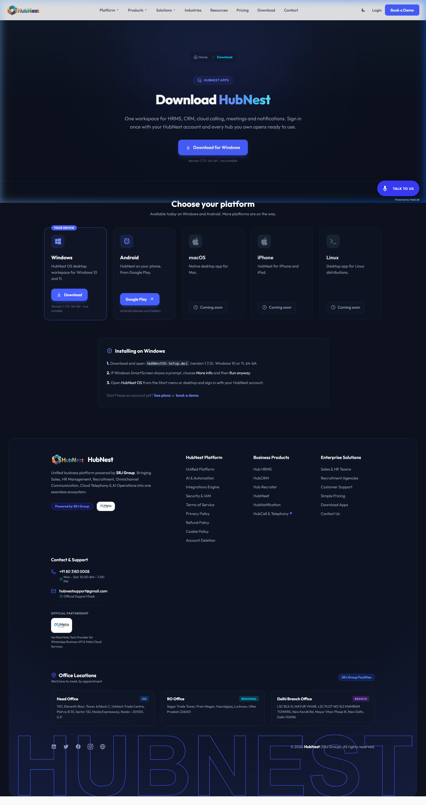
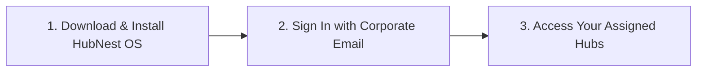

# Getting Started: Quick Start

Welcome to the **HubNest Quick Start Guide**. This section provides actionable, step-by-step instructions to take you from account creation to your first successful outcome in less than 10 minutes.

{ align=center style="border-radius: 8px; box-shadow: 0 4px 20px rgba(0,0,0,0.15); margin-bottom: 2rem;" }

---

## 1. Accessing HubNest

HubNest can be accessed through two primary channels:

1. **Native Desktop Workspace (HubNest OS)**: Recommended for daily work. Offers fast multi-tab navigation, system tray background notifications, and offline resiliency. Available for Windows 10 & 11 (64-bit).
2. **Web Browser Portal**: Accessible on any modern browser (Chrome, Edge, Firefox, Safari) at [srjhubnest.com](https://srjhubnest.com).

---

## 2. Account & System Requirements

### Desktop App Requirements
* **Operating System**: Windows 10 (Build 1809+) or Windows 11 (64-bit).
* **Hardware**: Dual-core 2.0 GHz CPU, 4 GB RAM (8 GB recommended), 500 MB free disk space.
* **Network**: Broadband connection (minimum 5 Mbps for HD video conferencing and WebRTC calling).
* **Peripherals**: Webcam and microphone required for HubMeet and VoIP Calling.

### Web Browser Requirements
* Modern browser with WebRTC, WebAssembly, and WebSocket support enabled.
* Cookie & LocalStorage access allowed for Single Sign-On session tokens.

---

## 3. First-Time Platform Access (3-Step Roadmap)

### Step 1: Download & Install
1. Open [srjhubnest.com/download](https://srjhubnest.com/download).
2. Download `HubNestOS-Setup.msi`.
3. Run the installer to completion.

### Step 2: Sign In with SSO
1. Launch **HubNest OS** from your desktop or start menu.
2. Enter the corporate email and password provided by your organization administrator.
3. Click **Sign In**. Single Sign-On verifies your identity against Keycloak and loads your company's tenant workspace.

### Step 3: Launch Your Hubs
Your personal dashboard automatically displays the tools your company administrator has provisioned:
* **Sales team members** see HubCRM and Calling Hub.
* **HR personnel** see HubHRMS and JobNest Recruiter.
* **All staff** see HubMeet for instant team communication.

---

## 4. Explore The Getting Started Guides

To complete your setup and customize your experience, follow the detailed guides below:

* **[02. Account Setup & Onboarding](account-setup.md)**: Profile completion, company settings, and inviting team members.
* **[03. Login & Account Security](login-security.md)**: MFA setup, session protection, and password resets.
* **[04. Roles & Permissions (RBAC)](roles-permissions.md)**: Understanding user roles and tenant permission rules.
* **[05. Dashboard Tour](dashboard-tour.md)**: Interface layout, notification tray, and switching hubs.
* **[06. Integrations & Configuration](integrations.md)**: API tokens, webhooks, and third-party tools.
* **[07. First Task Checklist](first-tasks.md)**: Role-specific checklists to achieve your first business outcome.
* **[08. Common Setup Problems](common-problems.md)**: Troubleshooting login errors, permission blocks, and mic/camera issues.
