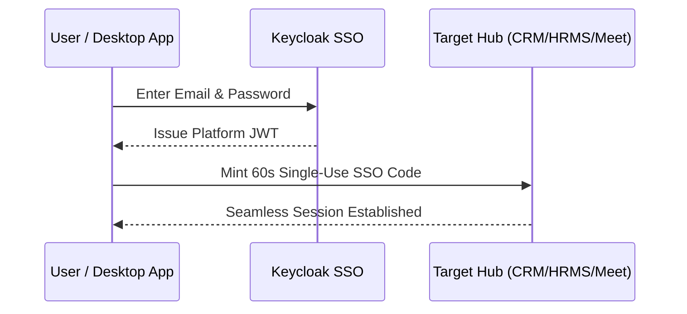

# Account & First-Time Login

HubNest uses centralized Single Sign-On (SSO) backed by Keycloak to provide secure, one-click access across all hubs without needing separate credentials for each tool.

---

## 🔑 Logging In

1. Launch **HubNest OS** from your desktop or start menu.
2. In the login prompt, enter your corporate **Email** and **Password**.
3. Click **Sign In**.

---

## 🏢 Multi-Tenant Workspace Assignment

When your account is provisioned by your company administrator:
* You are automatically assigned to your organization's tenant workspace.
* Your specific roles (e.g., HR Manager, Sales Representative, Support Agent) determine which hubs appear in your sidebar.

!!! note "Password Reset"
    If you forget your password, click **Forgot Password?** on the login screen to receive an instant verification link on your registered email address.
