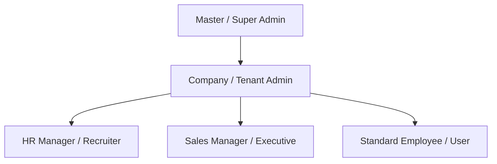

# Roles and Permissions (RBAC)

HubNest implements **Role-Based Access Control (RBAC)** to ensure employees only access data and features relevant to their job responsibilities, preventing unauthorized disclosure of confidential business and salary records.

---

## 1. Available User Roles

HubNest defines five standard role tiers:

### 1. Company / Tenant Administrator
* **Scope**: Full control over the organization's tenant workspace.
* **Capabilities**: Can invite/remove users, change roles, modify subscription plans, configure payment gateways, view company-wide audit logs, and access all operational hubs.

### 2. HR Manager / Recruiter
* **Scope**: Workforce administration and recruitment.
* **Capabilities**: Access to HubHRMS (employee records, shifts, leave approvals, payroll generation) and JobNest Recruiter (candidate profiles, job postings, interview scheduling).

### 3. Sales Manager / Executive
* **Scope**: Revenue generation and customer relationships.
* **Capabilities**: Full access to HubCRM (leads, deals, quotations, invoices), Calling Hub (softphone dialer, call logs), and customer WhatsApp messaging.

### 4. Standard Employee / Team Member
* **Scope**: Personal workspace and self-service.
* **Capabilities**: Access to HubMeet for team calls, HRMS self-service (punch attendance, apply for leaves, download personal payslips), and personal tasks.

---

## 2. Granular Permissions Matrix

| Feature / Hub | Company Admin | HR Manager | Sales Executive | Standard Employee |
| :--- | :---: | :---: | :---: | :---: |
| **Billing & Subscriptions** | :white_check_mark: Full | :x: No | :x: No | :x: No |
| **User & Team Management** | :white_check_mark: Full | :x: No | :x: No | :x: No |
| **HRMS Payroll & Salaries** | :white_check_mark: Full | :white_check_mark: Full | :x: No | :lock: Self Only |
| **Employee Directory** | :white_check_mark: Full | :white_check_mark: Full | :white_check_mark: Read Only | :white_check_mark: Read Only |
| **CRM Leads & Deals** | :white_check_mark: Full | :x: No | :white_check_mark: Full | :x: No |
| **Customer Invoicing** | :white_check_mark: Full | :x: No | :white_check_mark: Create/Send | :x: No |
| **HubMeet Video Calls** | :white_check_mark: Full | :white_check_mark: Full | :white_check_mark: Full | :white_check_mark: Full |
| **VoIP Softphone Calling** | :white_check_mark: Full | :x: No | :white_check_mark: Full | :x: No |
| **WhatsApp Campaigns** | :white_check_mark: Full | :x: No | :white_check_mark: Send | :x: No |

---

## 3. Assigning & Updating Permissions

Administrators can adjust a user's role at any time:

1. Open **Admin Console** ➔ **Team Management**.
2. Locate the employee in the team roster.
3. Click the **Edit Role** icon next to their name.
4. Select the new role from the dropdown.
5. Under **Hub Access**, check or uncheck individual hubs.
6. Click **Save Permissions**. The updated permissions take effect immediately upon the user's next action or page refresh.

---

## 4. Tenant Isolation Rules

HubNest strictly separates data between distinct organizations:

* **Database Schemas**: Data for each company resides in an isolated schema (e.g., `tenant_acme`), guaranteeing that company A cannot view leads, employee salaries, or recordings belonging to company B.
* **Storage Boundaries**: File uploads, resumes, and meeting recordings are partitioned and authenticated by organization ID.
* **Audit Trails**: Every administrative action (role change, permission grant, document deletion) is immutably recorded in the **Platform Audit Log** with timestamp, admin email, and IP address.
