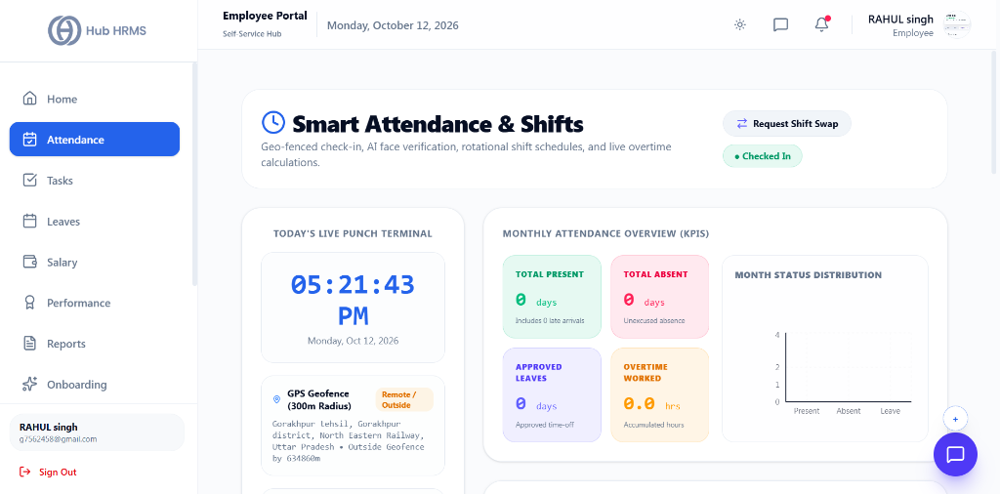
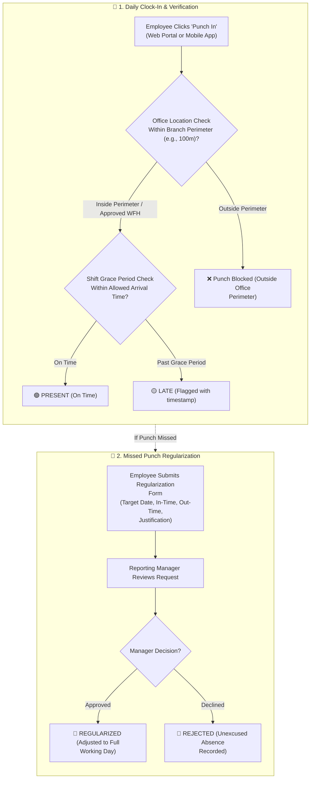

# 02. Daily Attendance & Time Tracking (`/employee/attendance`)

The **Daily Attendance** module is the central timekeeping system in Hub HRMS. It provides employees with high-precision digital clock-in tools, interactive monthly attendance calendars, real-time tracking of late arrivals and overtime, and a self-service regularization workflow for unrecorded hours.

---

## 🏛️ Live Interface Overview

Below is the live console layout of the **Smart Attendance & Shifts** dashboard:

---

## 🧭 Live Punch Terminal & Monthly Attendance Overview

The `/employee/attendance` dashboard is divided into real-time clock-in controls and aggregated monthly analytics:

### 1. 🕒 Today's Live Punch Terminal (Left Pane)
* **Real-Time Clock**: High-visibility digital clock showing live local time and date (e.g., `05:21:43 PM • Monday, Oct 12, 2026`).
* **GPS Geofence Perimeter**: Captures active geographic coordinates with reverse geocoded street address, radius status, and remote tags (e.g., `GPS Geofence (300m Radius)` with `Remote / Outside` indicator).
* **Shift Controls**: Quick actions to **Request Shift Swap** or review current state (`Checked In`).

### 2. 📊 Monthly Attendance Overview (KPIs) & Status Distribution (Right Pane)
Real-time summary tracking individual attendance reliability for the calendar month:

| Metric Indicator | Description | Live Metric Status | Operational Detail |
| :--- | :--- | :--- | :--- |
| **Total Present** | Total days clocked-in and verified. | `0 days` | Displays count of late arrivals (e.g., `Includes 0 late arrivals`). |
| **Total Absent** | Unexcused absences recorded this month. | `0 days` | Tracks unauthorized loss-of-pay days. |
| **Approved Leaves** | Days covered by approved leave applications. | `0 days` | Validated time-off deducted from quotas. |
| **Overtime Worked** | Extra hours logged beyond regular shift duration. | `0.0 hrs` | Accumulated overtime eligible for payout or comp-off. |

### 📈 Month Status Distribution Chart
An interactive graphical bar chart displaying the proportional ratio of **Present** (green), **Absent** (rose red), and **Leave** (indigo) days across the selected billing period. It dynamically re-renders whenever the calendar month or date range changes.

---

## 🧭 Attendance Punch & Regularization Workflow

The diagram below details the everyday process from check-in validation to status assignment and missed punch regularization:

---

## 🧭 Attendance Status Matrix & Badge Indicators

Your monthly attendance record is classified into the following standardized badges:

| Status Code | Badge Color | Definition | Working Hours Threshold |
| :--- | :--- | :--- | :--- |
| **`PRESENT`** | 🟢 Emerald Green | Clocked in on time and completed full standard shift. | $\ge 8\text{ hrs } 00\text{ mins}$ |
| **`LATE`** | 🟡 Amber Yellow | Clocked in after the assigned branch grace period (e.g., after 09:45 AM). | Effective shift completed, flagged late |
| **`HALF_DAY`** | 🟠 Orange | Worked between 4 to 8 hours, or clocked out early with supervisor consent. | $4\text{ hrs } 00\text{ mins} \le t < 8\text{ hrs}$ |
| **`ON_LEAVE`** | 🟣 Purple | Pre-approved Casual, Sick, or Privilege time-off recorded in LMS. | Leave quota consumed |
| **`ABSENT`** | 🔴 Crimson Red | No clock-in recorded by shift cutoff time without prior leave application. | $0\text{ hrs}$ (Subject to payroll loss of pay) |
| **`HOLIDAY`** | 🔵 Blue | Official gazetted public holiday or branch shutdown day. | Paid non-working day |
| **`REGULARIZED`**| 💠 Cyan | Missed punch corrected and formally approved by reporting manager. | Adjusted to full working day |

---

---

## 🛠️ Step-by-Step User Workflows

### 1. Dual-Factor AI Face & GPS Clock-In
1. Navigate to `/employee/attendance` and locate **Today's Live Punch Terminal**.
2. Review your live reverse-geocoded address and office radius indicator (e.g., `Within Office Radius (18m)`).
3. Click the primary **Check-In (Face & GPS)** button.
4. When the camera modal activates:
   * Align your face inside the central circular guide.
   * If on a registered desktop computer without a camera, the system automatically validates your session via **Workstation LAN Verified** status.
5. Click **Capture Live Photo & Check-In**.
6. The system verifies your facial biometric signature against your employee profile:
   * **Verification Success**: The shift stopwatch begins immediately, and status updates to `Present (Checked In)`.
   * **Biometric Mismatch (Attempt 1 of 2)**: Displays a warning prompt (`Face did not match! Attempt 1/2. Please re-position and try again`).
   * **Threshold Exceeded (Attempt 2 of 2)**: Triggers the emergency **Contact HR Screen**, allowing one-click notification to your HR administrator to prevent clock-in deadlock.

---

### 2. Logging Meal & Recess Breaks
During your active shift, you can accurately log breaks without clocking out:
1. In the terminal pane, click **Start Lunch / Break**.
2. The active shift stopwatch pauses, and the system records your `lunchOut` timestamp.
3. Upon returning to your desk, click **Resume from Break**.
4. The system logs `lunchIn` and recalculates effective productive hours, ensuring meal breaks are not flagged as unauthorized departure.

---

### 3. Requesting a Shift Swap with a Colleague
If you need to exchange an upcoming shift schedule with a fellow team member:
1. Click the **Request Shift Swap** button in the attendance toolbar.
2. In the modal:
   * **Select Colleague**: Choose the coworker you wish to swap shifts with from the team dropdown.
   * **Your Shift Date**: Select the date of the shift you cannot attend.
   * **Target Shift Date**: Select the date of your coworker's shift you agree to cover.
   * **Reason for Swap**: Provide an explanatory note (e.g., *"Family emergency; covering Ravi's Saturday morning shift"*).
3. Click **Submit Swap Request**. The coworker and supervisor receive instantaneous approval notifications.

---

### 4. Claiming Overtime Hours
When working past your designated shift schedule:
1. Click the **Apply Overtime** button.
2. Specify the parameters:
   * **Overtime Date**: The date on which additional hours were completed.
   * **Overtime Hours**: Total extra duration logged (e.g., `2.5 hrs`).
   * **Project / Task Justification**: Detail the sprint deliverable requiring extended hours.
3. Click **Submit Overtime Claim**. Approved overtime hours are credited towards monthly comp-off or salary bonuses.

---

### 5. Navigating the Visual Monthly Attendance Calendar
* **Month Selector**: Use the **`< Previous`** and **`Next >`** buttons to toggle between monthly attendance periods.
* **Interactive Roster Overlay**: Displays shift rosters, gazetted public holidays, approved leaves, and your daily attendance markers side by side.
* **Date Cell Inspection**: Clicking on any calendar day opens a detailed slide-out inspector:
  * **First In-Time & Last Out-Time**
  * **Break Duration Breakdown** (Lunch / Tea breaks)
  * **Effective Productive Working Hours**
  * **Punch Mode** (Web Browser / Native App / Biometric Hardware Sync)

---

### 6. Submitting a Regularization Request
If you forgot to punch out, experienced internet outages, or were traveling for client meetings:

1. Click the **Request Regularization** button on the top toolbar (or click on the flagged date in your calendar).
2. Complete the modal form fields:
   * **Target Date**: Select the specific calendar date requiring correction.
   * **Corrected In-Time**: Set the exact start time (e.g., `09:30 AM`).
   * **Corrected Out-Time**: Set the exact departure time (e.g., `06:30 PM`).
   * **Reason Category**:
     * *Forgot to Punch In / Punch Out*
     * *On-Site Client Meeting / Official Travel*
     * *Hardware / Biometric Reader Connectivity Issue*
     * *Power / Internet Outage*
   * **Detailed Justification**: Write a brief explanatory note (e.g., *"Attended client demo at Cyber Hub; manager verbally informed"*).
3. Click **Submit Regularization**.
4. The request routes to your reporting manager's queue with status `PENDING`. Once approved, your daily status changes to `REGULARIZED` and full salary hours are credited.

---

### 7. Filtering & Exporting Attendance Records
Below the calendar, the **Attendance Audit Table** displays your complete historical punch records:
* **Search Field**: Instantly query records by date, day, or remark notes.
* **Status Filter**: Filter by `PRESENT`, `LATE`, `HALF_DAY`, `ON_LEAVE`, or `ABSENT`.
* **Export CSV**: Click **Export** to download your filtered attendance history for personal records or expense claims.
* **Pagination Controls**: Adjust items per page (10, 25, 50) and navigate multi-month historical archives.

---

## 💡 Best Practices & Compliance Tips

!!! tip "Preventing Unintended LOP (Loss of Pay)"
    Regularization requests must be submitted before the monthly payroll cutoff date (typically the 25th of each month). Submissions after payroll freeze require HR Director override.

!!! warning "Location Authenticity"
    Always punch in from your assigned office building or authorized work location. Mock location apps or unauthorized proxy attempts are flagged for manager review.

---

## ❓ Frequently Asked Questions (FAQ)

??? question "How many regularizations am I allowed each month?"
    Most company policies allow up to 3 regularizations per calendar month. Exceeding this limit requires additional authorization from your Department Head.

??? question "Does overtime get tracked automatically?"
    Yes. Hours logged beyond your branch's standard shift duration (typically 8.5 hours) are tracked as overtime and can be claimed as Comp-Off or overtime pay depending on company policy.
