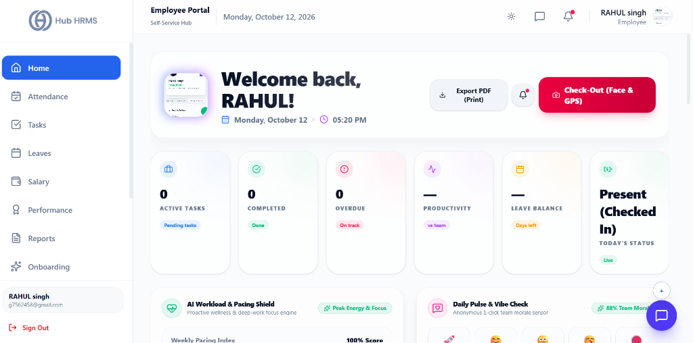
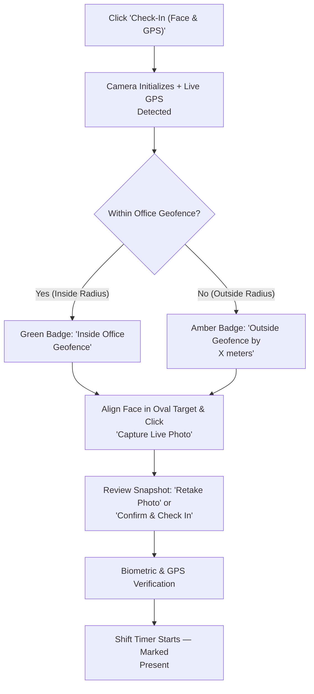

# 01. Employee Dashboard (`/employee/dashboard`)

The **Employee Dashboard** is the primary command center and daily digital workspace for every staff member in Hub HRMS. Designed with high-density telemetry, intelligent wellness sensors, and instant navigation, it consolidates your daily attendance punches, sprint deliverables, live productivity benchmarking, skill matrices, and team recognition into a single cohesive interface.

---

## 🏛️ Live Interface Overview

Below is the live console layout of the **Employee Self-Service Dashboard**:

---

## 🧭 Page Anatomy & Header Controls

The top section of the dashboard establishes immediate operational context and houses high-frequency actions:

| Control / Element | Type | Purpose & Working Behavior |
| :--- | :--- | :--- |
| **Profile Avatar & Live Beacon** | Visual Indicator | Displays your uploaded profile picture (or initial monogram) with a glowing green status dot indicating active authenticated session state. |
| **Day Streak Badge** | Telemetry Badge | Shows your consecutive on-time attendance streak (e.g., `🔥 12 Day Streak`). Accrues daily when punching in before shift grace time. |
| **Personalized Greeting** | Header Text | Greets you by first name and displays the live local day, date, and real-time ticking clock. |
| **Current Weather Indicator** | Telemetry Widget | Shows the local weather condition and temperature at your assigned office branch or geofence location (e.g., `☀️ 28°C Sunny`). |
| **Export PDF (Print)** | Action Button | Opens the system print preview dialogue (`window.print()`), formatted cleanly to save or print your daily dashboard telemetry as a PDF document. |
| **Notification Bell** | Interactive Dropdown | Features an unread notification red badge. Clicking toggles a flyout panel listing recent corporate memos, shift approvals, and task updates. Clicking any item marks it as read. |
| **Check-In / Check-Out (Face & GPS)** | Primary Action Trigger | Dynamic state button:  • **Not Checked In**: Blue button opening the **Face & GPS Verification Modal**. • **Present (Checked In)**: Red button linking directly to `/employee/attendance` for shift wrap-up. • **Checked Out**: Grey indicator badge displaying `Shift Completed (XX:XX PM)`. |

---

## 📊 Summary KPI Metric Cards (Interactive Filters)

Six high-visibility KPI cards summarize your active standing. **Clicking any KPI card acts as an interactive filter**, highlighting corresponding charts below:

| Metric Card | Data Source | Working Logic | Filter Behavior on Click |
| :--- | :--- | :--- | :--- |
| **Active Tasks** | Sprint Tracker | Counts pending and in-progress tasks assigned to your queue. | Focuses Deep Analytics, Time Allocation, and Tasks Feed. |
| **Completed** | Deliverables Log | Tallies deliverables finished during the active sprint cycle. | Filters performance charts to show completed trends. |
| **Overdue** | Deadline Monitor | Flags deliverables past their designated cutoff date with a red badge. | Highlights urgent time-allocation and priority charts. |
| **Productivity** | Telemetry Engine | Calculates your efficiency score compared against team benchmarks. | Isolates the Deep Performance and Skill Matrix radars. |
| **Leave Balance** | Leave Ledger | Total available paid leave quota (Earned, Sick, and Casual leaves). | Displays quick leave balance breakdown. |
| **Today's Status** | Live Punch Engine | Displays live status: `Present (Checked In)`, `On Break`, or `Logged Out`. | Refreshes real-time attendance telemetry. |

---

## 🛡️ Wellness & Sentiment Intelligence Layer

Positioned directly below the KPI metrics are two proactive employee well-being widgets:

### 1. AI Burnout Radar Widget
* **Fatigue Telemetry**: Continuously evaluates your weekly hours logged, pending task backlog, and overtime hours worked against healthy thresholds.
* **Risk Categorization**:
  * 🟢 **Balanced / Safe Zone**: Optimal task distribution with standard working hours.
  * 🟡 **Elevated Workload**: Moderate overtime or backlogged milestones; suggests taking scheduled breaks.
  * 🔴 **Burnout Risk Warning**: High consecutive overtime hours; alerts team leads to rebalance task allocation.

### 2. Team Pulse Morale Widget
* **Anonymous Sentiment Poll**: Allows you to record your daily working mood in one click (e.g., *Energized*, *Steady*, *Challenged*, *Fatigued*).
* **Aggregated Team Vibe**: Displays the cumulative team morale percentage (e.g., `88% Positive Vibe`) without disclosing individual employee responses.

---

## 📈 Deep Performance Analytics & Skill Matrix

This dual-card section visualizes your day-to-day productivity and technical competencies:

### Deep Performance Analytics (Area Chart)
* **Comparative Output Curves**: Displays an interactive area chart plotting **Your Output** (indigo filled curve) against the **Team Average** (dashed baseline curve) across working hours (09:00, 12:00, 15:00, 18:00).
* **Timeframe Selector**:
  * **Today**: Real-time hourly trajectory for the current shift.
  * **This Week**: Aggregate daily points across Monday through Friday.
  * **This Month**: 30-day cumulative sprint productivity.
  * **Custom Date Range**: Reveals dual `Start Date` and `End Date` calendar pickers for bespoke date range audits.
* **Live Sync Indicator**: A live pulsing badge confirming data is streamed directly from active task completions.

### Skill Matrix (Radar Chart)
* **Multi-Axis Competency Mapping**: Visualizes your proficiency score (0 to 100) across 5 core professional dimensions:
  1. **Problem Solving**
  2. **Time Management**
  3. **Agile & Teamwork**
  4. **Communication**
  5. **Leadership**
* **Category Filter**: Toggle between `All`, `Technical`, and `Soft Skills` to isolate specific evaluation tracks auto-scored through code reviews, peer feedback, and sprint appraisals.

---

## ⏱️ Time Allocation, Activity Feed & Peer Kudos

A 3-column operational layer providing granular transparency into where your working hours are spent:

### 1. Time Allocation (Donut Chart)
* Visualizes your logged shift time distributed across four primary work streams:
  * 🔵 **Coding / Core Execution**
  * 🟣 **Meetings & Standups**
  * 🟡 **Code & Design Reviews**
  * 🟢 **Sprint Planning & Architecture**
* Features dynamic percentage labels and an empty-state indicator (`0% Logged`) before your first task timer is started.

### 2. Recent Activity Audit Trail
* **Chronological Event Stream**: Real-time log of your personal actions (e.g., *"Checked in via Facial Recognition"*, *"Marked Task #104 as Completed"*, *"Submitted Leave Request"*).
* **Sort Dropdown**: Toggle between `Sort: Newest` and `Sort: Oldest`.
* **Export Button**: Downloads your activity stream as a structured audit file.
* **Expandable View**: Click `View More (X more) →` to expand the full audit log, or `Show Less` to collapse back to the top 5 entries.

### 3. Peer Kudos & Active Project Tracker
* **Peer Kudos**: Displays recent words of appreciation and encouragement sent to you by team members and managers, complete with sender attribution.
* **Active Project Card**: Shows your current major project assignment, accompanied by an animated progress bar indicating overall percentage completion and target release date.
* **AI Career Coach Widget**:
  * An intelligent workload assistant built into your dashboard.
  * Click **Get Insights** to analyze your recent output patterns, task backlogs, and work habits.
  * Delivers actionable productivity recommendations (e.g., *"Focus on clearing high-priority task PRs before starting sprint planning"*).

---

## 📊 Daily Output Pattern (Bar Chart)

* **Weekly Output Distribution**: A full-width bar chart charting the total number of deliverables completed across each day of the current work week (Monday through Friday).
* **Direct Value Labels**: Features numeric badges atop each bar for instant recognition of your peak productivity days.

---

## 📋 My Active Tasks Data Table

Located at the bottom of the dashboard, this table displays your most urgent sprint deliverables:

| Table Column | Content & Format | Description |
| :--- | :--- | :--- |
| **Task Title** | Bold text string | The formal title and descriptor of the assigned deliverable. |
| **Priority** | Color-coded Badge | • `HIGH` (Rose badge) • `MEDIUM` (Amber badge) • `LOW` (Blue badge) |
| **Status** | State Pill | • `DONE` (Green pill) • `IN PROGRESS` (Indigo pill) • `PENDING` (Amber pill) |
| **Due Date** | Monospace Date | Deadline for task completion (e.g., `2026-10-18`). |

* **View More Tasks Link**: Click the top right link or bottom button `View More Tasks →` to jump straight to the full interactive Kanban board and sprint planner at `/employee/tasks`.

---

## 📸 Facial & GPS Geofence Check-In Modal

When you click **Check-In (Face & GPS)** in the header, the system opens a secure dual-factor attendance modal:

### Detailed Modal Controls:
1. **Live Camera Feed**:
   * Opens your device webcam with a centered pulsing oval guide to frame your face properly.
   * If the camera is off, click **Start Live Camera** to grant video permissions.
2. **Captured GPS Location Box**:
   * **Live Geocoded Address**: Displays your real-time reverse-geocoded street address and coordinates.
   * **Geofence Compliance Pill**: Automatically measures the distance between your device and the registered office coordinates:
     * `Inside Office Geofence`: Green badge confirming you are within branch perimeter (e.g., within 500 meters).
     * `Outside Geofence`: Amber badge displaying exact distance outside perimeter.
3. **Capture Live Photo & Check In**:
   * Freezes the video frame and captures a high-resolution biometric snapshot.
4. **Retake vs. Confirm**:
   * **Retake Photo**: Discards the captured image and restarts the live camera feed.
   * **Confirm & Check In**: Submits both the facial photo and verified GPS coordinates to the attendance ledger, updating your status to `Present (Checked In)` and launching your shift stopwatch.

---

## 💡 Best Practices & System Tips

!!! tip "Fast Filter Reset"
    If you clicked a KPI card (e.g., *Active Tasks* or *Productivity*) and want to reset all charts back to the default comprehensive view, simply click the active KPI card once more to toggle the filter off.

!!! warning "Camera Alignment"
    Ensure adequate ambient lighting and face the camera directly without sunglasses or heavy obstructions. The facial validation engine compares your live capture against your registered profile avatar.

!!! note "Offline Check-In Resiliency"
    If your internet connection experiences momentary packet loss during check-in, the system securely caches the cryptographically stamped timestamp and coordinates locally, syncing with the central database the moment connection is re-established.

---

## ❓ Frequently Asked Questions (FAQ)

??? question "Can I clock in from home if I am assigned to an office branch?"
    Unless your profile has an approved **Work From Home (WFH)** authorization from your Manager or HR, clocking in outside the branch GPS perimeter will trigger an out-of-boundary alert.

??? question "What happens if I forget to clock out at the end of the shift?"
    The system automatically flags unclosed shifts at midnight. Next morning, submit a **Regularization Request** from the `/employee/attendance` tab explaining your departure time.
