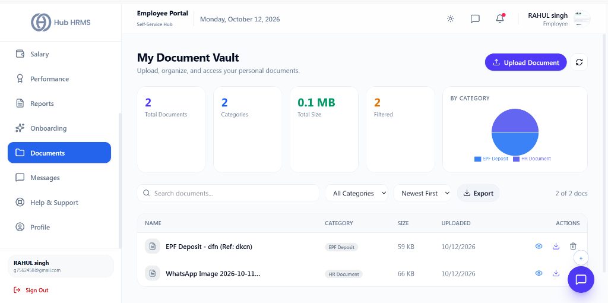
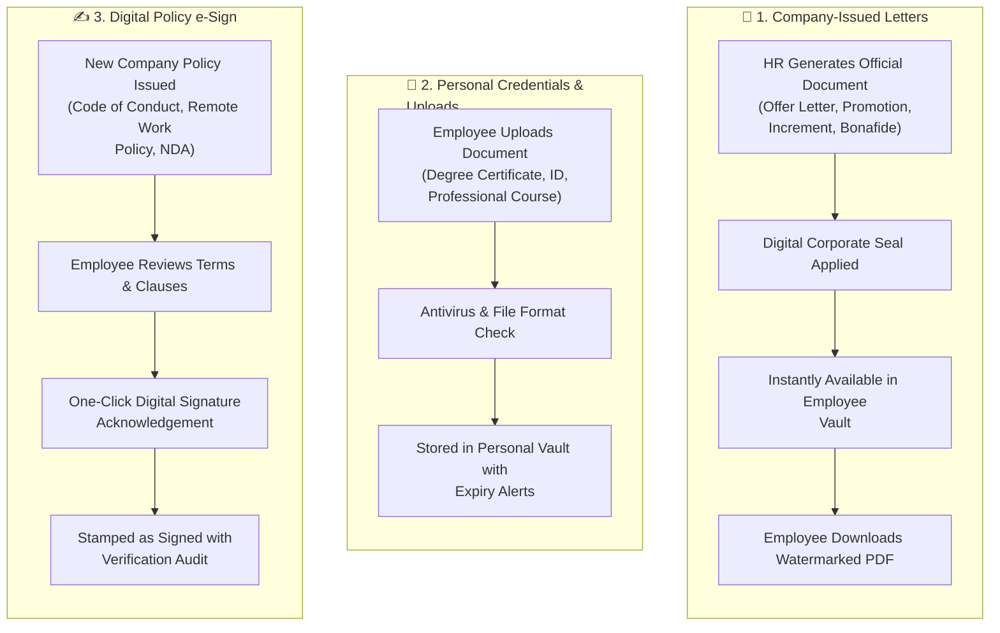

# 09. Digital Document Vault & Letters (`/employee/documents`)

The **Digital Document Vault** serves as your secure personal repository for all workplace records. From downloading company-issued employment contracts, promotion letters, and increment circulars to uploading skill certifications and digitally e-signing compliance policies, it eliminates the need for physical paperwork.

---

## 🏛️ Live Interface Overview

Below is the live console layout of the **My Document Vault**:

---

## 📊 Summary Document Metrics & Category Pie Distribution

At the top of the `/employee/documents` dashboard, four live metric cards and category distribution analytics provide total file visibility:

| Metric Indicator | Description | Live Metric Status | Action Available |
| :--- | :--- | :---: | :--- |
| **Total Documents** | Count of uploaded certificates, tax slips, and contracts. | **`2`** | View all files in repository. |
| **Categories** | Number of active document classification tags. | **`2`** | Filter by `EPF Deposit` or `HR Document`. |
| **Total Size** | Cumulative storage space consumed by your files. | **`0.1 MB`** | Personal storage quota monitoring. |
| **Filtered** | Current number of files matching active search/filter criteria. | **`2`** | Real-time table count. |

### 🥧 By Category Graphical Chart
* Displays an interactive visual breakdown (e.g., `EPF Deposit` in blue vs. `HR Document` in purple).

### ⚡ Document Actions & Search Toolbar
* **Search Documents**: Instant text search by file title or keyword.
* **Category Dropdown**: Filter by specific category tags (`All Categories`, `EPF Deposit`, `HR Document`, etc.).
* **Sort Filter**: Sort by `Newest First`, `Oldest First`, or Alphabetical.
* **Export Action**: Download a clean manifest list of all stored documents.
* **+ Upload Document Button**: Primary action modal to drag-and-drop or select new PDF/image files.
* **Row Actions**: One-click **Preview (Eye)**, **Download**, and **Delete (Trash)** for each uploaded file.

---

## 🧭 Document Lifecycle & Digital e-Sign Workflow

The diagram below illustrates how company letters are issued, how personal certifications are uploaded, and how policy documents are digitally signed:

---

## 🧭 Document Categories in Your Vault

Your documents are organized into two primary tabs:

### 1. Company-Issued Letters
| Document Category | Document Description | Typical Availability Cycle |
| :--- | :--- | :--- |
| **Offer & Appointment Letter** | Official signed contract specifying CTC, role, and terms of service. | Upon joining |
| **Non-Disclosure Agreement (NDA)** | Confidentiality and intellectual property rights agreement. | Upon joining |
| **Increment & Promotion Letters** | Annual compensation revision and designation change letters. | Post appraisal review cycle |
| **Bonafide Employment Certificate** | Formal certificate for bank loan applications or visa processing. | On-demand self-service |
| **Relieving & Experience Letter** | Official tenure certificate and clearance sign-off. | Upon exit completion |

### 2. Personal Credentials & Uploads
* 🎓 **Educational Certificates**: Bachelor's/Master's degree certificates and transcripts.
* 📜 **Professional Certifications**: Industry, Scrum, PMP, or professional technical certifications.
* 🆔 **Identity Proofs**: Passport scans, national ID copies, driving licenses.
* 🩺 **Medical Certificates**: Fitness certificates and health insurance cards.

---

## 🛠️ Step-by-Step User Workflows

### 1. Downloading Official Letters with Security Watermarks
1. Navigate to `/employee/documents` and select the **Company Letters** tab.
2. Locate the required document (e.g., *Annual Increment Letter - 2026*).
3. Click the **View / Preview** icon to inspect the document inline.
4. Click **Download PDF**.
5. All downloaded corporate letters feature a dynamic background watermark with your employee code and download timestamp to prevent unauthorized tampering.

---

### 2. Digitally e-Signing Company Policies
When HR releases a new policy (e.g., *Updated Remote Work Policy 2026*):
1. An alert banner appears at the top of your document vault:
   $$\text{"Action Required: 1 Document Pending Your e-Signature"}$$
2. Click **Review & Sign**.
3. Scroll through the document text to read all clauses.
4. Check the declaration box: *"I hereby acknowledge and agree to abide by the policies stated above."*
5. Click **Digitally Sign**.
6. The system captures your digital acknowledgment and embeds a verified signature badge into the document.

---

### 3. Uploading New Professional Certifications
1. Switch to the **Personal Uploads** tab.
2. Click **+ Upload Document**.
3. Select the document category (e.g., *Professional Certification*).
4. Enter the **Document Title** (e.g., *Certified Solutions Architect*).
5. Specify the **Expiry Date** if applicable (the system will alert you 30 days prior to renewal).
6. Drag and drop your PDF file (Max 10 MB).
7. Click **Save to Vault**.

---

## 💡 Best Practices & Storage Guidelines

!!! tip "Bonafide Certificate Instant Generation"
    Need proof of employment for a visa or home loan? Click **Generate Bonafide Letter** at the top right. The system auto-generates a digitally stamped PDF instantly.

!!! warning "Document Integrity"
    All official company letters include a unique verification code. Any alterations made to downloaded PDFs will fail official verification audits.

---

## ❓ Frequently Asked Questions (FAQ)

??? question "Can my colleagues or manager view my personal uploaded documents?"
    No. Your personal document vault is strictly confidential, visible only to you and authorized company HR Compliance administrators.

??? question "How long are my documents retained after leaving the organization?"
    In accordance with statutory labor regulations, your employment records remain accessible in read-only mode for up to 7 years following your exit.
