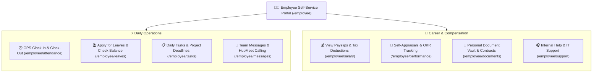

# 🧑‍💻 Employee Self-Service (ESS) Guide

The **Employee Self-Service (ESS)** portal (`/employee/dashboard`) gives every team member direct control over their daily workplace experience—from clocking in with GPS geofencing and applying for leaves to downloading encrypted PDF payslips and collaborating with coworkers.

---

## 🎯 Role Overview & Self-Service Experience

The ESS portal eliminates bureaucratic friction by putting transparency, time-tracking, and career milestones directly in the hands of employees.

---

## 🧭 Employee Portal Sidebar Modules

| # | Module | Route | Primary Everyday Uses |
|---|---|---|---|
| **01** | [Home / Dashboard](dashboard.md) | `/employee/dashboard` | Daily check-in widget, active work hours, announcements, and upcoming holidays. |
| **02** | [Attendance](attendance.md) | `/employee/attendance` | Web and mobile clock-in/out, monthly attendance calendar, and regularization requests. |
| **03** | [Tasks](tasks.md) | `/employee/tasks` | Assigned project tasks, personal to-do list, and deadline tracking. |
| **04** | [Leaves](leaves.md) | `/employee/leaves` | Checking available leave balances (CL, SL, PL) and submitting time-off requests. |
| **05** | [Salary](salary.md) | `/employee/salary` | Downloading password-protected PDF payslips and viewing annual tax breakdowns. |
| **06** | [Performance](performance.md) | `/employee/performance` | Updating personal OKR progress and submitting 360-degree self-appraisals. |
| **07** | [Reports](reports.md) | `/employee/reports` | Personal work hour logs, overtime summaries, and yearly leave statements. |
| **08** | [Onboarding](onboarding.md) | `/employee/onboarding` | Completing statutory checklists, uploading certificates, and digital contract signing. |
| **09** | [Documents](documents.md) | `/employee/documents` | Accessing corporate handbooks, signed offer letters, and annual Form 16 certificates. |
| **10** | [Messages](messages.md) | `/employee/messages` | Instant chat with colleagues, department channels, and one-click video calls. |
| **11** | [Help & Support](support.md) | `/employee/support` | Raising IT assistance tickets, requesting equipment, or HR queries. |
| **12** | [Profile](profile.md) | `/employee/profile` | Updating personal mobile numbers, profile avatars, and 2FA credentials. |

---

## 📸 Interface Screenshots

<!-- SCREENSHOT_PLACEHOLDER: Employee Dashboard Overview -->
> *Screenshot will be added here upon user submission.*
