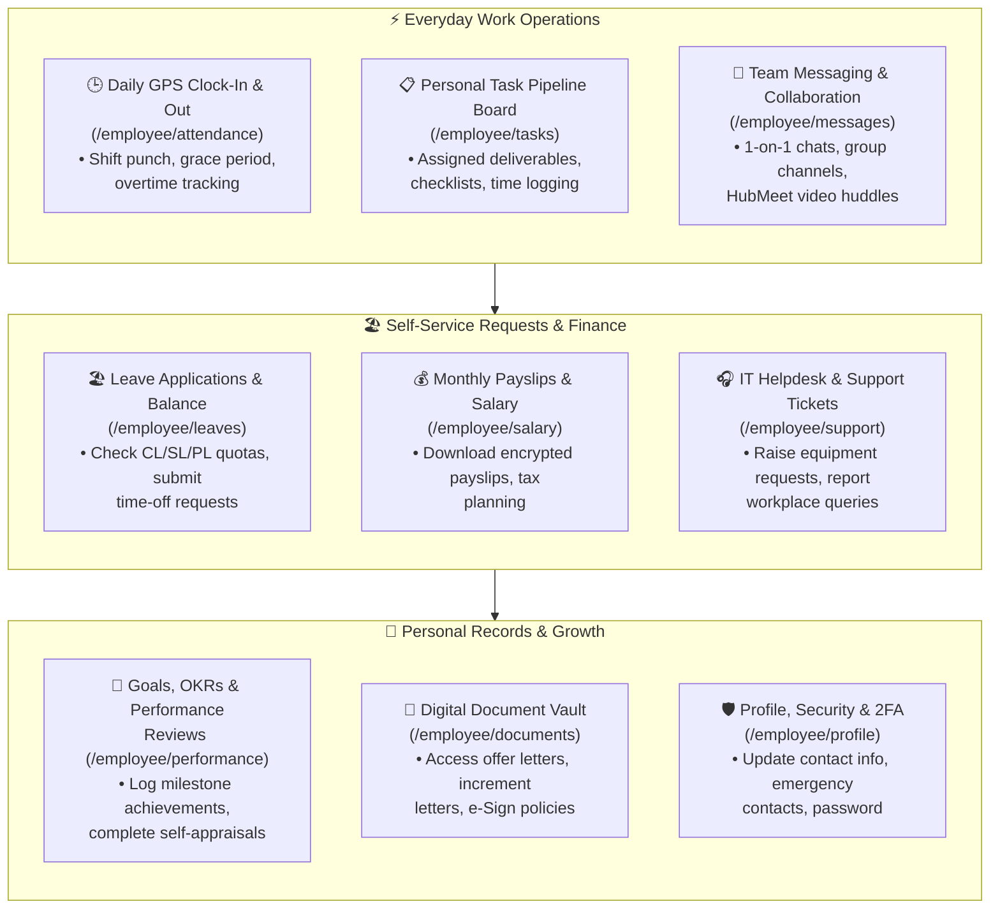

# 🧑‍💻 Employee Self-Service (ESS) Comprehensive Manual

The **Employee Self-Service (ESS)** portal (`/employee/*`) is the central digital workplace for every employee in Hub HRMS. Designed with speed, intuitive navigation, and high clarity, it puts attendance timekeeping, leave applications, encrypted salary documents, task deliverables, and team communications directly in your hands.

---

## 🏛️ Live Interface Overview

Below is the live console layout of the **Employee Self-Service (ESS)** environment:

---

## 🧭 Employee Workplace Journey Map

The diagram below outlines how the Employee Portal supports your everyday work activities from check-in to career milestones:

---

## 🧭 Employee Portal Navigation Sitemap

The ESS navigation sidebar features 12 dedicated functional modules:

| # | Chapter | Route | Primary Everyday Capabilities |
|---|---|---|---|
| **01** | [Dashboard](dashboard.md) | `/employee/dashboard` | One-click punch in/out, active work stopwatch, leave snapshot, and company noticeboard. |
| **02** | [Daily Attendance](attendance.md) | `/employee/attendance` | GPS geofence clock-in, interactive monthly calendar, and missed punch regularization. |
| **03** | [Tasks & Projects](tasks.md) | `/employee/tasks` | Drag-and-drop task pipeline boards, milestone checklists, and billable hour logging. |
| **04** | [Leave Management](leaves.md) | `/employee/leaves` | Live balances (CL, SL, PL), multi-tier approval tracking, and time-off applications. |
| **05** | [Salary & Payslips](salary.md) | `/employee/salary` | Encrypted monthly PDF payslip downloads, YTD tax summaries, and investment declarations. |
| **06** | [Goals & Performance](performance.md) | `/employee/performance` | Quarterly OKR tracking, self-evaluation surveys, and 360-degree appraisal feedback. |
| **07** | [Personal Reports](reports.md) | `/employee/reports` | Historical timesheets, overtime accumulation statements, and attendance audit exports. |
| **08** | [Digital Onboarding](onboarding.md) | `/employee/onboarding` | 5-step KYC stepper, identity verification, and statutory bank account onboarding. |
| **09** | [Document Vault](documents.md) | `/employee/documents` | Downloading signed contracts and promotion letters, and digital policy e-Signing. |
| **10** | [Team Messages](messages.md) | `/employee/messages` | Real-time team chat, file transfers, and one-click HubMeet video huddles. |
| **11** | [Help & Support](support.md) | `/employee/support` | IT helpdesk ticketing, SLA countdowns, and confidential workplace grievance reporting. |
| **12** | [Profile & Security](profile.md) | `/employee/profile` | Updating contact details, emergency contacts, password changes, and 2FA authentication. |

---

## 🚀 Recommended Everyday Routine for Employees

1. **Start of Workday (09:00 - 09:30 AM)**:
   * Open the **Dashboard** (`/employee/dashboard`) and click **Clock In** with location enabled.
   * Review the noticeboard for urgent company announcements or holiday alerts.
2. **Review Sprint Priorities**:
   * Open **My Tasks** (`/employee/tasks`) to check high-priority deliverables due today and move active items into the *In Progress* column.
3. **Midday Break & Sync**:
   * Pause your timer using **Take Break** during lunch, and click **Resume Work** upon return.
   * Check **Messages** (`/employee/messages`) for updates from your team or direct messages from supervisors.
4. **End of Shift Clock-Out**:
   * Update task checklists and log work notes in your active deliverables.
   * Click **Clock Out** on the dashboard and enter an optional end-of-day summary.

---

## ❓ Frequently Asked Questions (FAQ)

??? question "Can I access the Employee Portal on mobile devices?"
    Yes. The Hub HRMS web client is fully responsive, allowing full clock-in, leave application, and payslip download features on Android and iOS mobile browsers.

??? question "What should I do if my punch-in fails due to GPS location?"
    Ensure your browser has location permission granted for the site. If working remotely or off-site, request your manager to approve a Work From Home (WFH) or field status.
