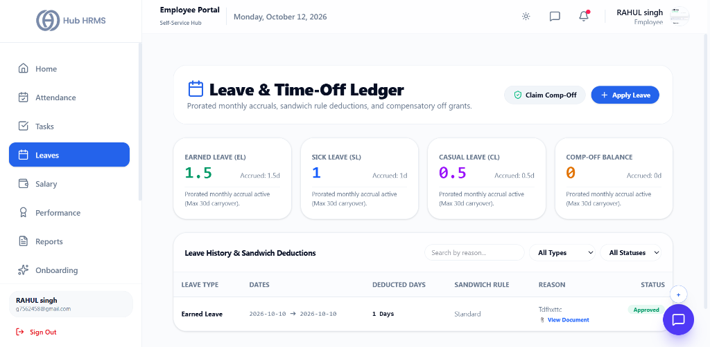
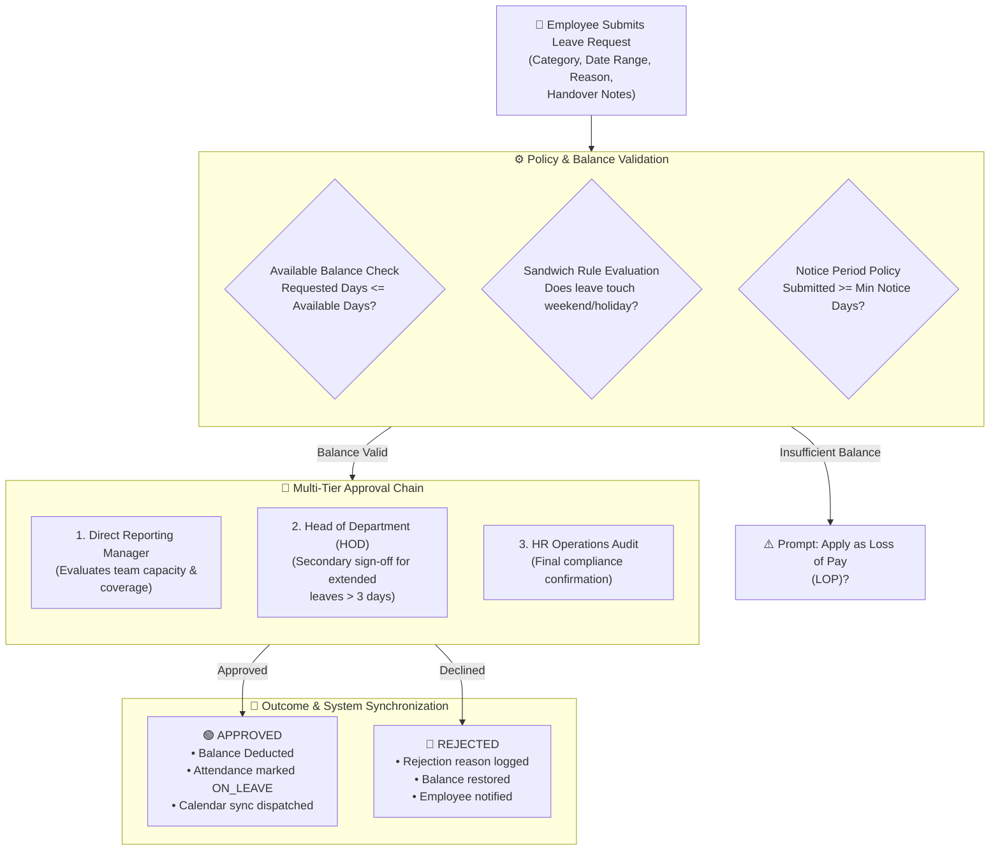

# 04. Leave Applications & Balance Tracking (`/employee/leaves`)

The **Leave Management** module enables employees to submit digital time-off applications, inspect real-time leave balances across different leave buckets, upload medical fitness certificates, and monitor multi-tiered approval workflows.

---

## 🏛️ Live Interface Overview

Below is the live console layout of the **Leave & Time-Off Ledger**:

---

## 📊 Summary Leave Quotas & Accrual Ledgers

At the top of the `/employee/leaves` dashboard, four live metric cards display prorated monthly accruals and available time-off balances:

| Leave Bucket | Available Balance | Accrual Type | Policy Rules & Carryover |
| :--- | :---: | :--- | :--- |
| **Earned Leave (EL)** | **`1.5` Days** | Accrued: `1.5d` | Prorated monthly accrual active (Max 30d carryover). |
| **Sick Leave (SL)** | **`1` Days** | Accrued: `1d` | Prorated monthly accrual active (Medical proof required $> 2\text{d}$). |
| **Casual Leave (CL)** | **`0.5` Days** | Accrued: `0.5d` | Prorated monthly accrual active (For planned personal affairs). |
| **Comp-Off Balance** | **`0` Days** | Accrued: `0d` | Compensatory off earned from holiday or weekend work. |

### ⚡ Quick Operational Actions
* **Claim Comp-Off**: Submit a compensatory leave grant claim for approved overtime or holiday shifts worked.
* **+ Apply Leave**: Primary modal to select leave type, start/end date, reason, and supporting documentation.
* **Leave History & Sandwich Deductions**: Audit log tracking past requests (e.g., Earned Leave for `2026-10-10`, `1 Days`, Status: `Approved`, with inline `View Document` link).

---

## 🧭 Leave Application & Approval Life-Cycle

The diagram below outlines the full lifecycle of a leave request, from balance verification and policy constraints to manager reviews and automated balance deductions:

---

## 🧭 Leave Categories & Annual Quotas

Every company tenant provisions structured leave categories. The standard statutory allocations include:

| Leave Type | Code | Typical Annual Quota | Accrual Cycle | Carry-Forward Policy |
| :--- | :---: | :---: | :---: | :--- |
| **Casual Leave** | `CL` | 12 Days | Monthly (1 Day/Month) | Expires Dec 31st (No encashment) |
| **Sick Leave** | `SL` | 10 Days | Credited Annually on Jan 1st | Medical certificate required for $\ge 3$ consecutive days |
| **Privilege / Earned** | `PL` / `EL` | 15 - 18 Days | Pro-rata monthly | Carry forward up to 30 days; encashable on exit |
| **Maternity Leave** | `ML` | 26 Weeks (182 Days) | Statutory mandate | Full paid leave for eligible female employees |
| **Paternity Leave** | `PTL` | 5 - 15 Days | Per childbirth event | Must be consumed within 6 months of delivery |
| **Loss of Pay** | `LOP` | Uncapped | Discretionary / Emergency | Direct salary deduction per day absent |

---

## 🛠️ Step-by-Step User Workflows

### 1. Applying for a New Leave (`+ Apply Leave`)
1. Navigate to `/employee/leaves`.
2. Review your **Balance Cards** at the top of the screen to confirm available days.
3. Click the blue **+ Apply Leave** button.
4. Complete the form fields:
   * **Leave Category**: Choose `Casual Leave`, `Sick Leave`, or `Privilege Leave`.
   * **From Date & To Date**: Select the calendar dates for your time off.
   * **Half-Day Option**: Toggle if you are taking a half-day, and specify `First Half` (Morning) or `Second Half` (Afternoon).
   * **Reason for Leave**: Provide a clear, professional explanation for supervisor reference.
   * **Supporting Attachment**: Click or drag files (up to 10MB) into the upload area to attach medical fitness certificates, doctor notes, or flight bookings.
5. **Live Sandwich Rule Estimator**:
   * As soon as you pick your Start Date and End Date, the system dynamically calculates the sandwich rule impact via the backend policy engine.
   * If your selected range bridges a weekend or public holiday (e.g., Friday + Monday), a real-time policy alert banner shows the exact adjusted day count and policy deductions before you hit submit.
6. Click **Submit Application**.
7. The status is marked `PENDING` and your manager receives immediate system and email notifications.

---

### 2. Claiming Compensatory Off (`Claim Comp-Off`)
If you worked during a company holiday, weekend deployment, or emergency maintenance shift:
1. Click the **Claim Comp-Off** button at the top of the leaves dashboard.
2. In the modal:
   * **Date Worked**: Select the weekend or recognized holiday date on which hours were completed.
   * **Work Justification**: Specify the project, ticket, or deployment event (e.g., *"Production database migration & v2.0 deployment"*).
3. Click **Submit Comp-Off Claim**. Once verified by your department lead, an additional day is automatically credited to your **Comp-Off Balance** card.

---

### 3. Tracking Application Status & History
Your active and past applications are organized in the **Leave History Table**:

| Column | Information Displayed |
| :--- | :--- |
| **Leave Type** | Category badge (e.g., `Casual Leave`, `Sick Leave`, `Earned Leave`). |
| **Duration** | Start date, end date, and total calculated business days (excluding weekends and official holidays). |
| **Applied On** | Submission timestamp. |
| **Approver** | Name of the assigned reviewing manager. |
| **Status Badge** | `PENDING` (Amber), `APPROVED` (Green), or `REJECTED` (Red). |
| **Actions** | Click **View Details** (`👁️`) to inspect supervisor review comments and attached documents. |

* **Filter Dropdowns**: Filter applications by **Type** (`All`, `Earned Leave`, `Sick Leave`, `Casual Leave`) and **Status** (`All`, `Pending`, `Approved`, `Rejected`).
* **Multi-Format Export**: Click **Export** to download your leave records as **CSV**, **Excel**, or **JSON**.

---

### 4. Cancelling or Withdrawing a Leave Request
* **If Status is `PENDING`**: Click the **Cancel Request** icon in the table. The request is deleted immediately with no quota deducted.
* **If Status is already `APPROVED`**: Submit a **Leave Cancellation Request**. Once your manager acknowledges the cancellation, the previously deducted days are credited back into your active leave balance.

---

## 💡 Best Practices & Corporate Policies

!!! tip "Plan Ahead for Privilege Leaves (PL)"
    Privilege leaves longer than 3 consecutive working days require minimum 7 days advance submission to allow managers to arrange shift handovers.

!!! warning "Sandwich Leave Rule Policy"
    If your company enforces the statutory sandwich rule, taking leave on Friday and Monday will count the intervening weekend (Saturday and Sunday) as leave days. Review the live estimate before submitting.

---

## ❓ Frequently Asked Questions (FAQ)

??? question "Can I take half-day leave on a weekend?"
    No. The system automatically filters out non-working company days and gazetted holidays from the total days calculation.

??? question "What happens if my leave is rejected?"
    When a manager rejects a request, they must provide a mandatory explanation note. Your consumed leave balance is not deducted, and you can re-apply for alternate dates.

