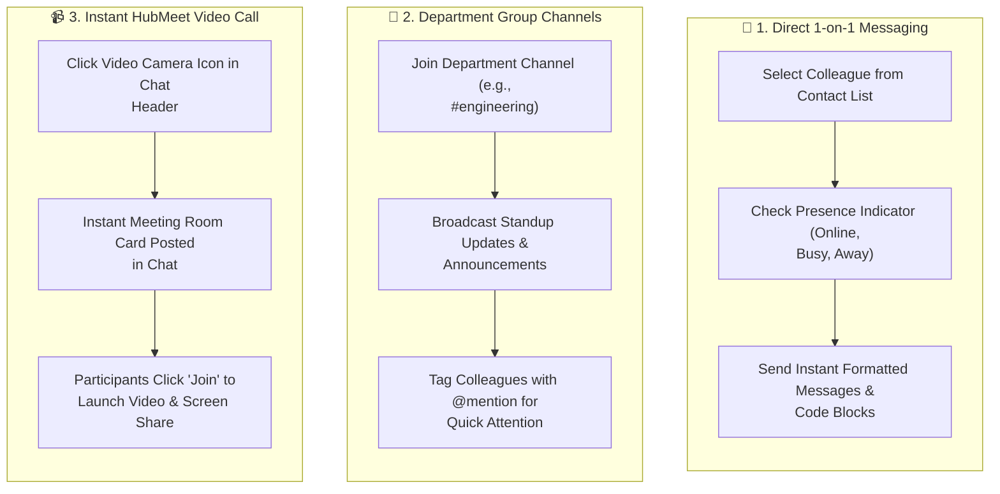

# 11. Team Messages & HubMeet Collaboration (`/employee/messages`)

The **Messages & Collaboration** module connects you directly with teammates, supervisors, and HR personnel in real time. Tightly integrated with **HubMeet**, it enables rapid 1-on-1 communication, department discussions, secure file transfers, and instant video huddles without switching apps.

---

## 🧭 Team Communication & Video Collaboration Flow

The diagram below illustrates how team members exchange messages, coordinate in group channels, and launch instant video meetings:

---

## 🧭 Messaging Workspace Components

Your communication workspace is divided into three key panels:

| Panel | Description | Key Capabilities |
| :--- | :--- | :--- |
| **Conversations Sidebar** | Left-hand column listing all active chats and group rooms. | • Search contacts by name or department. • Filter by Direct Messages (DMs) vs. Department Channels. • Unread message counter badges. |
| **Active Chat Feed** | Central message stream displaying the selected conversation. | • Formatted text messages with rich markdown. • Image and PDF attachment previews. • Read receipts (Delivered vs. Seen double-checks). |
| **Participant & Info Drawer** | Right-hand context pane showing profile details. | • Employee designation, branch, and current presence status (Online, Away, Busy). • Shared media and files repository. |

---

## 🛠️ Step-by-Step User Workflows

### 1. Starting a 1-on-1 Direct Message
1. Navigate to `/employee/messages`.
2. Click the **+ New Message (Pencil)** icon at the top of the conversation list.
3. In the employee search modal, type the name or email of your colleague (e.g., *Rajesh Kumar*).
4. Click their profile name to launch a dedicated conversation thread.
5. Type your message in the bottom input bar and press **Enter** (or click the blue Send airplane).

---

### 2. Sharing Files, Documents & Screenshots
1. In any open conversation, click the **Paperclip (Attachment)** icon.
2. Select your file (PDF documents, spreadsheets, images; Max 25 MB).
3. Add an optional caption explaining the file.
4. Press **Send**. The recipient receives an instant download link with an integrated thumbnail preview.

---

### 3. Launching an Instant HubMeet Video Meeting
When quick verbal alignment is required:
1. In the top-right header of your chat with a teammate or channel, click the **Video Camera (HubMeet)** icon.
2. Hub HRMS generates a meeting room link automatically.
3. An automated meeting invitation card is posted directly into the chat:
   $$\text{"Join HubMeet Video Huddle — Started by You"}$$
4. Both participants can click **Join Call** to launch high-definition audio/video with screen sharing without leaving Hub HRMS.

---

## 💡 Best Practices & Communication Etiquette

!!! tip "Searching Message History"
    Looking for a shared link or agreement from weeks ago? Use the **Search Messages (Ctrl + F)** input at the top of the chat panel to search across historical conversation logs.

!!! note "Managing Distractions (Do Not Disturb)"
    Need focused deep-work time? Click your avatar at the top right of the message bar and toggle your status to **Do Not Disturb (DND)** to silence audio chime alerts.

---

## ❓ Frequently Asked Questions (FAQ)

??? question "Are messages retained after I close the browser?"
    Yes. All chat history is persistently saved and syncs across your desktop app, web browser, and mobile client.

??? question "Can I edit or delete a message after sending?"
    You can edit or delete your own messages within 15 minutes of sending. After 15 minutes, messages remain permanent to maintain audit records.
