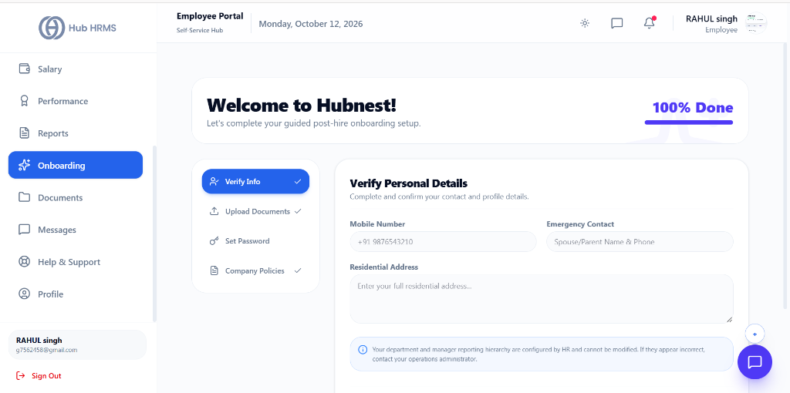
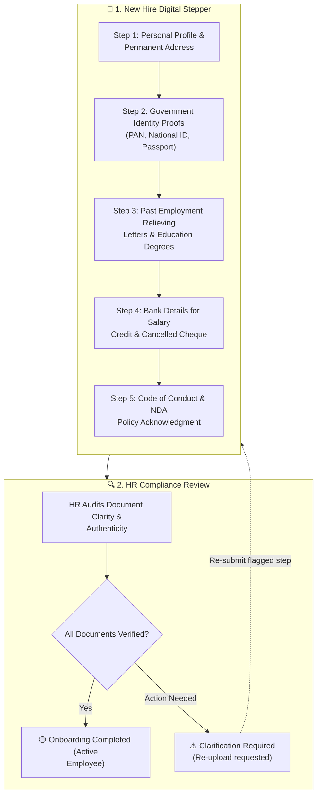

# 08. Digital Onboarding & KYC Verification (`/employee/onboarding`)

The **Digital Onboarding** portal guides newly hired employees through a seamless, paperless orientation experience. From uploading government-issued KYC documents and tax IDs to registering salary bank accounts and acknowledging code-of-conduct policies, it ensures complete statutory compliance before your first day of work.

---

## 🏛️ Live Interface Overview

Below is the live console layout of the **Employee Digital Onboarding** stepper:

---

## 🧭 The 4-Step Guided Post-Hire Stepper

The `/employee/onboarding` portal presents new joiners with a structured checklist with real-time completion tracking (e.g., **100% Done**):

### 1. 📇 Verify Info (Active)
* **Mobile Number**: Primary registered phone for two-factor security alerts.
* **Emergency Contact**: Next-of-kin contact name and phone number.
* **Residential Address**: Current residential and communication address.
* *Note*: Department and reporting manager hierarchy are pre-locked by HR operations.

### 2. 📄 Upload Documents
* Submission portal for identity proofs, education certificates, and tax records.

### 3. 🔐 Set Password
* Self-service credential initialization and account security setup.

### 4. 📜 Company Policies
* Mandatory digital acknowledgement of employee handbook, IT safety regulations, and confidentiality agreements.

---

## 🧭 Digital Onboarding & Verification Workflow

The diagram below details the step-by-step onboarding journey for every new joiner:

---

## 🧭 The 5 Onboarding Stepper Stages

Your onboarding profile progresses through five mandatory stages:

| Stage # | Step Name | Required Submissions | Verification Authority |
| :---: | :--- | :--- | :--- |
| **01** | **Personal Profile** | Permanent address, blood group, emergency contact details. | Self-certified |
| **02** | **Government KYC** | PAN Card, Aadhaar Card / National ID, Passport scan. | HR Compliance |
| **03** | **Career History** | Highest degree certificate, previous relieving letters, last 3 payslips. | BGV Agency / HR |
| **04** | **Bank & Payroll** | Account holder name, Account number, IFSC Code, Cancelled Cheque. | Finance & Payroll |
| **05** | **Statutory e-Sign** | Employee Handbook, Non-Disclosure Agreement (NDA), IT Asset Policy. | Legal / Corporate |

---

## 🛠️ Step-by-Step User Workflows

### Step 1: Submitting Identity & Tax Proofs
1. Log in to the onboarding portal via your invite link or navigate to `/employee/onboarding`.
2. Under **Step 2: Government Identity**:
   * Enter your 10-digit alphanumeric **PAN Number** and upload a clear PDF/JPEG copy.
   * Enter your **Aadhaar / National ID / SSN Number** and upload both front and back images.
   * Provide your **Passport Number** and expiration date (mandatory for international clients).
3. Click **Save & Continue**.

---

### Step 2: Registering Bank Account for Salary Credits
To prevent failed payroll disbursements:
1. Under **Step 4: Bank Details**:
   * Enter your **Bank Name** (e.g., *HDFC Bank, ICICI Bank, Chase*).
   * Enter your **Account Number** twice for confirmation.
   * Enter your **IFSC Code** (India) or **Routing Transit Number** (US).
   * Upload a clear photo of a **Cancelled Cheque** or **Bank Statement Header** clearly showing your printed name and account number.
2. Click **Save & Continue**.

---

### Step 3: Reviewing Verification Statuses
Once submitted, each document tile displays a real-time compliance badge:
* 🟡 **`UNDER REVIEW`**: HR Compliance team is currently auditing the document.
* 🟢 **`VERIFIED`**: Document approved; no further action required.
* 🔴 **`REJECTED / ACTION REQUIRED`**: Document was blurry, expired, or mismatched. Click **Re-upload** and read the reviewer note to provide a replacement copy.

---

## 💡 Best Practices & Security Guidelines

!!! tip "File Format & Image Clarity"
    Upload clear, high-resolution scans in **PDF**, **PNG**, or **JPEG** format (Max 5 MB per file). Avoid blurry smartphone photos with heavy shadows or cut-off corners.

!!! warning "Bank Account Name Matching"
    The account holder name on your uploaded cancelled cheque must exactly match the name registered on your government PAN card to comply with banking anti-money laundering (AML) laws.

---

## ❓ Frequently Asked Questions (FAQ)

??? question "What if I do not have my previous company's relieving letter yet?"
    You can temporarily upload your accepted resignation email or offer letter along with an explanatory note. HR will grant a 30-day grace period to submit the final relieving letter.

??? question "Is my uploaded data safe and private?"
    Yes. All identity documents are encrypted in dedicated private cloud storage, accessible only by authorized compliance officers.
