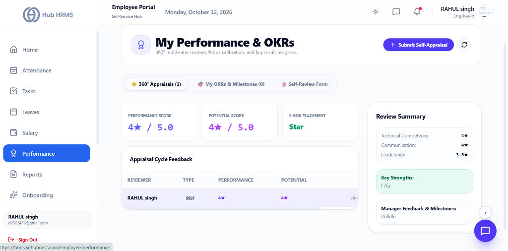
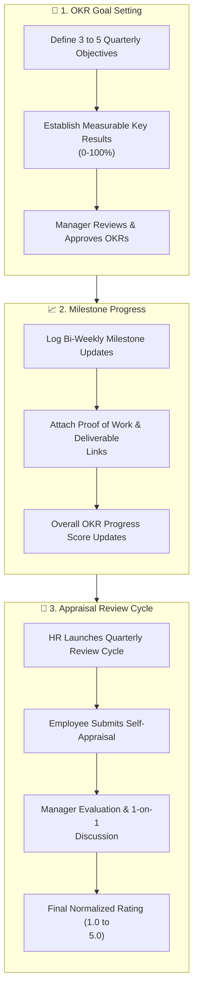

# 07. Goals, OKRs & Performance Reviews (`/employee/performance`)

The **Performance Management** module empowers employees to take ownership of their career growth. By connecting daily tasks with high-level corporate Objectives & Key Results (OKRs), it provides transparent tracking of quarterly milestones, structured self-appraisals, and constructive peer and manager feedback.

---

## 🏛️ Live Interface Overview

Below is the live console layout of the **My Performance & OKRs** dashboard:

---

## 📊 Summary Performance Scores & 9-Box Placement

At the top of the `/employee/performance` portal, real-time appraisal cards and 9-box calibration metrics provide continuous performance insights:

| Metric Indicator | Description | Live Metric Status | Qualitative Benchmark |
| :--- | :--- | :---: | :--- |
| **Performance Score** | Rating achieved across deliverables, code quality, and execution. | **`4★ / 5.0`** | Consistent high performer exceeding expectations. |
| **Potential Score** | Leadership capability, learning agility, and initiative metric. | **`4★ / 5.0`** | High growth readiness for expanded responsibility. |
| **9-Box Placement** | Corporate talent matrix quadrant based on performance vs potential. | **`Star`** 🟢 | Top-tier talent quadrant eligible for leadership fast-track. |

### 🗂️ Performance Navigation Tabs & Actions
* **360° Appraisals (1)**: Active appraisal cycle reviews with feedback logs and reviewer details (e.g., `SELF` review completed).
* **My OKRs & Milestones (0)**: Quarterly Objectives and Key Results tracker.
* **Self-Review Form**: Dedicated form for completing self-assessment questionnaires.
* **+ Submit Self-Appraisal**: Primary action button to file self-evaluations for active review cycles.

### 📋 Review Summary Drawer
* **Technical Competency**: `4★`
* **Communication**: `4★`
* **Leadership**: `3.5★`
* **Key Strengths**: Specific qualitative feedback recorded during review cycles.
* **Manager Feedback & Milestones**: Constructive supervisor notes and upcoming sprint goals.

---

## 🧭 Performance & Appraisal Lifecycle

The diagram below illustrates the complete performance review process, from goal setting to self-appraisals and final manager evaluation:

---

## 🧭 The 5-Point Performance Rating Scale

Performance in Hub HRMS is standardized across five operational tiers:

| Rating | Tier Title | Description | Salary Increment / Bonus Eligibility |
| :---: | :--- | :--- | :--- |
| **`5.0`** | **Exceptional** | Consistently exceeds ambitious key results; demonstrates transformative leadership. | Top-tier merit increment & bonus pool |
| **`4.0`** | **Exceeds Expectations** | Frequently delivers above baseline sprint milestones with minimal supervision. | Above-average performance increment |
| **`3.0`** | **Meets Expectations** | Reliably meets all core responsibilities and assigned deliverables on schedule. | Standard company annual increment |
| **`2.0`** | **Needs Improvement** | Inconsistent delivery; partially met key results. Requires coaching. | Placed on informal improvement plan |
| **`1.0`** | **Unsatisfactory** | Substantially missed critical deliverables. | 60-day formal Performance Improvement Plan (PIP) |

---

## 🛠️ Step-by-Step User Workflows

### 1. Creating and Updating OKR Milestones
1. Navigate to `/employee/performance`.
2. Under **My Active OKRs**, click on an active Objective (e.g., *Improve API Test Coverage from 65% to 90%*).
3. Click the **Update Progress** button.
4. Move the slider or enter the new numeric value (e.g., `82%`).
5. Add an operational milestone note (e.g., *"Completed integration test suite for payment microservice"*).
6. Click **Save Update**. Your overall department alignment score updates in real-time.

---

### 2. Completing Your Quarterly Self-Appraisal
When HR launches the quarterly or annual review cycle:
1. Click the notification alert or open the **Appraisals** tab.
2. Complete the standardized self-evaluation sections:
   * **Core Achievements**: Detail your 3 biggest accomplishments during the review period.
   * **Obstacles & Blockers**: Highlight any technical, cross-team, or resource challenges faced.
   * **Personal Skill Growth**: List courses completed, certifications earned, or new tools mastered.
   * **Competency Self-Scores**: Rate yourself from 1.0 to 5.0 on *Technical Delivery*, *Collaboration*, and *Ownership*.
3. Click **Submit Self-Appraisal**.
4. The review locks and routes directly to your Department Manager for their evaluation and 1-on-1 scheduling.

---

## 💡 Best Practices & Growth Guidelines

!!! tip "SMART Goal Framework"
    Frame all Key Results to be **Specific, Measurable, Achievable, Relevant, and Time-bound**. Avoid vague goals like *"Learn technical skills"*; prefer *"Earn Professional Technical Certification by Q3"*.

!!! note "Objective Realignment"
    If company priorities shift mid-quarter (e.g., emergency pivot to a new product feature), request your manager to adjust your active OKR key results to reflect the new direction.

---

## ❓ Frequently Asked Questions (FAQ)

??? question "Can I see my manager's rating before the 1-on-1 meeting?"
    Manager scores remain private until your 1-on-1 meeting is concluded and HR officially closes the review cycle to ensure unbiased discussions.

??? question "How often are OKR check-ins expected?"
    Best practice is to log milestone check-ins every two weeks. Regular updates prevent surprises at the end of the quarter.
