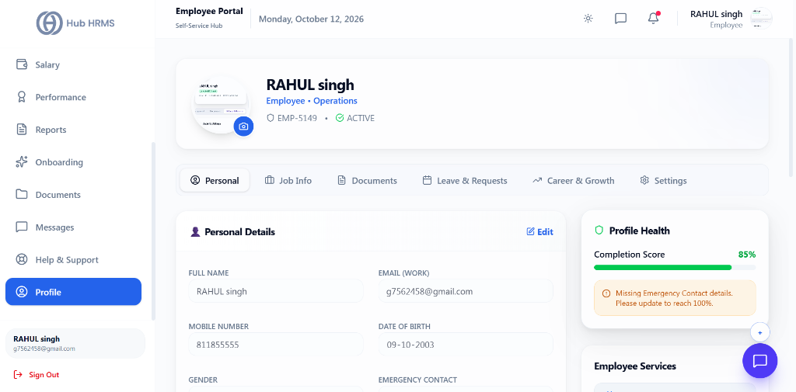
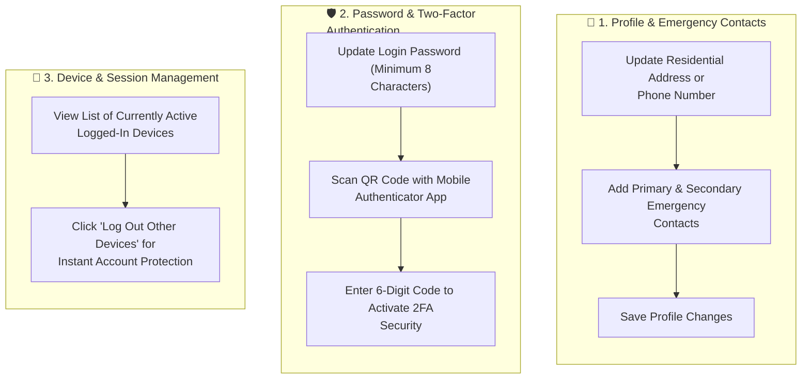

# 13. My Profile, Security & Account Settings (`/employee/profile`)

The **Profile & Security** module allows employees to maintain accurate personal records, update emergency contacts, manage login credentials, and control notification preferences. It ensures your account remains protected against unauthorized access and keeps your workplace profile up to date.

---

## 🏛️ Live Interface Overview

Below is the live console layout of the **Employee Profile & Account Settings** console:

---

## 🗂️ Navigation Tabs & Profile Health Score

The `/employee/profile` screen provides complete control over personal dossiers and self-service security settings:

### 1. Profile Navigation Tabs
* **Personal**: Manages Full Name, Work Email (`g7562458@gmail.com`), Mobile Number (`811855555`), Date of Birth (`09-10-2003`), Gender, and Emergency Contacts.
* **Job Info**: Displays Department (`Operations`), Designation, Employee ID (`EMP-5149`), and Active Employment status (`ACTIVE`).
* **Documents**: Uploaded KYC verification documents, ID cards, and academic certificates.
* **Leave & Requests**: Historical leave quotas, compensatory off requests, and approval status.
* **Career & Growth**: Performance scores, training certificates, and promotion progression.
* **Settings**: Password changes, language preference, and privacy toggles.

### 2. 💚 Profile Health & Completion Score
* **Completion Score Bar**: Real-time profile completeness indicator (e.g., **`85%`**).
* **Missing Data Alerts**: Contextual reminders (e.g., *"Missing Emergency Contact details. Please update to reach 100%"*).
* **Edit Button**: One-click inline editing to update contact numbers and residential details.

---

## 🧭 Account Security & Profile Management Flow

The diagram below details how you can maintain your personal details and protect your account using modern security features:

---

## 🧭 Profile Management Sections

Your account settings are organized into four dedicated management tabs:

| Tab Name | Data Fields Managed | Edit Permissions |
| :--- | :--- | :---: |
| **Personal Information** | Full name, official email, personal phone number, blood group, date of birth, current and permanent residential address. | Editable by Employee |
| **Professional Metadata** | Employee ID, official designation, assigned department, reporting manager, date of joining, work location/branch. | Read-Only (Managed by HR) |
| **Emergency Contacts** | Primary & secondary emergency contacts (Name, Relationship, Phone number, Address). | Editable by Employee |
| **Security & Login** | Account password change, Two-Factor Authentication (2FA/MFA), active browser sessions, login audit history. | Self-Managed |

---

## 🛠️ Step-by-Step User Workflows

### 1. Updating Residential Address & Contact Info
1. Navigate to `/employee/profile`.
2. Under the **Personal Information** tab, click the **Edit Details** button.
3. Update your **Contact Phone Number** or **Current Residential Address**.
4. If your address change affects your official tax jurisdiction or state, an automated notice alerts HR to review state professional tax applicability.
5. Click **Save Changes**.

---

### 2. Updating Emergency Contacts
Workplace safety regulations require at least one active emergency contact on record:
1. Select the **Emergency Contacts** tab.
2. Click **+ Add Contact** (or click the pencil icon to update existing contacts).
3. Provide:
   * **Full Contact Name** (e.g., *Sita Sharma*)
   * **Relationship** (e.g., *Spouse, Parent, Sibling*)
   * **Primary Mobile Number**
   * **Alternative Phone / Landline**
4. Check the box **Set as Primary Emergency Contact**.
5. Click **Save Contact**.

---

### 3. Changing Account Password & Enabling 2FA (MFA)
To protect your account against unauthorized access:
1. Switch to the **Security & Privacy** tab.
2. **Password Change**:
   * Enter your **Current Password**.
   * Enter your **New Password** (Must contain at least 8 characters, including 1 uppercase, 1 lowercase, 1 digit, and 1 special character).
   * Confirm the new password and click **Update Password**.
3. **Enabling Two-Factor Authentication (MFA)**:
   * Click **Enable Two-Factor Authentication**.
   * Open your mobile authenticator app (Google Authenticator, Microsoft Authenticator, or Authy).
   * Scan the displayed on-screen **QR Code**.
   * Enter the generated **6-digit verification code**.
   * Click **Verify & Enable**. From now on, logins require both your password and the rolling 6-digit authenticator code.

---

### 4. Logging Out from Other Devices & Active Sessions
If you used a public workstation or misplaced a device:
1. Scroll down to the **Active Login Sessions** table.
2. Review the list of active devices, showing browser type, IP address, operating system, and last active timestamp.
3. Click the red **Terminate All Other Sessions** button.
4. Your account is immediately signed out from all other devices.

---

## 💡 Best Practices & Account Security

!!! tip "Save Backup Recovery Codes"
    When configuring Two-Factor Authentication (MFA), download and store your **10 Emergency Backup Codes** in a secure location (such as a password manager). These allow you to log in if your phone is lost or unavailable.

!!! warning "Sensitive Profile Fields"
    Certain fields such as your official legal name, government tax ID (PAN), and bank account details cannot be directly edited after initial onboarding verification. To update these, submit an **HR Helpdesk Ticket** with proof of change.

---

## ❓ Frequently Asked Questions (FAQ)

??? question "What should I do if I lose access to my authenticator app?"
    Use one of your saved backup recovery codes to log in, or contact your company's IT Helpdesk Administrator to temporarily reset your MFA factor following identity verification.

??? question "How often should I change my password?"
    Enterprise security policies typically enforce a password expiration notice every 90 days. You cannot reuse any of your last 5 previous passwords.
