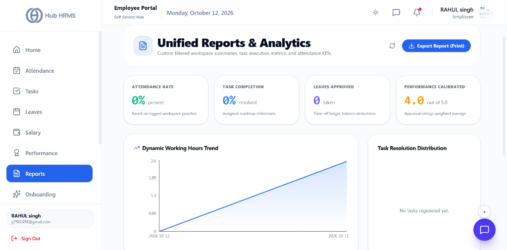
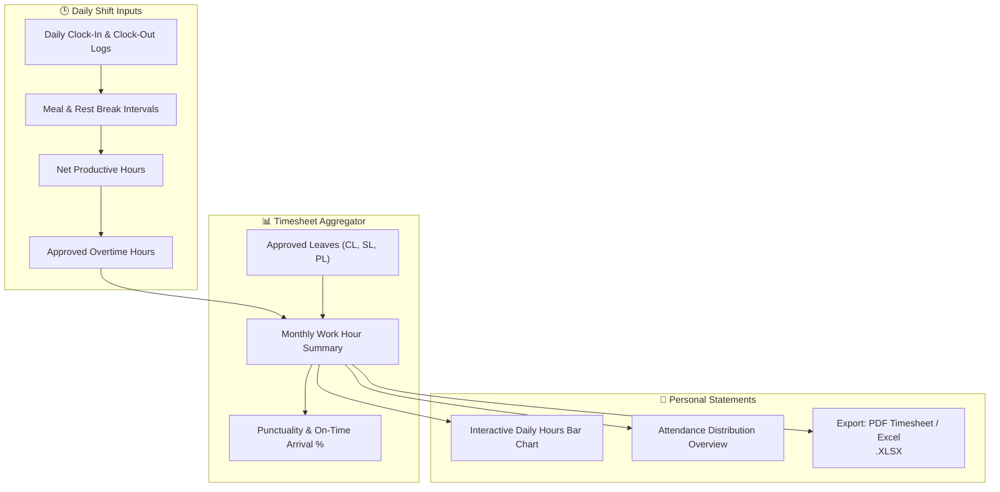

# 10. Personal Reports & Timesheet Analytics (`/employee/reports`)

The **Personal Reports** module gives employees transparent visibility into their historical productivity data. Through intuitive charts, monthly timesheet breakdowns, and overtime logs, you can audit your effective work hours, review leave utilization, and download verified statements for financial or personal records.

---

## 🏛️ Live Interface Overview

Below is the live console layout of the **Unified Reports & Analytics** workspace:

---

## 📊 Summary Operational Metrics & Print Action

At the top of the `/employee/reports` dashboard, four live metric cards summarize your personal workspace performance:

| Metric Indicator | Description | Live Metric Status | Benchmark Detail |
| :--- | :--- | :---: | :--- |
| **Attendance Rate** | Percentage of scheduled days attended without unexcused absence. | **`0%`** | Based on logged workspace punches. |
| **Task Completion** | Percentage of assigned deliverables executed and closed. | **`0%`** | Assigned roadmap milestones. |
| **Leaves Approved** | Total paid and authorized days off taken in the period. | **`0`** | Time-off ledger balance deductions. |
| **Performance Calibrated**| Normalized appraisal rating weighted across cycle evaluations. | **`4.0`** | Appraisal ratings weighted average (out of 5.0). |

### 📥 One-Click Export
* **Export Report (Print)**: Generates an executive, print-ready PDF containing your personal timesheet, task resolution distribution, and dynamic working hours trendline.

### 📈 Dynamic Analytics Visualizations
* **Dynamic Working Hours Trend**: Linear progression chart tracking daily billable work hours across consecutive calendar dates.
* **Task Resolution Distribution**: Real-time distribution breakdown categorizing open vs in-progress vs completed deliverables.

---

## 🧭 Personal Timesheet & Reports Workflow

The diagram below illustrates how your daily shift punches and leave history are summarized into personal productivity reports:

---

## 📊 Summary Metric Indicators

At the top of your report console, four core operational summary cards provide instant insight:

| Metric Card | Value Formula | Target Standard | Operational Interpretation |
| :--- | :---: | :---: | :--- |
| **Total Logged Hours** | $\sum \text{Effective Daily Work Hours}$ | $\approx 176\text{ hrs / month}$ | Cumulative productive time completed in the selected billing period. |
| **Average Daily Hours** | $\frac{\text{Total Logged Hours}}{\text{Days Present}}$ | $8.0 - 8.5\text{ hrs / day}$ | Reflects consistent work duration across standard shifts. |
| **Overtime Earned (OT)**| $\sum \text{Extra Approved Shift Hours}$ | As per project needs | Extra hours eligible for payroll overtime stipends or comp-off days. |
| **Punctuality Score** | $\frac{\text{On-Time Check-Ins}}{\text{Days Present}} \times 100$ | $\ge 95\%$ | Tracks arrival within branch grace periods. |

---

## 🛠️ Step-by-Step User Workflows

### 1. Generating a Monthly Timesheet Report
1. Navigate to `/employee/reports`.
2. Select your reporting period from the **Date Filter** dropdown:
   * **Current Pay Period** (1st to 30th/31st of the current month)
   * **Last Pay Period** (Previous month's closed timesheet)
   * **Quarter-to-Date (QTD)** or **Year-to-Date (YTD)**
   * **Custom Range** (Select start and end dates on the calendar)
3. Click **Generate Report**. The charts and breakdown table update instantly.

---

### 2. Inspecting the Daily Work Distribution Chart
* **Daily Hours Bar Graph**: Displays daily bars for each working day.
  * 🟢 **Green Bar**: Completed full standard shift ($\ge 8\text{ hrs}$).
  * 🟡 **Yellow Bar**: Short hours or half-day ($4\text{ to }7.9\text{ hrs}$).
  * 🔵 **Blue Cap**: Overtime hours logged beyond standard shift.
* Hovering over any daily bar reveals the exact clock-in, clock-out, and break intervals.

---

### 3. Exporting Verified Timesheets (PDF / Excel)
1. Click the **Export** button on the top right toolbar.
2. Select your desired format:
   * **Download PDF**: Formatted, official timesheet document stamped with your employee ID, manager name, and digital verification hash.
   * **Export Excel (.xlsx)**: Raw tabular dataset containing daily timestamps, break logs, and status tags for personal records.
3. The export is generated in seconds and downloads to your device.

---

## 💡 Best Practices & Timesheet Tips

!!! tip "Verifying Before Payroll Lock"
    Always inspect your personal report around the 23rd-24th of each month. If any day appears marked as `ABSENT` due to a forgotten punch, submit a regularization request before payroll freezes.

!!! note "Overtime Approval Process"
    Overtime hours reflected in this report require manager sign-off before being disbursed in your monthly payslip. Check with your supervisor if approved hours are pending.

---

## ❓ Frequently Asked Questions (FAQ)

??? question "Can I export attendance data for previous years?"
    Yes. The custom date range selector permits filtering across your entire historical tenure with the company.

??? question "Why are break hours subtracted from my total logged time?"
    In accordance with standard labor compliance regulations, non-working meal and tea breaks are excluded to compute true billable effective hours.
