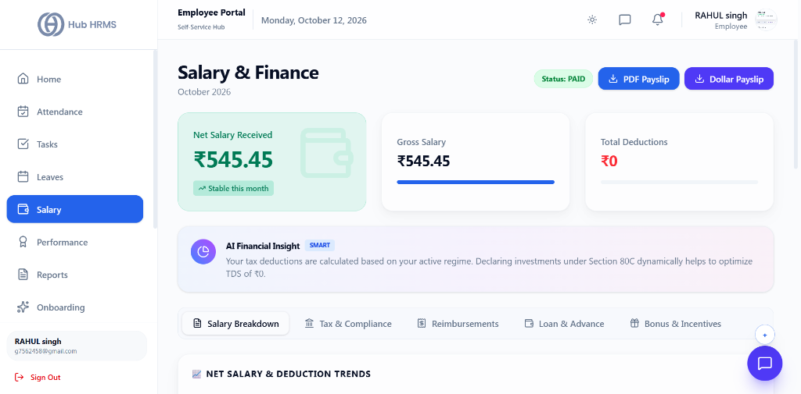
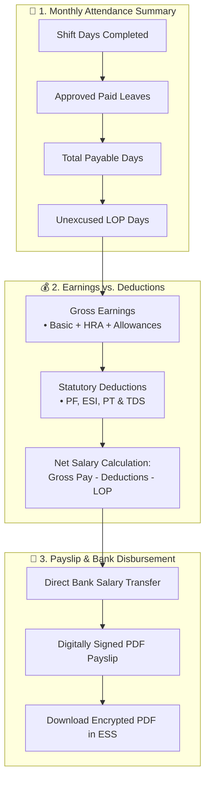

# 05. Payslips, Compensation & Tax Vault (`/employee/salary`)

The **Compensation & Payslip Vault** provides complete financial transparency to employees. It provides on-demand access to monthly digitized payslips, transparent year-to-date (YTD) earnings summaries, statutory deduction audits (PF, ESI, Professional Tax), and annual income tax regime declarations.

---

## 🏛️ Live Interface Overview

Below is the live console layout of the **Salary & Finance** console:

---

## 📊 Summary Compensation Indicators & Payout Badges

At the top of the `/employee/salary` dashboard, real-time cards provide financial visibility for the active billing cycle:

| Metric Indicator | Description | Live Metric Status | Action Available |
| :--- | :--- | :--- | :--- |
| **Net Salary Received** | Net take-home payout after all statutory deductions. | **`₹545.45`** (`Stable this month`) | Direct bank transfer credit figure. |
| **Gross Salary** | Total base earnings plus all monthly allowances. | **`₹545.45`** | Full earnings benchmark. |
| **Total Deductions** | Aggregate statutory withholdings (PF, ESI, TDS, EMIs). | **`₹0`** | Zero unapproved deductions. |

### 📑 One-Click Payslip Downloads & Status
* **Status Badge**: Current disbursement status (e.g., `Status: PAID`).
* **PDF Payslip**: Instant download of the official digitally stamped compensation slip.
* **Dollar Payslip**: Multi-currency conversion export for international assignments and visa documentation.

### 🧠 AI Financial Insight
* Provides personalized fiscal recommendations (e.g., *"Your tax deductions are calculated based on your active regime. Declaring investments under Section 80C dynamically helps to optimize TDS of ₹0"*).

### 🗂️ Salary Navigation Tabs
* **Salary Breakdown**: Line-by-line itemization of Basic, HRA, DA, Special Allowances, and deductions.
* **Tax & Compliance**: Section 80C/80D declaration status and tax slab simulator.
* **Reimbursements**: Approved claims queued for upcoming payout.
* **Loan & Advance**: Running balances of interest-free advances and EMI deduction logs.
* **Bonus & Incentives**: Performance incentives and annual bonuses credited.

---

## 🧭 Monthly Payroll Calculation & Payslip Flow

The diagram below illustrates how your monthly gross earnings, attendance records, and statutory deductions are processed to compute your take-home net salary and generate your official payslip:

---

## 📊 Comprehensive Salary Structure Breakdown

Every monthly payslip itemizes **Earnings** against **Statutory & Voluntary Deductions**:

### 1. Gross Earnings Components
| Earning Component | Typical Percentage / Value | Description | Tax Exemption Under Old Regime |
| :--- | :---: | :--- | :--- |
| **Basic Salary** | $40\% - 50\%$ of CTC | Core base salary foundation for PF and Gratuity. | Fully Taxable |
| **House Rent Allowance (HRA)**| $40\% - 50\%$ of Basic | Allowance for accommodation expenses. | Partially exempt via rent receipts |
| **Special Allowance** | Balancing Figure | Performance and role-based allowance. | Fully Taxable |
| **Conveyance / Travel** | Fixed / Reimbursed | Commute and travel stipend. | Standard Deduction covered |
| **Medical Allowance** | Fixed Stipend | Health and medical assistance allowance. | Standard Deduction covered |

### 2. Deductions Components
| Deduction Component | Contribution Formula | Mandatory Statutory Authority | Beneficiary Account |
| :--- | :---: | :--- | :--- |
| **Provident Fund (PF)** | $12\%$ of Basic Salary | EPFO (Employees' Provident Fund) | Transferred to UAN Retirement Fund |
| **Employee State Insurance (ESI)** | $0.75\%$ of Gross ($<\text{₹}21,000/\text{mo}$) | ESIC Corporation | Medical coverage for employee & family |
| **Professional Tax (PT)** | $\text{₹}200/\text{month}$ (State-dependent) | State Municipal Government | State Labor Compliance |
| **TDS (Income Tax)** | Per Tax Slab Calculation | Income Tax Department of India | Deposited against Employee PAN |

---

## 🛠️ Step-by-Step User Workflows

### 1. Downloading Monthly Encrypted Payslips
1. Navigate to `/employee/salary`.
2. Locate the **Payslips Archive** table.
3. Find the desired pay cycle (e.g., *September 2026*).
4. Click the blue **Download PDF** button.
5. **Password Protection Security**:
   * The PDF is encrypted using standard security protocols.
   * **Default Password Format**: First 4 letters of your First Name in uppercase + Year of Birth:
     $$\text{Example: John Doe, born in 1996} \rightarrow \mathbf{JOHN1996}$$

---

### 2. Choosing Your Tax Regime (`New` vs `Old`)
1. In the **Tax Planning** tab, review the side-by-side comparison calculator:
   * **New Tax Regime (Default)**: Lower tax slabs, zero requirement to submit investment bills, standard rebate up to ₹7,00,000.
   * **Old Tax Regime**: Higher slab rates, but permits deductions under Chapter VI-A (80C, 80D, 24b Home Loan Interest, HRA).
2. Select your preferred regime at the beginning of the financial year.

---

### 3. Submitting Annual Investment Proofs
During the open tax declaration window (typically December to February):
1. Navigate to the **Investment Declarations** section.
2. Select the investment section:
   * **Section 80C**: Life Insurance (LIC), PPF, ELSS Mutual Funds, EPF, Child Tuition Fees (Max ₹1,50,000).
   * **Section 80D**: Health Insurance Premiums for Self, Spouse, Children, and Senior Citizen Parents.
   * **Section 80CCD(1B)**: National Pension Scheme (NPS) extra ₹50,000.
   * **House Rent Receipts**: Monthly rent agreement and landlord PAN (if annual rent $> \text{₹}1,00,000$).
3. Enter the claimed amount and attach scanned receipts/statements (PDF/JPEG).
4. Click **Submit for Verification**. The internal Finance & Payroll team audits the proofs and adjusts your final TDS deductions accordingly.

---

## 💡 Best Practices & Financial Tips

!!! tip "Verifying PF Deposits"
    Your PF deduction shown on the payslip must match your **EPFO Member Passbook**. Ensure your active UAN (Universal Account Number) is linked to your Hub HRMS profile.

!!! warning "Form 16 Availability"
    Annual Form 16 Part A and Part B certificates are generated and made available for direct one-click download in this module by June 15th following the financial year end.

---

## ❓ Frequently Asked Questions (FAQ)

??? question "Why is my net take-home salary different from last month?"
    Differences usually stem from either unpaid leave days (Loss of Pay - LOP), overtime payments, changes in tax bracket brackets (TDS), or bonus disbursements.

??? question "Can I modify my investment declarations mid-year?"
    You can update estimated declarations anytime before December. However, final actual proofs can only be submitted during the official HR verification window.
