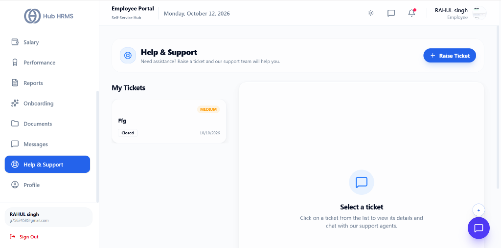
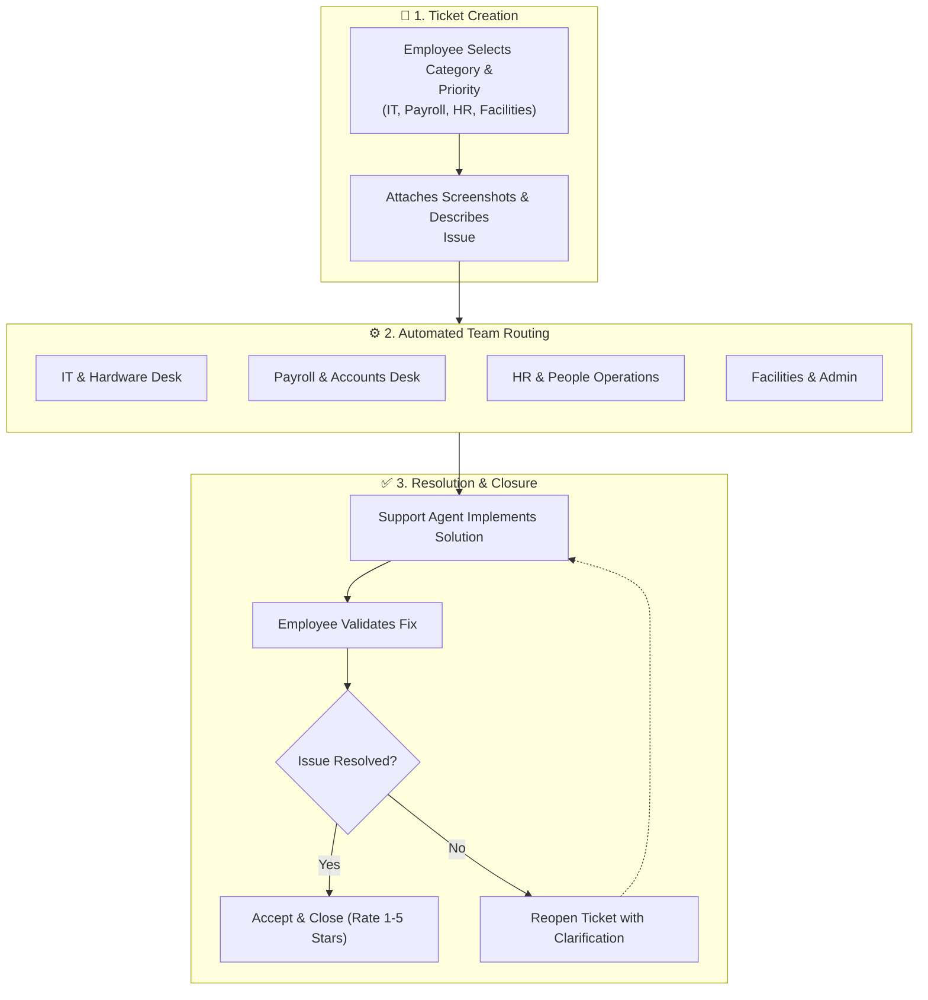

# 12. Helpdesk, IT Support & Grievances (`/employee/support`)

The **Helpdesk & Grievance Console** provides an official, transparent ticketing channel for every employee. Whether you need assistance with computer hardware, have questions regarding your monthly payslip, require software license provisioning, or wish to report a workplace grievance, this module ensures your inquiries are routed to the appropriate department and resolved within agreed Service Level Agreements (SLAs).

---

## 🏛️ Live Interface Overview

Below is the live console layout of the **Employee Helpdesk & Support Tickets** screen:

---

## 🗂️ My Tickets Queue & Active Support Pane

The `/employee/support` dashboard provides clear separation between your submitted requests and active resolution chats:

### 1. 📋 My Tickets Queue (Left Pane)
* Lists your active and past tickets with priority indicators (e.g., `MEDIUM`), submission date (`10/10/2026`), and status badge (`Closed` / `Open`).
* Click any ticket card to load the conversational interaction history in the right pane.

### 2. 💬 Interactive Support Canvas (Right Pane)
* When a ticket is selected, opens an interactive two-way messaging thread with IT/HR support agents, allowing file re-uploads and live status updates.
* **+ Raise Ticket Button**: Prominent action button in the header to open a modal form (Subject, Description, Priority, Module) with screenshot attachments.

---

## 🧭 Support Ticketing & Resolution Lifecycle

The diagram below outlines how your support tickets are categorized, assigned to specialized resolver teams, and tracked through to resolution:

---

## 🧭 Ticket Priority & Service Level Agreement (SLA) Matrix

Tickets are prioritized based on operational impact:

| Priority Level | Color Badge | Target First Response | Target Resolution SLA | Typical Scenario |
| :--- | :--- | :---: | :---: | :--- |
| **`URGENT`** | 🔴 Crimson Red | $< 30\text{ minutes}$ | $< 4\text{ hours}$ | System crashes, laptop hardware failure during live client demo, security breaches. |
| **`HIGH`** | 🟠 Orange | $< 2\text{ hours}$ | $< 12\text{ hours}$ | Unable to clock in due to location lock, incorrect monthly salary deduction, VPN failure. |
| **`MEDIUM`** | 🔵 Blue | $< 6\text{ hours}$ | $< 24\text{ hours}$ | Software license request (Figma, GitHub), insurance card update, tax declaration question. |
| **`LOW`** | ⚪ Gray | $< 12\text{ hours}$ | $< 48\text{ hours}$ | General HR policy inquiries, company stationery requests, ergonomic keyboard request. |

---

## 🛠️ Step-by-Step User Workflows

### 1. Raising a New Support Ticket (`+ Raise Ticket`)
1. Navigate to `/employee/support`.
2. Click the blue **+ Raise Ticket** button in the top toolbar.
3. Complete the ticket creation form:
   * **Support Category**:
     * 💻 **IT, Hardware & Networks**: Laptop repair, Wi-Fi connectivity, OS setup.
     * 💰 **Payroll, Tax & Reimbursements**: Payslip discrepancies, TDS inquiries.
     * 👥 **Human Resources & Policies**: Leave balance adjustments, BGV verification.
     * 🏢 **Facilities, Admin & Assets**: Desk allocation, ID access badge replacement.
   * **Subject Line**: Write a concise summary (e.g., *"Cannot access corporate VPN from remote network"*).
   * **Detailed Description**: Detail the exact problem, error codes, and steps to reproduce.
   * **Priority**: Choose from `LOW`, `MEDIUM`, `HIGH`, or `URGENT`.
   * **Attachments**: Attach screenshots or error logs.
4. Click **Create Ticket**. A unique ticket ID (e.g., `#TICK-8042`) is generated.

---

### 2. Communicating with Helpdesk Agents
1. Click on any ticket in your **My Tickets** table to open the conversation drawer.
2. Review updates posted by the assigned resolver.
3. Use the comment box to reply with requested information or test results.
4. An automated audit trail records every status transition (`Open` $\rightarrow$ `In Progress` $\rightarrow$ `Resolved`).

---

### 3. Confirming Resolution & Rating Support Quality
1. When an agent resolves your issue, you receive a notification:
   $$\text{"Your Ticket #TICK-8042 has been marked RESOLVED"}$$
2. Test the fix (e.g., verify that your VPN connects or your salary discrepancy is adjusted).
3. If satisfied, click **Accept & Close Ticket**.
4. Rate the resolver's service from **1 to 5 Stars** and leave optional feedback to help maintain corporate service standards.

---

## 💡 Best Practices & Submission Guidelines

!!! tip "Include Error Screenshots"
    Attaching clear screenshots showing the exact error prompt or URL significantly reduces resolution time and prevents back-and-forth clarification emails.

!!! note "Self-Service Knowledgebase (FAQs)"
    Before creating a ticket, check the **Frequently Asked Questions (FAQ)** tab in this module. Over 60% of common IT and HR questions have instant self-service answers available.

---

## ❓ Frequently Asked Questions (FAQ)

??? question "Can I reopen a closed ticket?"
    Yes. You can reopen any closed ticket within 5 business days by replying in the comment thread if the problem recurs.

??? question "Are grievance tickets private?"
    Yes. Grievances flagged under the **Confidential HR / Workplace Conduct** category are strictly isolated and visible only to the designated Head of HR.
