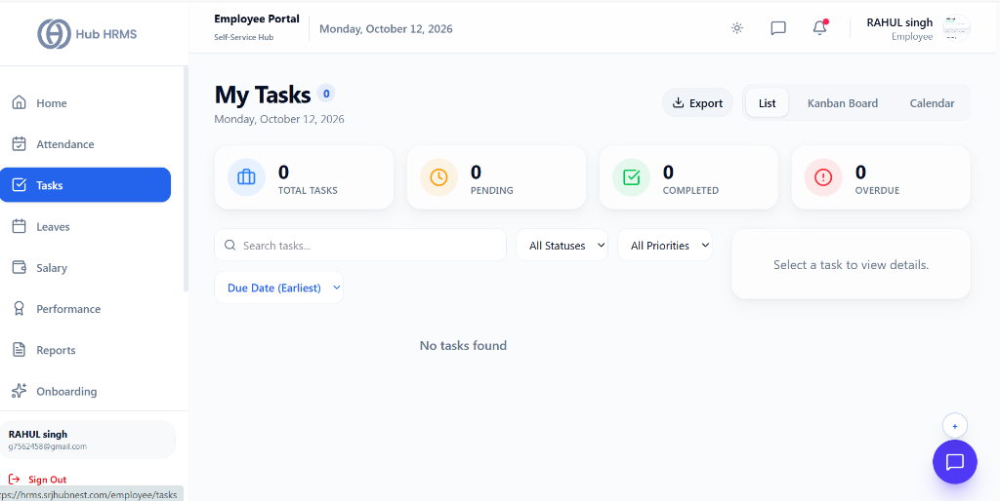
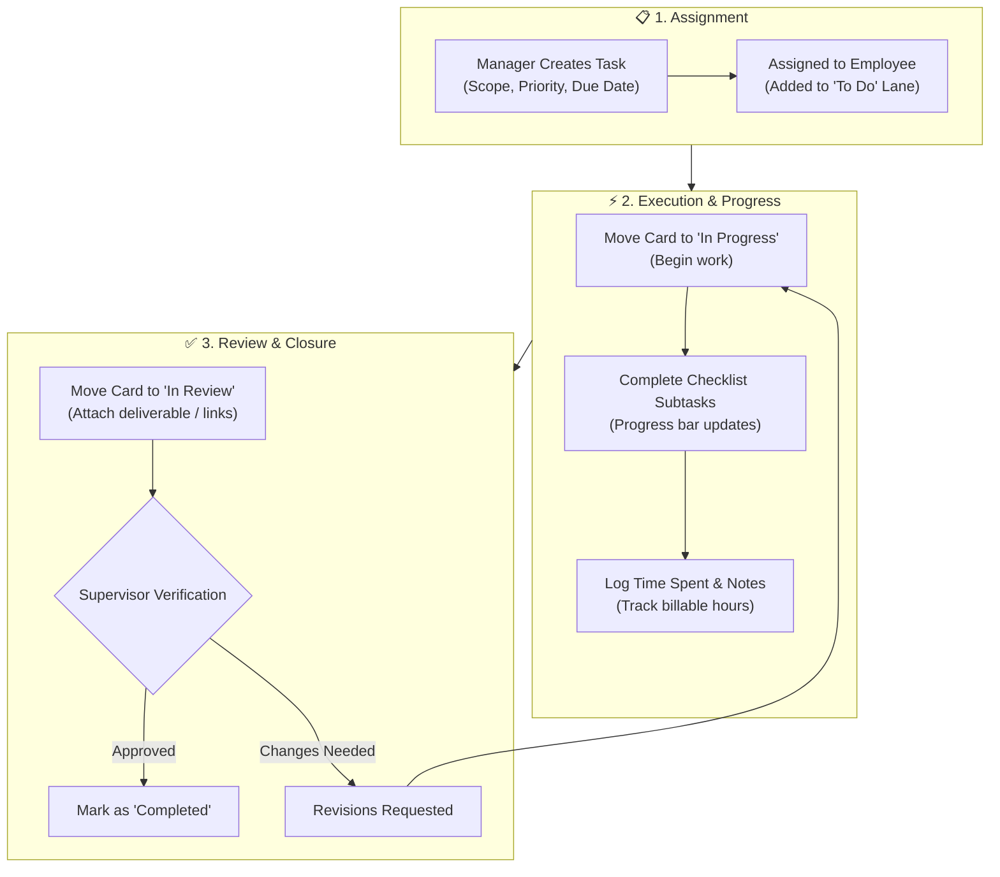

# 03. My Assigned Tasks & Sprint Deliverables (`/employee/tasks`)

The **Tasks & Projects** module empowers employees to organize, track, and execute their day-to-day deliverables with clarity. Featuring a Pipeline visual board, milestone calendars, priority indicators, and checklist tracking, it keeps team goals aligned and ensures timely project completion.

---

## 🏛️ Live Interface Overview

Below is the live console layout of the **Employee Tasks Management** dashboard:

---

## 📊 Summary KPI Indicators & View Modes

At the top of the `/employee/tasks` dashboard, four live metric cards and multiple layout options give employees complete clarity over their workload:

| KPI Indicator | Description | Live Metric Status | Action Available |
| :--- | :--- | :--- | :--- |
| **Total Tasks** | Cumulative assignments active in your personal queue. | `0` | Click to filter across all sprint tasks. |
| **Pending** | Tasks in progress or awaiting your execution. | `0` | Priority focus for daily schedule. |
| **Completed** | Finished tasks that have met acceptance criteria. | `0` | Archive of validated project contributions. |
| **Overdue** | Deliverables exceeding their designated deadline. | `0` | Urgent escalation to prevent blockers. |

### 🗂️ View Options & Layouts
* **List View**: Clean row-by-row table showing title, assignee, priority tag, and due date.
* **Pipeline Board**: Interactive workflow columns (`To Do`, `In Progress`, `Review`, `Done`) with drag-and-drop state progression.
* **Calendar View**: Monthly timeline plotting deliverables against milestone deadlines.
* **Export Action**: One-click export of your task timesheet and deliverables report.

---

## 🧭 Task Lifecycle & Pipeline Workflow

The diagram below outlines the full lifecycle of a task from assignment to execution, checklist completion, and manager sign-off:

---

## 🧭 Task Pipeline Stages & Priority Indicators

Your workspace organizes deliverables into four clear workflow lanes:

| Pipeline Stage | Purpose & Meaning | Trigger Action |
| :--- | :--- | :--- |
| **`TODO / BACKLOG`** | New deliverables assigned to you, awaiting work. | Click **Start Task** to move to progress. |
| **`IN PROGRESS`** | Active tasks currently underway. | Regularly check off subtasks and log hours. |
| **`IN REVIEW`** | Deliverables submitted to supervisor or QA for sign-off. | Attach pull request, design link, or report. |
| **`COMPLETED`** | Successfully closed deliverables. | Preserved for monthly performance reviews. |

### Priority Badges
* 🔴 **`URGENT`**: Critical blocker; requires same-day resolution.
* 🟠 **`HIGH`**: Important sprint milestone due within 48 hours.
* 🔵 **`MEDIUM`**: Standard operational task.
* ⚪ **`LOW`**: Maintenance or flexible-schedule task.

---

## 🛠️ Step-by-Step User Workflows

### 1. Switching Layouts & Dynamic Filtering
* **Layout Switcher**: Choose between **List** (compact row view), **Kanban Board** (drag-and-drop workflow lanes), or **Calendar** (deadlines plotted across days).
* **Clickable KPI Filters**: Click any of the top 4 metric cards (**Total Tasks**, **Pending**, **Completed**, **Overdue**) to instantly filter the active list.
* **Multi-Format Export**: Click the **Export** dropdown button to download your filtered tasks as **CSV**, **Excel**, or **JSON** for reports or client reviews.
* **Dynamic Sorting**: Sort your queue via the sort dropdown:
  * *Due Date (Earliest)* — Prioritize nearest deadlines.
  * *Due Date (Latest)* — View upcoming future milestones.
  * *Priority Level* — Sort by High, Medium, or Low urgency.
  * *Title (A-Z)* — Alphabetical index of deliverables.

---

### 2. Fast Priority Adjustments & Quick Status Menu
* **Priority Bumpers**: Use the inline `▲` (Increase Priority) and `▼` (Decrease Priority) arrows on any task row to quickly escalate or demote urgency without opening the editor.
* **Quick Status Menu**: Click the three-dot (`⋮`) action menu on any task card to change state in one click:
  * `Mark Pending` (Amber indicator)
  * `In Progress` (Blue indicator)
  * `Mark Complete` (Green strike-through styling)
  * `Mark Overdue` (Red alert state)

---

### 3. Detailed Task Modal & Built-in Stopwatch
Clicking any task row or the eye (`👁️`) icon opens the comprehensive **Task Details Modal**:

1. **AI Critical Path Insight**: Delivers automated productivity guidance (e.g., *"Critical Path: High-priority task. Completing this first prevents downstream blockers and reduces sprint risk by 25%"*).
2. **Work Stopwatch Timer**:
   * Click **Play (Start Timer)** when you begin active work.
   * Click **Pause** during interruptions.
   * Accumulated elapsed time is automatically logged to the sprint timesheet.
3. **Interactive Subtask Checklists**: Check off individual acceptance criteria as you finish them; the parent progress bar recalculates automatically.
4. **Comments & Activity Stream**: Post real-time progress notes, tag teammates, and review chronological status changes.
5. **Attachments & Artifacts**: Upload test results, design mocks, or code review links directly into the task card.

---

## 💡 Best Practices & Sprint Tips

!!! tip "Daily Morning Standup Alignment"
    Check your task board at the start of your day right after clocking in. Prioritizing `URGENT` items prevents overdue flags on your personal performance score.

!!! warning "Overdue Deliverables Alert"
    If a task's due date passes without being moved to `COMPLETED`, the card header turns red and an automated reminder is sent to you and your supervisor.

---

## ❓ Frequently Asked Questions (FAQ)

??? question "Can I create personal to-do tasks that only I can see?"
    Yes. If self-tasking is enabled in your department's workflow permissions, you can create internal tracking deliverables and link them to your active sprint project.

??? question "Can I reassign a task to a colleague if I am blocked?"
    Reassignments typically require manager permission. Leave a comment in the task thread tagging your supervisor to request reassignment.

