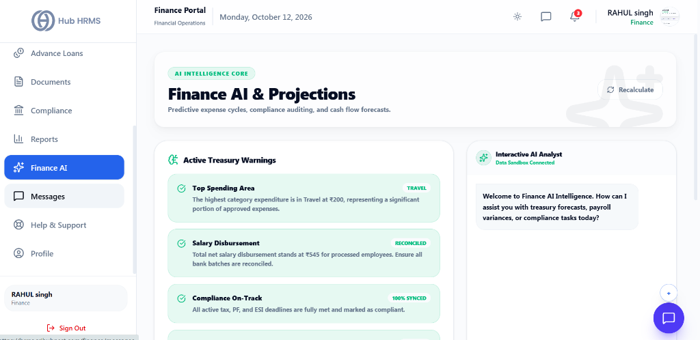
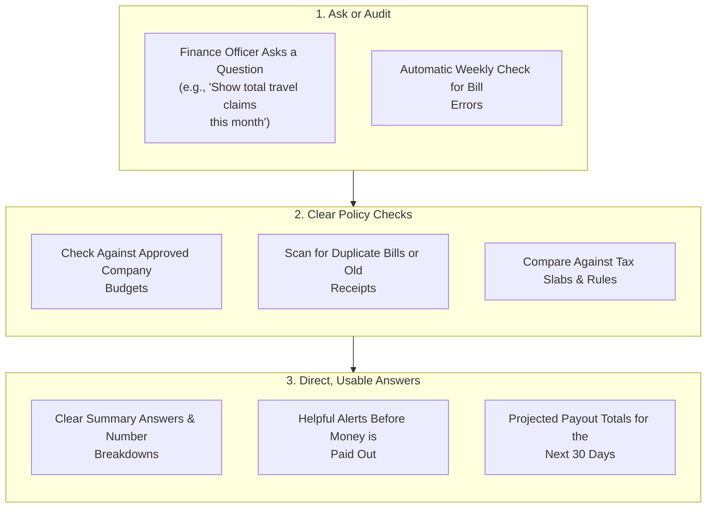

# 08. Smart Finance Assistant (`/finance/ai`)

The **Smart Finance Assistant** is a helpful digital tool built into the Hub HRMS Finance Portal. Instead of manually cross-checking hundreds of bills or recalculating spreadsheets, finance officers can ask direct questions in plain English, spot accidental duplicate bills, and see accurate projections of upcoming salary payouts.

---

## 🏛️ Live Interface Overview

Below is the live console layout of the **Finance AI & Projections** workspace:

---

## 📊 Summary Panels: Active Treasury Warnings & Interactive AI Analyst

The `/finance/ai` workspace is split into two intelligent operational panes:

### 1. ⚠️ Active Treasury Warnings (Left Pane)
Automated real-time anomaly detection cards continuously audit financial logs:
* **Top Spending Area**: Highlights category-level expense concentrations (e.g., `TRAVEL` - *"The highest category expenditure is in Travel at ₹200, representing a significant portion of approved expenses"*).
* **Salary Disbursement**: Validates bulk payroll reconciliation (e.g., `RECONCILED` - *"Total net salary disbursement stands at ₹545 for processed employees. Ensure all bank batches are reconciled"*).
* **Compliance On-Track**: Live synchronization check with government deadlines (e.g., `100% SYNCED` - *"All active tax, PF, and ESI deadlines are fully met and marked as compliant"*).
* **Recalculate Button**: One-click action to refresh and re-run prediction models against newly synced database entries.

### 2. 💬 Interactive AI Analyst (Right Pane)
A conversational finance co-pilot with a dedicated live data sandbox connection:
* Ask questions about treasury forecasts, payroll variances, cash runways, or compliance schedules.
* Receive instant summarized breakdowns without running complex database queries.

---

## 🧭 How the Finance Assistant Works

Here is how your questions and expense receipts are checked securely:

---

## 💡 What You Can Do with the Finance Assistant

### 1. 💬 Ask Quick Salary & Budget Questions
Get answers instantly without manually pulling multiple reports:
* **Salary & Payroll Questions**:
  * *"What is our projected total salary payout for next month with new joiners included?"*
  * *"Which department had the biggest overtime payout over the last 3 months?"*
* **Tax & Deductions**:
  * *"How much total TDS tax has been deducted so far this quarter?"*
  * *"List all employees whose tax investment proof submission is still pending."*
* **Office & Travel Expenses**:
  * *"Show me all travel reimbursement claims above \$1,000 submitted this month."*
  * *"How do our actual marketing expenses compare against the approved quarterly budget?"*

---

### 2. 🚨 Automatic Bill & Duplicate Receipt Checking
The system quietly double-checks submitted claims before you approve payments:
* **Catches Duplicate Receipts:** Flags if the same restaurant, hotel, or fuel bill has already been submitted in another claim.
* **Flags Policy Limits:** Alerts you if a claim is higher than the allowed company policy limit (such as hotel per-diem or meal allowances).
* **Checks Weekend Dates:** Gently highlights non-working day bills so managers can confirm they were approved business trips.

---

### 3. 📈 Simple Payout & Cashflow Projections
Helps finance teams plan upcoming bank balances with ease:
* **Probation Confirmations:** Automatically factors in scheduled salary hikes when employees complete their probation periods.
* **Upcoming Bonus Planning:** Test different incentive numbers to see the exact impact on next month's bank balance.
* **Next 30 Days Cash Outlook:** Gives finance controllers a clean, reliable forecast of upcoming paydays and tax deposits.

---

## ⚙️ How to Use the Assistant

### Step 1: Open the Assistant
1. Click **Smart Assistant** from the Finance portal sidebar.
2. Click one of the suggested buttons (e.g., *Check Bill Errors*, *Forecast Next Month Salary*, or *Review Tax Status*) or simply type your question in the chat box.

### Step 2: Review Findings
1. The assistant replies in simple English with clear summary tables and links.
2. If any bill has a question mark or looks duplicate, click **Review Claim** to see the uploaded receipt and policy details side-by-side.

### Step 3: Take Action
1. Choose how to handle flagged items right from the screen:
   - **Ask Employee:** Send a quick note asking for a clearer bill or clarification.
   - **Approve Exception:** Approve with an explanatory manager note if it was an authorized emergency expense.
   - **Download Summary:** Save a clean PDF summary for your accounting files.

---

## 💡 Helpful Tips

> [!TIP]
> **Check Before Friday Payments:** Run the bill error check once every Friday before processing weekly reimbursement transfers to catch any duplicate receipts early.

> [!NOTE]
> **Safe & Private:** Your company numbers and employee bank details stay strictly inside your account. They are never shared outside or used for public training.
