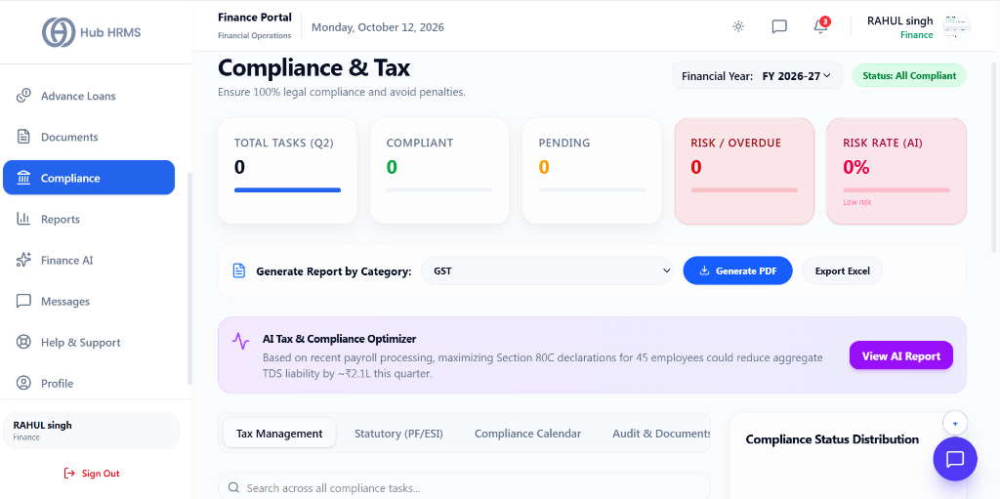
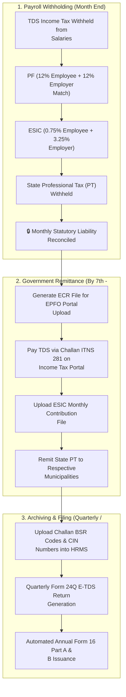

# 07. Statutory Tax & Labor Compliance (`/finance/compliance`)

The **Statutory Compliance** module provides Finance Officers and payroll controllers with automated reconciliation tools to satisfy state and central government labor mandates. From tracking Tax Deducted at Source (TDS) under Section 192 to reconciling EPFO Provident Fund challans and ESIC health contributions, it ensures zero compliance penalties.

---

## 🏛️ Live Interface Overview

Below is the live console layout of the **Finance Statutory Compliance & Tax** dashboard:

---

## 📊 Summary KPI Indicators & Quick Report Actions

At the top of the `/finance/compliance` dashboard, five real-time metric cards and category report generators provide immediate legal compliance status:

| KPI Indicator | Description | Live Metric Status |
| :--- | :--- | :--- |
| **Total Tasks (Q2)** | Cumulative statutory filing tasks scheduled for the active quarter. | Scheduled task count (e.g., `0`). |
| **Compliant** | Tasks filed, reconciled, and verified with valid challan receipts. | Highlighted in green (e.g., `0`). |
| **Pending** | Filings awaiting deposit confirmation or return submission. | Highlighted in amber (e.g., `0`). |
| **Risk / Overdue** | Mandates exceeding government deadlines without paid challans. | Alert indicator highlighted in red (e.g., `0`). |
| **Risk Rate (AI)** | Automated legal risk metric assessing penalty vulnerability. | Real-time rate indicator (e.g., `0% Low risk`). |

### 📄 Quick Category Report Exports
* **Generate Report by Category**: Select from dropdown (`GST`, `TDS`, `PF`, `ESIC`, `PT`, `Audit`) to immediately export compliant records.
* **Generate PDF**: One-click export for official board and regulatory submissions.
* **Export Excel**: Full tabular ledger format for auditor review.

> [!NOTE] **AI Tax & Compliance Optimizer**  
> An automated optimization banner provides actionable tax recommendations based on recent payroll runs (e.g., *"Maximizing Section 80C declarations for 45 employees could reduce aggregate TDS liability by ~₹2.1L this quarter"* with a one-click **View AI Report** trigger).

### 🗂️ Compliance Navigation Tabs
* **Tax Management**: TDS withholding, advance tax schedules, and Form 24Q preparation.
* **Statutory (PF/ESI)**: EPFO ECR returns, wage ceiling reconciliations, and ESIC state insurance.
* **Compliance Calendar**: Timeline view with upcoming remittance deadlines and automated reminder triggers.
* **Audit & Documents**: Permanent vault of signed audit certificates and government receipts.

---

## 🧭 Monthly Statutory Compliance Lifecycle

The diagram below details the recurring monthly workflow for government tax remittances:

---

## 🧭 Statutory Mandates & Remittance Timelines

| Statutory Authority | Compliance Type | Typical Contribution Rate | Due Date | Governing Portal |
| :--- | :--- | :---: | :---: | :--- |
| **EPFO** | Employees' Provident Fund (PF) | $12\%\text{ Employee} + 12\%\text{ Employer}$ | 15th of following month | EPFO Unified Portal |
| **ESIC** | Employee State Insurance | $0.75\%\text{ Employee} + 3.25\%\text{ Employer}$ | 15th of following month | ESIC Portal |
| **Income Tax Dept** | TDS on Salaries (Sec 192) | Slabs per New / Old Regime | 7th of following month | NSDL / TIN-Protean |
| **State Governments** | Professional Tax (PT) | $\text{₹}200/\text{month}$ (State-dependent) | End of month / Quarterly | State Commercial Tax Portals |
| **Labor Welfare** | Labor Welfare Fund (LWF) | State-mandated nominal fee | Semi-annually / Annually | State Labor Boards |

---

## 🛠️ Step-by-Step Guide: How to Generate Filings & Reconcile Challans

### 1. Generating the EPFO Electronic Challan Return (ECR)
1. Navigate to `/finance/compliance` and select the **PF Compliance** tab.
2. Select the completed payroll month (e.g., *September 2026*).
3. Click **Generate ECR File**.
4. The system validates that all active employees have their 12-digit **Universal Account Number (UAN)** and PAN linked.
5. The formatted ECR text file (`.txt`) is downloaded, ready for direct upload to the official EPFO Unified Portal.

---

### 2. Reconciling TDS Challan Payments
After paying TDS to the government via Challan 281:
1. In the **TDS Management** tab, click **+ Record Tax Challan**.
2. Input the official bank receipt details:
   * **BSR Code** (7-digit bank code)
   * **Challan Tender Date**
   * **Challan Serial Number (CIN)**
   * **Total Amount Paid**
3. Hub HRMS maps the paid challan against the individual employee TDS deductions for that month, laying the foundation for seamless quarterly Form 24Q filing.

---

### 3. Generating Quarterly Form 24Q for e-TDS Returns
At the conclusion of each financial quarter (Q1, Q2, Q3, Q4):
1. Navigate to the **Quarterly Returns** section.
2. Click **Generate Form 24Q Data Export**.
3. The system bundles employee salary breakdowns, Section 80C deductions, and recorded challan receipts into the official government RPU format, ready for filing with the Income Tax Department.

---

## 💡 Best Practices for Finance Officers

!!! tip "PAN Verification Audits"
    Run the **PAN-Aadhaar Linkage Audit** prior to payroll lock. Employees with unlinked or inoperative PANs attract a higher statutory TDS deduction rate of 20% under Section 206AA.

!!! warning "Late Remittance Interest"
    Delayed deposit of TDS incurs a statutory interest charge of 1.5% per month from the date of deduction under Section 201(1A). Always complete remittances before the 7th of each month.

---

## ❓ Frequently Asked Questions (FAQ)

??? question "Can Hub HRMS automatically generate Form 16 certificates?"
    Yes. Once the annual Form 24Q Q4 return is acknowledged by the government and TRACES generates Part A, upload the file to Hub HRMS to instantly combine Part A and Part B into signed PDFs for all employees.

??? question "What is the wage ceiling for mandatory PF?"
    Under current statutory rules, PF is mandatory for employees with Basic Salary up to ₹15,000/month. For salaries above ₹15,000, company policy can apply PF either on the statutory cap (₹1,800/mo) or on the full Basic salary.
