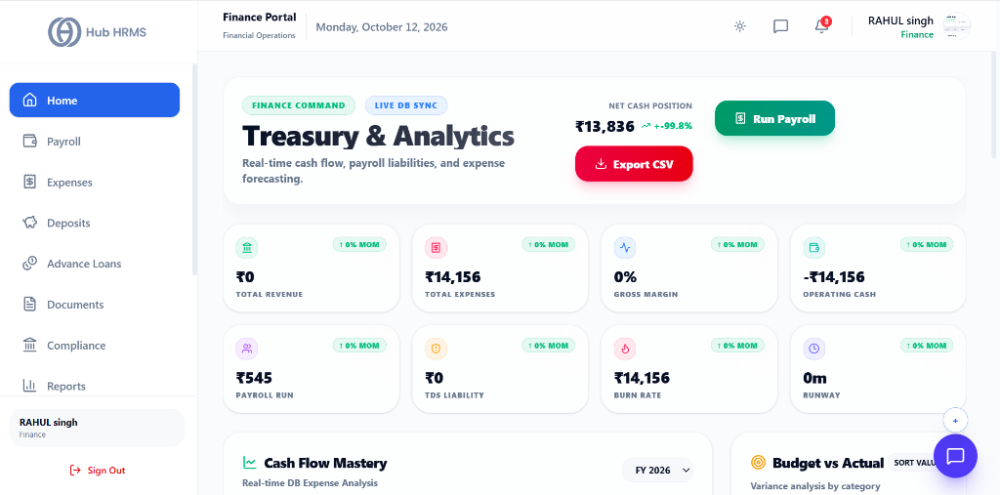
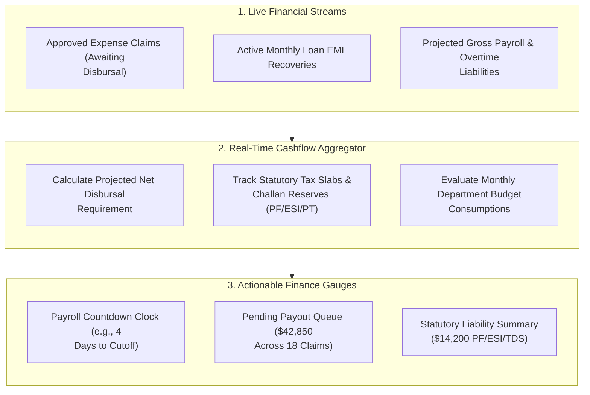

# 02. Finance Executive Dashboard (`/finance/dashboard`)

The **Finance Executive Dashboard** is the command center for corporate controllers and payroll accountants. It aggregates enterprise cash outlays, pending reimbursement queues, loan repayments, and upcoming monthly payroll liabilities into real-time operational indicators.

---

## 🏛️ Live Interface Overview

Below is the live console layout of the **Finance Executive Dashboard**:

{ width="100%" }

---

## 🧭 Financial Flow & Payroll Readiness

The flowchart below demonstrates how financial data streams flow into the executive dashboard:

---

## 📊 Core Treasury & Financial Metric Cards

As shown in the live console, eight real-time financial indicator cards summarize your corporate treasury standing:

| Financial Card | Indicator Displayed | Operational Meaning & Usage |
| :--- | :---: | :--- |
| **1. Total Revenue** | `₹0 (↑ 0% MoM)` | Cumulative company earnings recorded for the active accounting cycle. |
| **2. Total Expenses** | `₹14,156 (↑ 0% MoM)` | Aggregated outflow encompassing payroll disbursements, office bills, and approved reimbursements. |
| **3. Gross Margin** | `0% (↑ 0% MoM)` | Real-time profitability percentage comparing total revenue against direct operating costs. |
| **4. Operating Cash** | `-₹14,156 (↑ 0% MoM)` | Liquid operating cash reserves available for day-to-day corporate obligations. |
| **5. Payroll Run** | `₹545 (↑ 0% MoM)` | Current pay-cycle net salary obligations queued for upcoming bank disbursement. |
| **6. TDS Liability** | `₹0 (↑ 0% MoM)` | Statutory tax withheld under Section 192, tracked for upcoming government remittance. |
| **7. Burn Rate** | `₹14,156 (↑ 0% MoM)` | Monthly capital consumption rate, tracking speed of organizational fund spend. |
| **8. Runway** | `0m (↑ 0% MoM)` | Months of operational runway remaining based on current cash reserves and burn velocity. |

---

## ⚡ Treasury Actions & Real-Time Analytics

### 1. 💵 Run Payroll Shortcut
Directly in the top header, the **Run Payroll** green button allows finance officers to launch the active salary processing cycle immediately without navigating through submenus.

### 2. 📥 Export CSV Reports
Click **Export CSV** to instantly download real-time cash flow statements, pending liabilities, and expense forecast ledgers formatted for external accounting software.

### 3. 📈 Cash Flow Mastery & Budget vs Actual
* **Cash Flow Mastery**: Interactive chronological expense charts analyzing live database records across the fiscal year (`FY 2026`).
* **Budget vs Actual**: Visual category-by-category variance analysis comparing approved department budget ceilings against actual spend.

---

## 💡 Best Practices

> [!TIP]
> **Daily Dashboard Review:** Review the *Expense Reimbursement Funnel* daily so employee travel and business receipts are cleared within 48 hours rather than bottlenecking at month-end.
