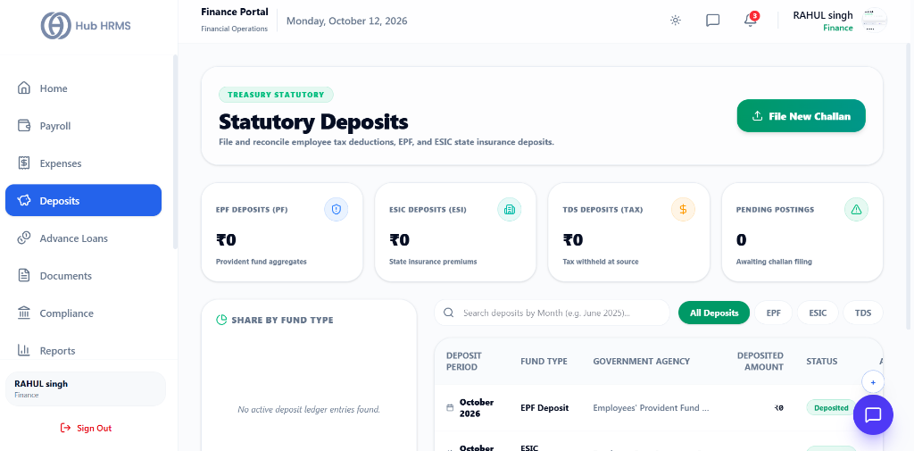
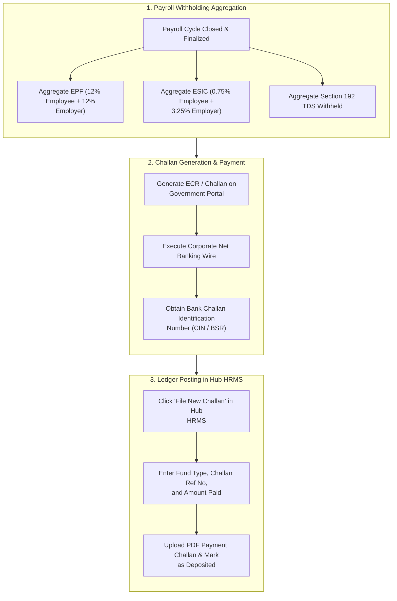

# 05. Statutory Deposits & Challan Filings (`/finance/deposits`)

The **Statutory Deposits** module provides Finance Officers with a dedicated reconciliation and filing hub for mandatory government dues. It calculates corporate and employee withholding totals for **Employees' Provident Fund (EPF)**, **Employee State Insurance (ESIC)**, and **Tax Deducted at Source (TDS)**, providing seamless challan uploads and compliance record-keeping.

---

## 🏛️ Live Interface Overview

Below is the live console layout of the **Finance Statutory Deposits** dashboard:

---

## 🧭 Statutory Deposit Reconciliation & Filing Workflow

The diagram below illustrates the end-to-end statutory deposit workflow from monthly payroll calculation to government challan posting:

---

## 📊 Summary KPI Indicators & Navigation Tabs

At the top of the `/finance/deposits` dashboard, four live metric cards and filter tabs display current statutory compliance obligations:

| KPI Indicator | Description | Live Metric Status |
| :--- | :--- | :--- |
| **EPF Deposits (PF)** | Total Employees' Provident Fund contributions due for the period. | Displays aggregate provident fund liabilities (e.g., `₹0`). |
| **ESIC Deposits (ESI)** | Total Employee State Insurance contributions calculated from gross salaries $\le \text{₹}21,000$. | Displays state insurance premium liabilities (e.g., `₹0`). |
| **TDS Deposits (Tax)** | Total income tax withheld from employee salaries under Section 192. | Displays tax withheld at source awaiting deposit (e.g., `₹0`). |
| **Pending Postings** | Count of statutory liabilities awaiting challan upload and bank reconciliation. | Real-time pending count badge (e.g., `0 Awaiting challan filing`). |

### 🗂️ Category Filters & Actions
* **All Deposits**: Consolidated ledger showing EPF, ESIC, and TDS payment records.
* **EPF Filter**: Isolates provident fund payments and Electronic Challan cum Return (ECR) files.
* **ESIC Filter**: Displays Employee State Insurance challan receipts and payment dates.
* **TDS Filter**: Tracks monthly tax withholding deposits and BSR challan references.
* **File New Challan**: Instant modal dialog to record a government remittance and upload the PDF challan.

---

## 🛠️ Step-by-Step Guide: How to File a New Statutory Challan

### 1. Opening the Filing Dialog
1. Navigate to `/finance/deposits`.
2. Click the green **File New Challan** button in the top right corner.

---

### 2. Entering Remittance Details
1. **Deposit Month / Period**: Select the billing month (e.g., *October 2026*).
2. **Fund Type**: Choose from the dropdown:
   * `EPF Deposit` (Employees' Provident Fund Organization)
   * `ESIC Deposit` (Employees' State Insurance Corporation)
   * `TDS Deposit` (Income Tax Department)
3. **Deposited Amount**: Enter the exact amount transferred to the government bank account.
4. **Reference / Challan Number**: Enter the Challan Identification Number (CIN), Challan Reference Number (CRN), or BSR Code provided by the bank.
5. **Attach Challan Document**: Drag and drop the official bank payment receipt or signed challan PDF.
6. Click **Confirm & Submit**. The status instantly updates to `Deposited`.

---

## 💡 Best Practices for Finance Officers

> [!TIP] **Statutory Due Dates**  
> * **EPF & ESIC**: Must be remitted on or before the **15th of the following month**.  
> * **TDS Withholding**: Must be deposited on or before the **7th of the following month**. Always upload the paid challan to ensure seamless quarterly Form 24Q filing.

> [!IMPORTANT] **Audit Vault Integration**  
> Every uploaded challan document is automatically mirrored in the **Document Hub (`/finance/documents`)** under the *PF Documents* or *Tax Documents* folders for year-end statutory audit readiness.

---

## ❓ Frequently Asked Questions (FAQ)

??? question "Where do the pending deposit figures come from?"
    The deposit metrics are calculated automatically from the finalized monthly payroll run in `/finance/payroll`, summing employee deductions and mandatory employer contributions.

??? question "Can I download historical challan receipts for audits?"
    Yes. Every record in the deposits ledger includes a one-click download icon to retrieve the original bank-stamped challan PDF at any time.
