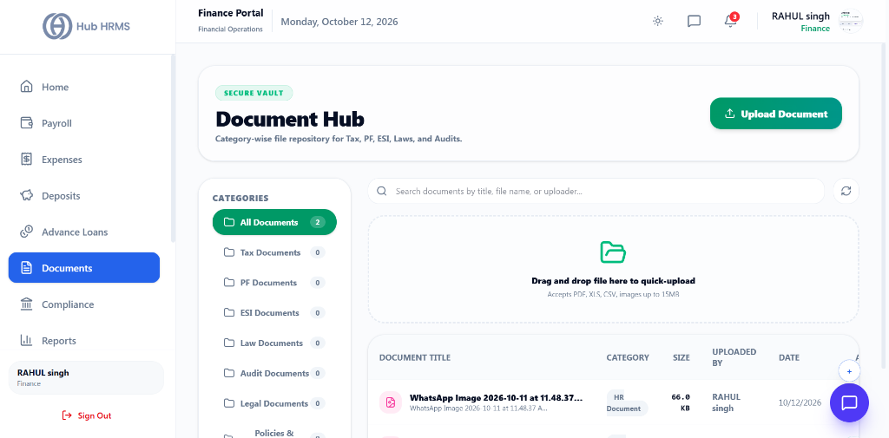
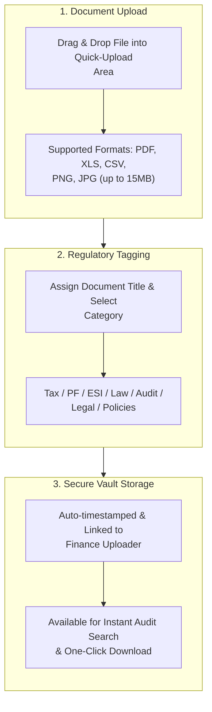

# 07. Document Hub & Regulatory Filing Vault (`/finance/documents`)

The **Document Hub** serves as a secure, category-wise cloud repository for corporate finance, regulatory filings, and tax records. It allows Finance Officers to quick-upload scanned challans, annual tax declarations, audit reports, and legal documentation with immediate category tagging and audit retrieval.

---

## 🏛️ Live Interface Overview

Below is the live console layout of the **Finance Document Hub**:

---

## 🧭 Document Ingestion & Compliance Archival Flow

The diagram below illustrates how fiscal records and statutory certificates are uploaded, tagged, and archived:

---

## 🗂️ Document Categories & Directory Structure

The left sidebar categorizes all financial and compliance assets into dedicated folders:

| Folder Category | Description | Primary Document Types |
| :--- | :--- | :--- |
| **All Documents** | Master repository displaying all uploaded corporate records. | Consolidated views, search across all tags. |
| **Tax Documents** | Income tax withholding, TDS certificates, and advance tax receipts. | Form 16, Form 24Q, Section 192 challans, BSR receipts. |
| **PF Documents** | Provident Fund filings and employee pension records. | Monthly ECR payment receipts, EPFO challans. |
| **ESI Documents** | State insurance premium filings and health benefit records. | ESIC payment challans, monthly contribution sheets. |
| **Law Documents** | Statutory labor laws, wage acts, and local state compliance orders. | Minimum Wages compliance orders, Shop & Establishment acts. |
| **Audit Documents** | Internal and external financial audit workpapers. | Chartered Accountant audit reports, balance sheet certifications. |
| **Legal Documents** | Corporate contracts, director resolutions, and legal agreements. | Service contracts, non-disclosure agreements, board resolutions. |
| **Policies & Compliance**| Internal corporate fiscal and HR policies. | Travel expense limits, reimbursement guidelines, loan eligibility rules. |

---

## 🛠️ Step-by-Step Guide: How to Upload & Manage Documents

### 1. Quick Drag-and-Drop Upload
1. Navigate to `/finance/documents`.
2. Drag and drop any file directly onto the **"Drag and drop file here to quick-upload"** canvas.
3. The upload drawer opens automatically with the file pre-attached.

---

### 2. Manual Upload Dialog
1. Click the green **+ Upload Document** button in the top right corner.
2. Enter the **Document Title** (e.g., *October 2026 EPF ECR Challan*).
3. Select the appropriate **Category** from the dropdown (e.g., `PF Documents`).
4. Select the file from your computer if not already attached.
5. Click **Confirm Upload**. The file is encrypted, uploaded to secure cloud storage, and displayed in the table.

---

### 3. Searching and Downloading Documents
* Use the top search bar: `Search documents by title, file name, or uploader...`.
* Click any document row to view details, size, and upload date.
* Click the download icon to immediately save a local copy for auditors or regulatory submissions.

---

## 💡 Best Practices for Finance Officers

> [!TIP] **Consistent File Naming**  
> Adopt a structured naming convention such as `[Category]_[Period]_[Description].pdf` (e.g., `EPF_2026-10_Challan_Receipt.pdf`) to accelerate year-end statutory audits.

> [!IMPORTANT] **Cross-Module Sync**  
> Statutory challans uploaded in the **Deposits (`/finance/deposits`)** tab automatically appear in this Document Hub under their respective folders.

---

## ❓ Frequently Asked Questions (FAQ)

??? question "What is the maximum file size allowed?"
    The Document Hub accepts PDF, XLS, XLSX, CSV, and image files up to **15MB** each.

??? question "Can other roles view these finance documents?"
    No. Documents stored in `/finance/documents` are strictly secured with role-based access control, visible only to Finance Officers and Master Administrators.
