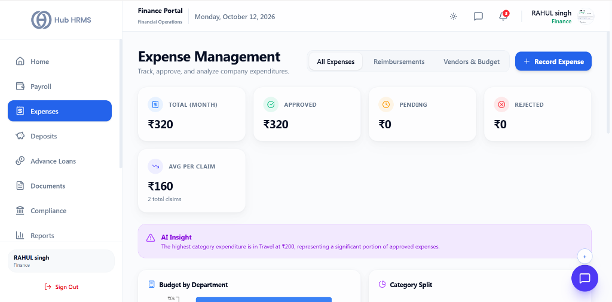
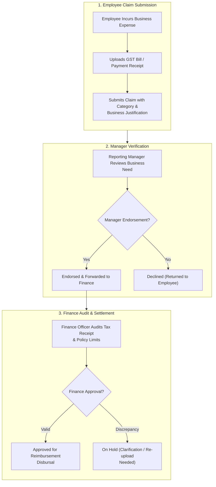

# 04. Expense Claims & Reimbursements (`/finance/expenses`)

The **Expense Claims & Reimbursements** module provides Finance Officers with a robust verification console to manage corporate spending. Employees submit out-of-pocket travel, client entertainment, and equipment purchase claims, which flow through multi-tier managerial endorsements before final audit and payout approval by Finance.

---

## 🏛️ Live Interface Overview

Below is the live console layout of the **Finance Expense Reimbursement Console**:

---

## 🧭 Expense Reimbursement Pipeline Workflow

The diagram below illustrates the end-to-end journey of an employee expense claim:

## 📊 Summary KPI Indicators & Navigation Tabs

At the top of the `/finance/expenses` dashboard, five real-time metric cards and navigation filter tabs give immediate visibility into corporate expenditure:

| KPI Indicator | Description | Live Metric Status |
| :--- | :--- | :--- |
| **Total (Month)** | Aggregate company expenditure recorded in the active month. | Real-time aggregate (e.g., `₹320`). |
| **Approved** | Total verified and approved expense claims. | Highlighted in green (e.g., `₹320`). |
| **Pending** | Expense claims waiting for managerial or finance review. | Real-time pending volume (e.g., `₹0`). |
| **Rejected** | Claims declined due to policy violations or missing proof. | Highlighted in red (e.g., `₹0`). |
| **Avg Per Claim** | Average value calculated across total expense claims. | Real-time claim distribution metric (e.g., `₹160 across 2 total claims`). |

### 🗂️ View Navigation Tabs
* **All Expenses**: Consolidated master ledger showing all company expenditures.
* **Reimbursements**: Dedicated queue for employee out-of-pocket claims awaiting disbursement.
* **Vendors & Budget**: Department-level expense allocations and vendor billing breakdown.
* **+ Record Expense**: One-click modal to manually log direct company expenses with receipt uploads.

> [!NOTE] **AI Spending Insights & Breakdown Charts**  
> An automated analysis banner identifies key spending trends (e.g., *"The highest category expenditure is in Travel at ₹200, representing a significant portion of approved expenses"*). Visual charts below provide real-time **Budget by Department** and **Category Split** breakdowns.

---

| Expense Category | Eligible Items | Maximum Policy Cap (Per Day) | Mandatory Attachment |
| :--- | :--- | :---: | :--- |
| **✈️ Business Travel** | Airfare, train tickets, inter-city cabs, tolls. | As per grade entitlement | Official ticket & boarding pass |
| **🏨 Lodging & Hotel** | Hotel room rent, official guesthouse stay. | $\text{₹}3,500 - \text{₹}8,000$ (Per Tier City) | Itemized hotel GST tax invoice |
| **🍽️ Meals & Daily Food**| Meals during official travel or client dinners. | $\text{₹}800 - \text{₹}1,500$ per day | Restaurant bill with merchant GSTIN |
| **💻 IT Hardware & Tools**| Cables, mice, software tools, cloud credits. | Pre-approved limit | Vendor tax invoice |
| **🚕 Local Commute** | Uber, Ola, metro tokens for client meetings. | Actuals | Digital ride receipt |

---

## 🛠️ Step-by-Step Guide: How to Audit & Settle Claims

### 1. Filtering Pending Expense Claims
1. Navigate to `/finance/expenses`.
2. The default view shows all claims with status **`PENDING FINANCE AUDIT`**.
3. Use the search bar to locate claims by **Employee Name**, **Department**, or **Expense Category**.

---

### 2. Inspecting Receipts and Invoices
Click on any claim row to open the **Expense Audit Drawer**:
1. **Merchant Name & Date**: Verifies that the expense occurred during an authorized travel period.
2. **Amount Claimed vs. Policy Cap**: The system automatically flags claims that exceed daily tier allowances.
3. **Attached Receipt Preview**: View the scanned receipt or PDF invoice inline. Verify that:
   * The receipt is legible and unaltered.
   * Company GSTIN is printed (if claiming input tax credit).
   * Dates match the submitted claim timeline.

---

### 3. Approving, Rejecting, or Partial Settlement
* **To Approve Full Claim**:
  * Click the green **Approve & Queue for Payment** button.
  * The claim status updates to `APPROVED`.
  * The amount is queued for the next weekly reimbursement payment run or monthly salary credit.
* **To Settle Partially (e.g., Alcohol excluded from dinner bill)**:
  * Click **Adjust Approved Amount**.
  * Enter the revised payable figure and add an explanation note (e.g., *"₹450 non-reimbursable beverages deducted per policy"*).
  * Click **Approve Adjusted Amount**.
* **To Reject Claim**:
  * Click the red **Reject Claim** button.
  * Input a mandatory policy explanation note for the employee.

---

## 💡 Best Practices for Finance Officers

!!! tip "GST Input Tax Credit (ITC)"
    For high-value hotel and flight invoices ($> \text{₹}5,000$), ensure the vendor has billed against your company's registered GSTIN to allow your organization to claim input tax credits during GST return filings.

!!! warning "Receipt Submission Timeframe"
    Corporate policy enforces that all travel and out-of-pocket claims must be submitted within 30 days of the travel date. Older claims require special approval from the Finance Director.

---

## ❓ Frequently Asked Questions (FAQ)

??? question "How do employees receive reimbursed funds?"
    Reimbursements can be settled via separate mid-month direct bank transfers or merged directly into the employee's monthly payslip as non-taxable reimbursements.

??? question "Can an employee resubmit a rejected claim?"
    Yes. If a claim was rejected due to an unreadable receipt photo, the employee can upload a clearer scan and resubmit for reconsideration.
