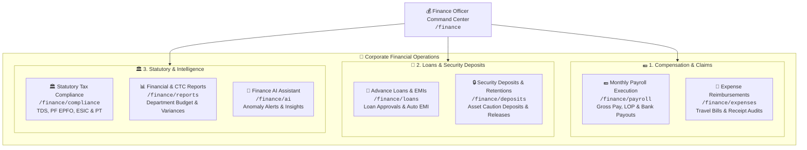
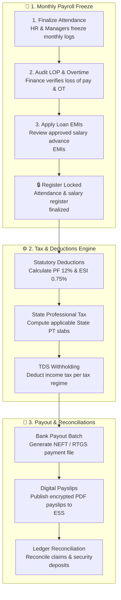

# 💰 Finance & Accounts Comprehensive Guide

The **Finance & Accounts** portal (`/finance/*`) in Hub HRMS provides accountants, controllers, and finance executives with a centralized operational command center. Designed for precision and compliance, it automates company-wide payroll execution, expense reimbursement pipelines, employee advance loans, security deposit ledgers, and statutory tax reconciliations.

---

## 🏛️ Live Interface Overview

Below is the live console layout of the **Finance & Accounts Workspace**:

{ width="100%" }

---

## 🎯 Role Purpose & Operational Scope

While HR handles employee lifecycle events and Managers track daily shift delivery, the Finance Officer manages financial liquidity, statutory tax withholdings, and employee compensation:

---

## 🧭 Functional Workflow: End-to-End Financial Processing

The diagram below details the operational journey of monthly finance operations in Hub HRMS:

---

## 🧭 Finance Portal Navigation Sitemap

The Finance navigation sidebar features 12 dedicated functional modules:

| # | Chapter | Route | Primary Responsibilities |
|---|---|---|---|
| **01** | [Overview](index.md) | `/finance/` | Role introduction, financial scope, and navigation sitemap. |
| **02** | [Finance Dashboard](dashboard.md) | `/finance/dashboard` | Cashflow telemetry, pending expense queues, upcoming payroll countdowns, and quick stats. |
| **03** | [Payroll Processing](payroll.md) | `/finance/payroll` | Monthly payroll batch processing, statutory calculations, and bank payout files. |
| **04** | [Expense Claims](expenses.md) | `/finance/expenses` | Employee reimbursement pipelines, receipt verification, and payment approvals. |
| **05** | [Security Deposits](deposits.md) | `/finance/deposits` | Asset deposits, contractor retention ledgers, and refund releases. |
| **06** | [Advance Loans](loans.md) | `/finance/loans` | Salary advance applications, loan tenures, and automated monthly payroll deductions. |
| **07** | [Tax & Compliance](compliance.md) | `/finance/compliance` | TDS challan reconciliations, PF EPFO monthly returns, and ESIC filing audit. |
| **08** | [Financial Reports](reports.md) | `/finance/reports` | Company-wide salary expenditures, department cost center budgets, and annual cashflow statements. |
| **09** | [Finance AI](ai.md) | `/finance/ai` | AI anomaly detection, duplicate expense alerts, and budget projection models. |
| **10** | [Messages](messages.md) | `/finance/messages` | Internal inquiries with employees and management regarding salary and expense claims. |
| **11** | [Help & Support](support.md) | `/finance/support` | IT assistance and internal banking coordination ticketing. |
| **12** | [Profile & Security](profile.md) | `/finance/profile` | Finance Officer credentials, security passwords, and Two-Factor Authentication (2FA). |

---

## 🚀 Recommended Monthly Financial Calendar

1. **Days 1 to 20**: Process active **Expense Claims** (`/finance/expenses`) and review new **Loan Applications** (`/finance/loans`).
2. **Day 24 (Payroll Freeze)**: Lock monthly attendance records and finalize overtime / unpaid absence logs.
3. **Day 25 to 28 (Payroll Run)**: Execute the **Monthly Payroll Batch** (`/finance/payroll`), audit statutory tax deductions, and download the bank payout file.
4. **Day 30 / 1st**: Release encrypted PDF payslips to the Employee Portal and disburse salaries.
5. **Day 7 of Next Month**: Deposit statutory TDS with the tax department and file monthly PF/ESI returns.

---

## ❓ Frequently Asked Questions (FAQ)

??? question "Can employees see finance ledgers and company bank details?"
    No. The Finance & Accounts portal is strictly restricted to designated finance officers and company admins. Employees only have access to their personal payslips in ESS.

??? question "Can I rollback a payroll run if an error is discovered?"
    Yes. Before the bank disbursement file is marked as processed, a payroll run can be rolled back to recalculate specific employee records.
