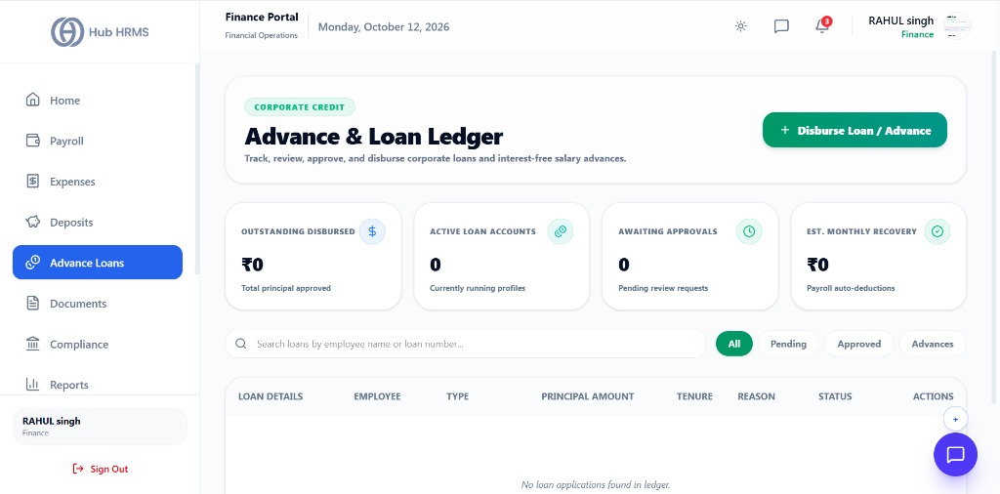
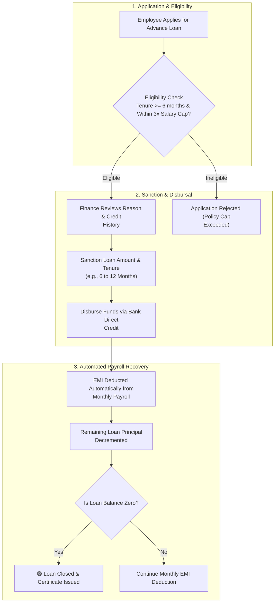

# 06. Advance Loans & EMI Ledgers (`/finance/loans`)

The **Advance Loans & EMI Ledgers** module allows Finance Officers to manage company-sponsored salary advances, personal emergency loans, and asset financing programs. It automates tenure schedules, calculates monthly Equated Monthly Installments (EMIs), and syncs deductions directly into the monthly payroll run to eliminate manual recovery tracking.

---

## 🏛️ Live Interface Overview

Below is the live console layout of the **Finance Loans & Advance Ledgers** dashboard:

---

## 📊 Summary KPI Indicators & Navigation Tabs

At the top of the `/finance/loans` dashboard, four live metric cards and filter tabs display the current corporate credit and advance loan status:

| KPI Indicator | Description | Live Metric Status |
| :--- | :--- | :--- |
| **Outstanding Disbursed** | Total sanctioned principal currently active and unpaid. | Real-time aggregate principal approved (e.g., `₹0 Total principal approved`). |
| **Active Loan Accounts** | Count of employees currently repaying advance loans or salary credit. | Count of currently running loan profiles (e.g., `0 Currently running profiles`). |
| **Awaiting Approvals** | Count of loan and advance applications submitted by employees awaiting review. | Queue count (e.g., `0 Pending review requests`). |
| **Est. Monthly Recovery** | Expected total recovery to be auto-deducted from the upcoming monthly payroll. | Estimated auto-deduction liability (e.g., `₹0 Payroll auto-deductions`). |

### 🗂️ Category Filters & Actions
* **All**: Master list of all loan profiles across every status.
* **Pending**: Applications submitted by employees requiring finance review.
* **Approved**: Sanctioned loans currently active with monthly payroll deductions.
* **Advances**: Filter exclusively for short-term salary advances.
* **+ Disburse Loan / Advance**: One-click action button to sanction and record a new corporate loan or interest-free advance.

---

## 🧭 Advance Loan Lifecycle & Recovery Flow

The diagram below outlines how employee loan applications are sanctioned, disbursed, and automatically recovered:

---

## 🧭 Corporate Loan Categories & Terms

Hub HRMS supports flexible loan policies configured by company administration:

| Loan Category | Maximum Sanction Limit | Maximum Tenure | Interest Rate | Typical Use Case |
| :--- | :---: | :---: | :---: | :--- |
| **💵 Salary Advance** | $1\times\text{ Monthly Gross Salary}$ | $1 - 3\text{ Months}$ | $0\%$ (Interest-free) | Urgent month-end liquidity needs. |
| **🏥 Medical Emergency Loan** | Up to $\text{₹}2,00,000$ | $6 - 12\text{ Months}$ | $0\%$ (Emergency perk) | Hospitalization expenses for employee or family. |
| **💻 Tech Equipment Financing**| Up to $\text{₹}1,00,000$ | $12\text{ Months}$ | $0\%$ | Personal work laptop or home workstation upgrades. |
| **🏠 Relocation Assistance** | Up to $\text{₹}75,000$ | $6\text{ Months}$ | $0\%$ | Rental deposits when transferring to a new city branch. |

---

## 🛠️ Step-by-Step Guide: How to Sanction & Manage Loans

### 1. Reviewing Pending Loan Requests
1. Navigate to `/finance/loans`.
2. Inspect the **Pending Sanctions** queue.
3. Click on any application row to view the employee dossier:
   * **Employee Name, Tenure & CTC**: Verifies service length and monthly repayment capacity.
   * **Requested Amount & Purpose**: Medical, relocation, or personal liquidity.
   * **Existing Debt Obligations**: Verifies whether the employee has any existing uncleared advances.

---

### 2. Sanctioning and Structuring the Repayment Schedule
1. In the loan review drawer, verify or adjust the **Approved Principal Amount**.
2. Select the **Repayment Tenure** (e.g., `6 Months`).
3. Set the **First EMI Start Month** (typically the upcoming payroll cycle).
4. The system automatically computes:
   $$\text{Monthly EMI Deduction} = \frac{\text{Sanctioned Principal}}{\text{Tenure Months}}$$
5. Click **Sanction & Disburse**. The bank disbursal transaction is initiated and the EMI deduction is linked to future payroll cycles.

---

### 3. Monitoring the Amortization Ledger
* Switch to the **Active Loan Ledgers** tab to see real-time recovery status across all employees.
* Each ledger shows:
  * **Original Principal Amount**
  * **Total Recovered to Date**
  * **Outstanding Balance**
  * **Completed Installments vs. Remaining Installments** (e.g., *4 of 6 Paid*)

---

### 4. Foreclosure & Early Prepayment
If an employee wishes to settle their remaining balance in a single lump sum (e.g., from an annual performance bonus or personal funds):
1. Locate the employee's active loan and click **Foreclose Loan**.
2. Select the settlement mode:
   * **Deduct Remaining Balance from Next Payslip**
   * **Direct Bank Transfer / Cheque Deposit**
3. Click **Confirm Early Closure**. The ledger marks the loan as `SETTLED` and halts future monthly payroll deductions.

---

## 💡 Best Practices for Finance Officers

!!! tip "Total Debt Recovery Cap"
    Ensure that the employee's total monthly loan EMI deductions do not exceed **40% of their net take-home salary** to ensure adequate living income.

!!! warning "Employee Separation & Recovery"
    If an employee resigns while an active advance loan is outstanding, the system automatically pulls the remaining unpaid principal into their **Full & Final Settlement (FnF)** statement for recovery from gratuity or leave encashment.

---

## ❓ Frequently Asked Questions (FAQ)

??? question "Can an employee have two loans active simultaneously?"
    By default, corporate policy permits only one active advance loan at a time. A second loan requires special executive waiver from the Finance Director.

??? question "Are salary advances taxable?"
    Interest-free salary advances repaid within 90 days are generally treated as non-taxable employer advances under standard tax guidelines.
