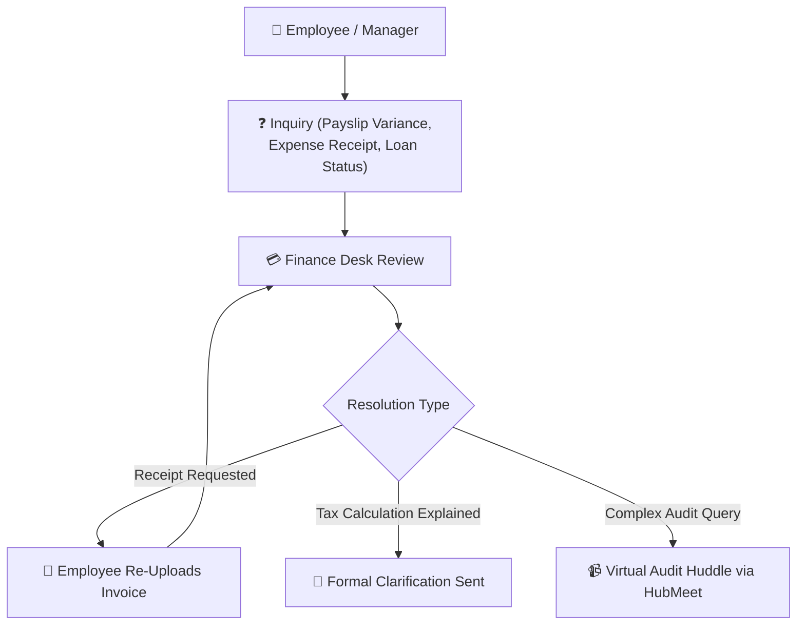

# 10. Finance Communications & Inquiries (`/finance/messages`)

The **Finance Communications & Inquiries** module provides a dedicated channel for finance controllers to communicate directly with employees and department managers regarding salary inquiries, expense receipts, tax declarations, and loan terms.

---

## 🧭 Finance Communication & Inquiry Flow

The diagram below illustrates how fiscal inquiries are received, addressed, and resolved:

---

## 📢 Dedicated Communication Threads

* **Expense Clarifications:** Directly linked to specific submitted reimbursement claims so employees understand why an invoice requires additional details.
* **Salary Discrepancy Inquiries:** Private one-on-one threads discussing loss-of-pay deductions or overtime calculations.
* **Tax Investment Declarations:** Clarifications regarding Form 16, HRA rent receipts, and 80C investment proofs.
* **HubMeet Financial Reviews:** One-click encrypted video calls with executive management for quarterly budget audits.

---

## 💡 Best Practices

> [!TIP]
> **Link Receipts in Chat:** When requesting updated receipts, reference the specific expense claim number so the employee can attach the corrected invoice directly to the message thread.
