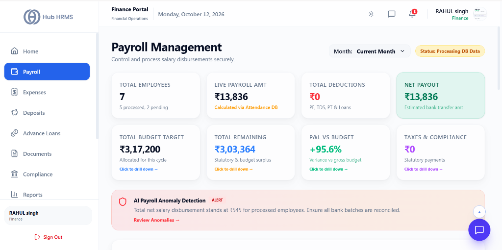
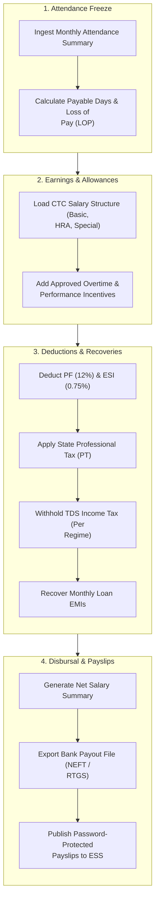

# 03. Company Payroll Processing (`/finance/payroll`)

The **Payroll Processing** module is the central engine for corporate salary management in Hub HRMS. Designed to eliminate manual spreadsheet math, it automatically ingests employee attendance logs, deducts unpaid absences, computes statutory taxes (PF, ESI, PT, TDS), factors in loan EMIs, and generates verified bank disbursal files.

---

## 🏛️ Live Interface Overview

Below is the live console layout of the **Finance Payroll Management** dashboard:

---

## 🧭 Monthly Payroll Execution Flow

The diagram below outlines the five-step process followed by finance officers each billing cycle:

---

## 📊 Summary KPI Indicators

At the top of the `/finance/payroll` dashboard, eight live metric cards provide an immediate payroll health check:

| KPI Indicator | Description | Status & Details |
| :--- | :--- | :--- |
| **Total Employees** | Total headcount in the current payroll cycle. | Shows processed vs pending headcount breakdown (e.g., *7 total: 5 processed, 2 pending*). |
| **Live Payroll Amt** | Cumulative gross earnings computed dynamically from attendance. | Calculated automatically via live Attendance DB sync. |
| **Total Deductions** | Aggregate deductions across the company. | Includes PF, TDS, PT, and Loan EMI recoveries. |
| **Net Payout** | Total estimated funds to be disbursed to employees. | Highlighting net bank transfer amount required for payout. |
| **Total Budget Target** | Allocated payroll budget for the current cycle. | Benchmarked against department limits with drill-down views. |
| **Total Remaining** | Statutory and budget surplus remaining for this period. | Real-time surplus available before reaching budget cap. |
| **P&L vs Budget** | Percentage variance comparing actual payroll expenditure vs budgeted allowance. | Expressed as positive/favorable variance (e.g., `+95.6%`). |
| **Taxes & Compliance** | Statutory remittance obligations accrued this cycle. | Tracking pending challans and government withholdings. |

> [!NOTE] **AI Payroll Anomaly Detection**  
> An automated monitoring alert bar scans all processed employee disbursements to catch discrepancies, unexpected spikes, or missing bank details before payout execution.
---

## 🛠️ Step-by-Step Guide: How to Execute a Monthly Payroll Run

### 1. Selecting the Payroll Cycle
1. Navigate to `/finance/payroll`.
2. Select the **Billing Month & Year** (e.g., *October 2026*).
3. Select the target **Branch** (or select *All Branches* for consolidated company payroll).
4. Click **Initialize Payroll Batch**.

---

### 2. Auditing Attendance & Deductions
The payroll register table loads all eligible employees:
* Review **Payable Days**, **LOP Days**, and **Overtime Hours**.
* Verify statutory deductions:
  * **Provident Fund (PF)**: 12% of Basic Salary.
  * **ESIC**: 0.75% of Gross Salary (applicable for salaries $\le \text{₹}21,000/\text{month}$).
  * **Professional Tax (PT)**: Computed per branch state slabs.
  * **TDS Withholding**: Based on employee tax declarations and selected tax regime.
* If a special bonus or deduction is required, click the **Adjust (Pencil)** icon next to the employee name to add one-time incentives or deductions.

---

### 3. Locking and Approving the Payroll Run
1. Verify the total net payout figure against company financial accounts.
2. Click the green **Approve & Lock Payroll** button.
3. The payroll batch is locked against further edits to preserve audit compliance.

---

### 4. Downloading the Bank Payout File
1. Click the **Export Bank File** button on the top toolbar.
2. Select your banking partner format:
   * **HDFC Bank CMS Format (.txt / .csv)**
   * **ICICI Bank E-Collections Format (.xlsx)**
   * **Standard RBI NEFT/RTGS Batch Format (.csv)**
3. The exported file contains encrypted account numbers, IFSC codes, employee names, and net payable amounts ready for direct corporate banking portal upload.

---

### 5. Publishing Payslips
Click **Publish Payslips**. Encrypted PDF payslips become instantly available to employees in their `/employee/salary` portal.

---

## 💡 Best Practices for Finance Officers

!!! tip "Bank Account Validation"
    Always check the *Invalid Bank Details* warning filter before locking payroll. Employees with unverified bank accounts or missing IFSC codes are highlighted in yellow.

!!! warning "Statutory Remittance Deadlines"
    Remember to deposit withheld PF and TDS with the relevant authorities before the 7th of the following month to avoid statutory penalties.

---

## ❓ Frequently Asked Questions (FAQ)

??? question "Can I run payroll for a single department first?"
    Yes. Use the department filter at the top of the screen to process and review payroll on a department-by-department basis.

??? question "What happens if an employee leaves mid-month?"
    Hub HRMS automatically calculates pro-rata days worked up to the employee's official last working day. Final settlement (Gratuity, Leave Encashment, Notice Period Recovery) is processed in the Settlement Tab.
