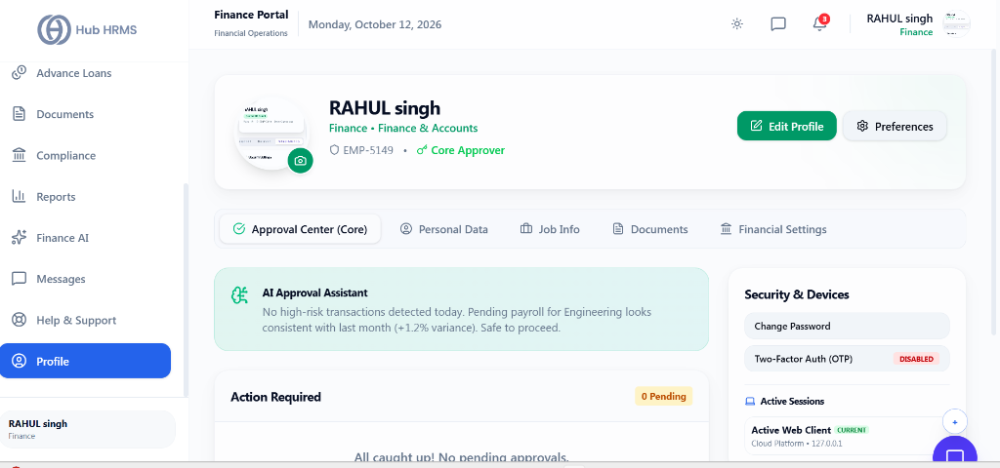
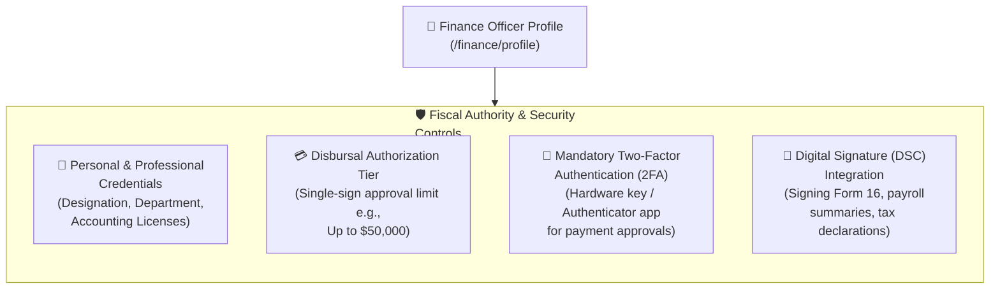

# 12. Finance Profile & Security (`/finance/profile`)

The **Finance Profile & Security** module houses personal credentials, payment release authorization limits, digital signature certificates, and heightened security controls required for handling corporate fiscal assets in Hub HRMS.

---

## 🏛️ Live Interface Overview

Below is the live console layout of the **Finance Profile & Security Console**:

---

## 🗂️ Navigation Tabs & Fiscal Security Widgets

The `/finance/profile` console provides role-based credentials and security management:

### 1. Profile Navigation Tabs
* **Approval Center (Core)**: Dedicated hub displaying active approval requests with pending counts (e.g., `0 Pending`).
* **Personal Data**: Personal profile details, employee identification (`EMP-5149`), contact details, and edit options.
* **Job Info**: Department (`Finance & Accounts`), role assignments, and core approver authorizations (`Core Approver`).
* **Documents**: Personal tax identification (PAN), compliance declarations, and certifications.
* **Financial Settings**: Configured disbursement preferences, bank linkages, and payout limits.

### 2. Intelligent Assistants & Security Controls
* **AI Approval Assistant**: Intelligent background risk scanner (e.g., *"No high-risk transactions detected today. Pending payroll for Engineering looks consistent with last month (+1.2% variance). Safe to proceed"*).
* **Security & Devices**:
  * **Change Password**: Immediate self-service credential update.
  * **Two-Factor Auth (OTP)**: Multi-factor verification security status toggle.
  * **Active Sessions**: Displays active logins with device type, IP address, and platform identifiers (`Active Web Client`).

---

## 🧭 Profile & Security Configuration Architecture

The flowchart below demonstrates the security controls managed within the finance profile:

---

## ⚙️ Key Profile Sections & Configurations

### 1. 📇 Personal Information & Accounting Credentials
* **Full Name, Official Email, and Contact Number.**
* **Professional Affiliation:** (e.g., *CPA, Chartered Accountant, or Internal Auditor ID*).

### 2. 💳 Disbursal Authorization Tier
Displays your assigned corporate payment release limits:
* **Tier 1 (Reviewer):** Authorized to verify and calculate payroll and expense claims.
* **Tier 2 (Approver):** Authorized to release bank payout files up to corporate threshold limits.
* **Dual Authorization:** Critical disbursals above corporate thresholds mandate co-signing with the CFO or Managing Director.

### 3. 🔐 Heightened Fiscal Security (2FA)
Because the finance portal oversees capital disbursals:
* **Mandatory Two-Factor Authentication:** Requires authenticator app verification upon every login and before exporting bank payment files.
* **Session Inactivity Timeout:** Automatically locks the finance portal after 10 minutes of inactivity to protect corporate data on unattended workstations.

---

## 💡 Best Practices

> [!CAUTION]
> **Never Share Floor Terminals:** Always lock your session before leaving your workstation. All disbursal file downloads are permanently tagged with your specific officer credentials.
