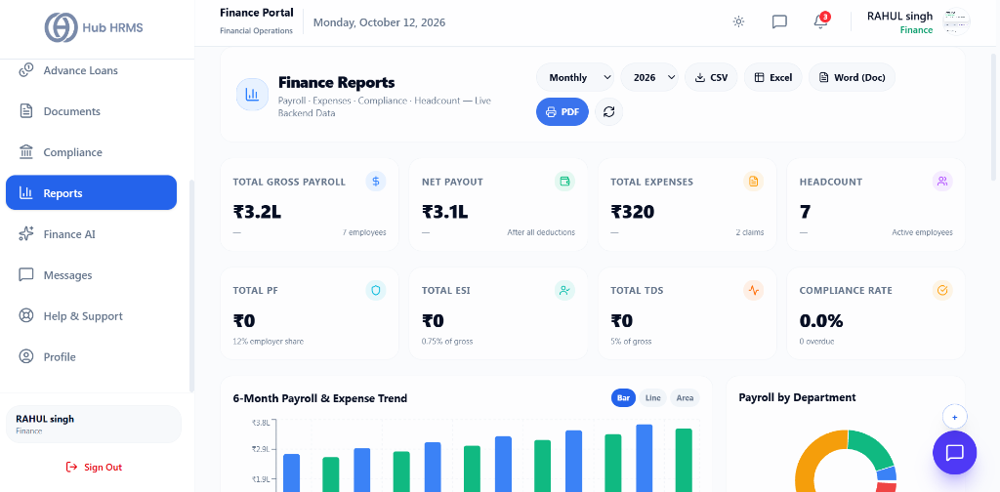
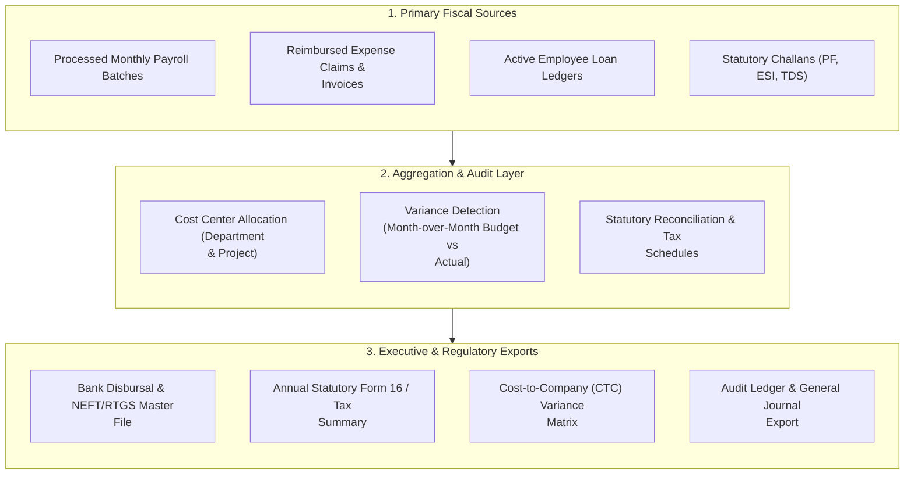

# 07. Financial Reports & Analytics (`/finance/reports`)

The **Financial Reports & Analytics** module provides corporate finance controllers, payroll officers, and executive leadership with real-time fiscal intelligence. It delivers one-click generation of payroll registers, statutory audit statements, cost-center expense allocations, and multi-quarter CTC variance reports without manual spreadsheet reconciliation.

---

## 🏛️ Live Interface Overview

Below is the layout of the **Finance Reports & Analytical Ledger** console:

---

## 📊 Summary KPI Indicators & Multi-Format Exports

At the top of the `/finance/reports` dashboard, eight live metric cards and multi-format export utilities provide an instant overview of financial operations:

| KPI Indicator | Description | Live Metric Status |
| :--- | :--- | :--- |
| **Total Gross Payroll** | Aggregate gross compensation across active workforce. | Real-time aggregate (e.g., `₹3.2L for 7 employees`). |
| **Net Payout** | Total net funds disbursed to employee accounts after deductions. | Highlighted in green (e.g., `₹3.1L After all deductions`). |
| **Total Expenses** | Total approved business reimbursements and company expenditures. | Real-time spending total (e.g., `₹320 across 2 claims`). |
| **Headcount** | Count of active employees included in current financial reports. | Total active workforce (e.g., `7 Active employees`). |
| **Total PF** | Total Employer Provident Fund share (12%) calculated. | Statutory PF obligation (e.g., `₹0 12% employer share`). |
| **Total ESI** | Total Employer State Insurance contribution (0.75%) calculated. | Statutory ESI obligation (e.g., `₹0 0.75% of gross`). |
| **Total TDS** | Total tax withheld at source from employee compensation. | Statutory TDS obligation (e.g., `₹0 5% of gross`). |
| **Compliance Rate** | Overall regulatory filing and payment timeliness score. | Percentage score with overdue tracker (e.g., `0.0% 0 overdue`). |

### 📥 One-Click Export Toolbar
* **Period Selectors**: Filter records by cycle (`Monthly`, `Quarterly`, `Annual`) and Financial Year (`2026`).
* **CSV Export**: Clean delimited raw data for custom spreadsheet calculations.
* **Excel Export**: Formatted workbook containing individual sheets for Payroll, Expenses, and Taxes.
* **Word (Doc)**: Formatted executive narrative document for quarterly stakeholder meetings.
* **PDF Report**: Publication-grade printable report with charts and executive sign-off lines.

---

## 🧭 Financial Reporting & Audit Workflow

The diagram below illustrates how fiscal records, expense logs, and salary batches flow into corporate audit statements and executive dashboards:

---

## 📊 Core Financial Report Catalogs

| Report Name | Description | Frequency | Typical Audience | Export Formats |
| :--- | :--- | :--- | :--- | :--- |
| **Monthly Payroll Register** | Itemized breakdown of gross salary, allowances, statutory deductions, LOP, and net pay for all employees. | Monthly | Payroll Team, Internal Audit | Excel, CSV, PDF |
| **Statutory Compliance Pack** | Consolidated schedule for PF (ECR format), ESI contributions, Professional Tax slabs, and TDS deductions. | Monthly / Quarterly | Tax Consultants, Govt Authorities | Excel, Text, PDF |
| **Department Expenditure** | Total personnel and operational cost segmented by department, business unit, and branch location. | Monthly / Annual | CFO, Department Heads | Excel, Interactive Chart |
| **CTC Variance Statement** | Comparison between budgeted workforce cost and actual payout, highlighting increments and new hires. | Quarterly / Annual | Executive Board, HR Director | PDF, Excel |
| **Reimbursement Summary** | Ledger of travel, food, medical, and client entertainment payouts against approved employee bills. | Bi-Weekly / Monthly | Accounts Payable | Excel, CSV |
| **Employee Loan Ledger** | Outstanding principal, recovered EMIs, accrued interest, and active repayment schedules. | Monthly / On-Demand | Finance Controller | Excel, PDF |

---

## ⚙️ How to Generate and Export Reports

### Step 1: Select Report Type & Financial Period
1. Navigate to **Finance Portal > Reports** from the sidebar menu.
2. Under **Report Catalog**, select the desired report category (e.g., *Monthly Payroll Register* or *Statutory Pack*).
3. Specify the reporting period:
   - **Preset Ranges:** *Current Month*, *Previous Month*, *Current Quarter (Q1-Q4)*, or *Full Financial Year (FY)*.
   - **Custom Range:** Select explicit *From* and *To* dates using the calendar picker.

### Step 2: Apply Department & Cost-Center Filters
1. Click **Filters & Segmentation**.
2. Narrow data by:
   - **Department:** *Engineering*, *Sales*, *Marketing*, *Operations*, etc.
   - **Employment Type:** *Full-Time*, *Contractor*, *Intern*.
   - **Branch / Location:** *Headquarters*, *Regional Offices*, or *Remote*.

### Step 3: Preview Live Analytics
1. The on-screen summary table updates instantly with:
   - **Total Net Disbursed:** Sum total of net payments for the filter criteria.
   - **Statutory Liability:** Combined PF, ESI, PT, and TDS withheld.
   - **Average Cost Per Head:** Operational personnel spend divided by head count.
2. Review drill-down entries directly in the interactive data grid.

### Step 4: Export for Audit & Accounting Systems
1. Click the **Export** button in the top-right corner.
2. Choose your preferred export destination:
   - **Formatted Excel (.xlsx):** Color-coded tabs with pre-calculated summary rows for executive review.
   - **Raw CSV (.csv):** Standard unformatted tabular data ready for ERP and accounting software ingestion.
   - **Signed PDF (.pdf):** Official company-branded statement suitable for statutory inspections.

---

## 💡 Best Practices for Finance Officers

> [!TIP]
> **Reconcile Before Final Freeze:** Always run the *Statutory Compliance Pack* alongside the *Payroll Register* before releasing bank payments to ensure tax deductions precisely match statutory rates.

> [!NOTE]
> **Audit Trail Logging:** Every generated report export is timestamped and recorded in the system audit log with the requesting officer's credentials to maintain strict fiscal compliance.
