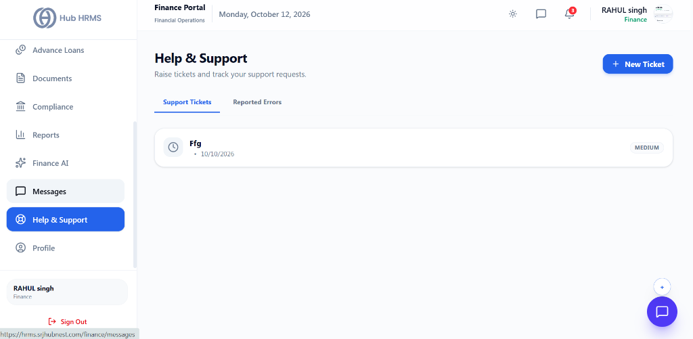
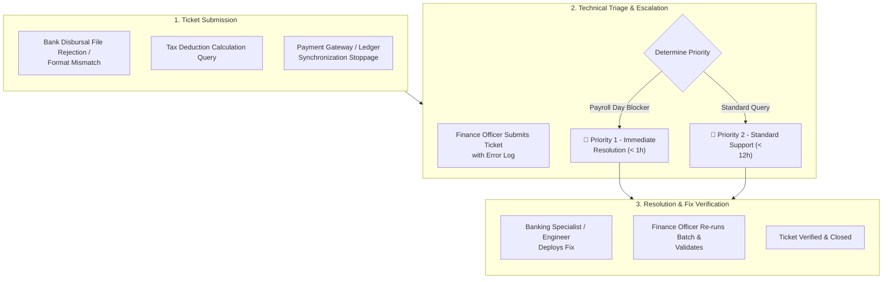

# 11. Finance Support Desk (`/finance/support`)

The **Finance Support Desk** is the specialized technical assistance portal for finance officers to report banking portal integration issues, payroll formula questions, and ERP synchronization tickets.

---

## 🏛️ Live Interface Overview

Below is the live console layout of the **Finance Support & Ticket Management** desk:

---

## 🗂️ Support Views & Ticket Actions

The `/finance/support` portal provides finance officers with focused channels to track operational issues:

* **Support Tickets Tab**: Displays all operational tickets raised by the finance team with real-time status badges (e.g., `MEDIUM`, `URGENT`), creation date, and assignee details.
* **Reported Errors Tab**: Dedicated view for technical error logs and batch processing failures.
* **+ New Ticket Button**: Quick modal trigger allowing finance officers to submit priority tickets directly to technical support with attachments and description.

---

## 🧭 Support Ticket Resolution Flow

The flowchart below demonstrates the progression of a financial technical support ticket:

---

## 🎟️ Common Finance Support Categories

* **Bank Payout File Format Mismatch:** Issues with bank-specific NEFT/RTGS batch file layouts.
* **Tax Bracket & Surcharge Updates:** Updating statutory tax percentage changes announced in national budgets.
* **Accounting Software Sync:** Troubleshooting ledger exports to QuickBooks, Tally, or SAP.

---

## 💡 Best Practices

> [!TIP]
> **Attach Bank Error Files:** When opening a ticket for rejected bank payment files, attach the encrypted response file received from the banking portal so the technical team can instantly identify the rejected column.
