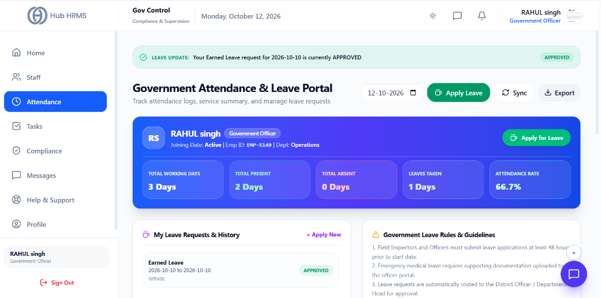
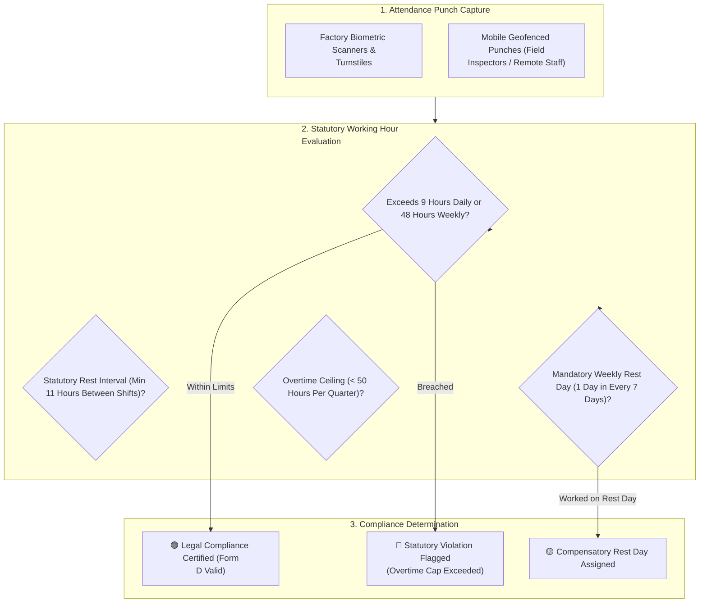
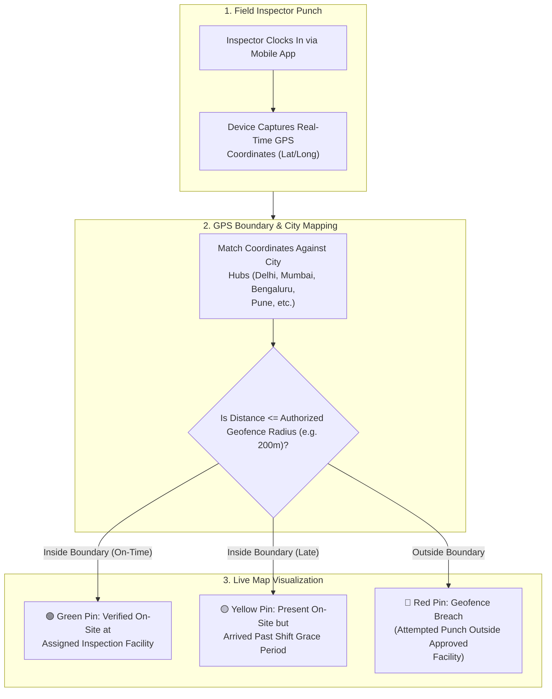

# 03. Attendance Auditing & Field Inspection Map (`/government/attendance`)

The **Statutory Attendance Auditing** module ensures that enterprise working hours, shift durations, and overtime allocations comply strictly with the Factories Act, Shops & Establishments Acts, and International Labour Organization (ILO) standards. Featuring the interactive **GovAttendanceMap**, compliance officers can track field inspection teams, inspect geofenced clock-ins, and prevent fatigue-inducing labor violations.

---

## 🏛️ Live Interface Overview

Below is the live console layout of the **Government Attendance & Leave Portal**:

---

## 📊 Officer Service Summary & Leave Status

At the top of the `/government/attendance` portal, real-time duty indicators and officer service metrics provide complete operational tracking:

### 🟢 Active Leave Banner
* Shows real-time application updates (e.g., `LEAVE UPDATE: Your Earned Leave request for 2026-10-10 is currently APPROVED`).

### 📇 Officer Service Card
* Displays Officer Name, Role (`Government Officer`), Status (`Active`), Employee ID (`EMP-5149`), and Department (`Operations`).
* **+ Apply for Leave**: Instant modal to request official casual, earned, or duty-leave.

### 📈 Monthly Attendance Metrics
| Metric Card | Description | Live Metric Status |
| :--- | :--- | :--- |
| **Total Working Days** | Number of official working days scheduled for the selected month. | Scheduled days (e.g., `3 Days`). |
| **Total Present** | Verified days present on field duty or in-office. | Present count (e.g., `2 Days`). |
| **Total Absent** | Unexcused absences recorded. | Absence count (e.g., `0 Days`). |
| **Leaves Taken** | Approved leave days consumed. | Approved leave (e.g., `1 Days`). |
| **Attendance Rate** | Cumulative attendance percentage for the active service period. | Percentage score (e.g., `66.7%`). |

---

## 🧭 Statutory Attendance & Working Hour Audit Flow

The diagram below illustrates how raw clock-ins are audited against statutory ceilings and rest day mandates:

---

## 🗺️ Live Field Inspection & Location Map (`GovAttendanceMap`)

For field compliance officers, labor inspectors, and statutory mobile audit staff, the **GovAttendanceMap** provides an interactive Leaflet-powered GPS tracking command surface:

### Key Map Capabilities:
* **Interactive Leaflet Map View**: Zoom in and pan across nationwide manufacturing plants, construction sites, and regional branch offices.
* **Color-Coded Status Markers**:
  * 🟢 **Green Marker (`PRESENT`)**: Verified within the designated facility boundary.
  * 🟡 **Yellow Marker (`LATE`)**: Clocked in inside the perimeter but after the morning grace cutoff.
  * 🔴 **Red Marker (`BREACH / OUT OF BOUNDS`)**: System detected an out-of-perimeter check-in attempt; flagged for compliance review.
* **Multi-City Support**: Pre-configured geofence coordinates for major commercial hubs including **Delhi, New Delhi, Mumbai, Bengaluru, Chennai, Hyderabad, Kolkata, Pune, Jaipur, Ahmedabad, Lucknow, and Chandigarh**.
* **Inspector Popups**: Click any pin on the map to see the inspector's full name, badge ID, exact punch timestamp, battery level, and distance from the factory gate.

---

## ⚖️ Statutory Working Hour Ceilings

| Compliance Parameter | Legal Ceiling / Standard | Violation Consequence | System Enforcement Rule |
| :--- | :--- | :--- | :--- |
| **Daily Work Limit** | Maximum **9 hours / day** (including spread-over) | Labor notice / Safety hazard | System flags overtime beyond 8th hour; requires supervisor sign-off. |
| **Weekly Work Limit** | Maximum **48 hours / week** | Statutory fine | Restricts scheduling past 48 hours without executive authorization. |
| **Quarterly Overtime Cap** | Maximum **50 hours / quarter** | Severe non-compliance | Hard block on scheduling additional OT shifts once cap is reached. |
| **Overtime Wage Rate** | **2x Normal Hourly Wage (Double Rate)** | Wage code violation | Automatically computes 200% base hourly rate in payroll register. |
| **Mandatory Weekly Rest** | **1 full rest day every 7 days** | Factory Act violation | Flags any worker scheduled for 7 consecutive days without a day off. |

---

## ⚙️ How to Conduct a Statutory Attendance Audit

### Step 1: Filter Audit Range and Branch
1. Navigate to **Compliance Portal > Attendance** (`/government/attendance`).
2. Select the **Branch / Factory Site** and target date range (e.g., *Current Month* or *Q3*).

### Step 2: Review Form D (Attendance Register)
1. Switch to the **Form D Register** tab.
2. The grid presents daily attendance codes for every worker:
   - `P` (Present), `A` (Absent), `WO` (Weekly Off), `PH` (Public Holiday), `OT` (Overtime Hours).
3. Review total payable days and ensure overtime hours are separated into their own auditable column.

### Step 3: Run Overtime Ceiling Audit
1. Click **Audit Overtime Ceilings**.
2. The system scans all workers and highlights any employee approaching or exceeding the 50-hour quarterly cap:
   - 🟢 **Normal:** < 35 hours OT.
   - 🟡 **Approaching Limit:** 35 to 49 hours OT.
   - 🔴 **Exceeded Limit:** >= 50 hours OT.
3. For flagged cases, click **Send Supervisor Directive** to enforce mandatory stand-down rest days.

### Step 4: Export Signed Form D Register
1. Click **Export Form D (PDF / Excel)**.
2. The export includes official compliance headers, plant registration numbers, and digital signature stamps.

---

## 💡 Best Practices

> [!TIP]
> **Audit Compensatory Offs:** When an employee must work on their scheduled weekly rest day due to an operational emergency, verify that their compensatory rest day is provided within the subsequent 3 days, as required by the Factories Act.
