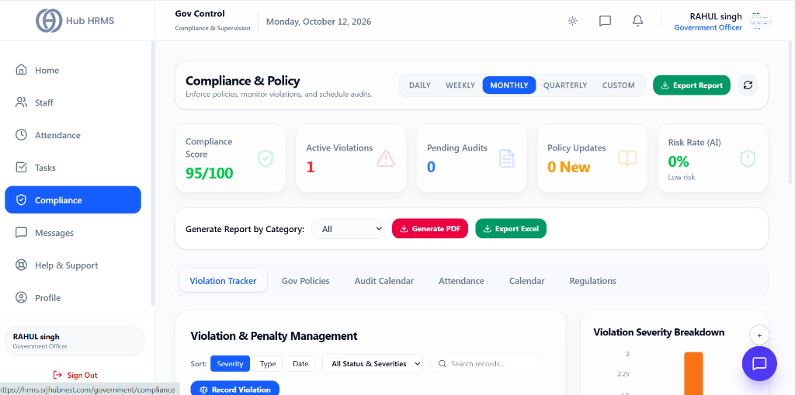
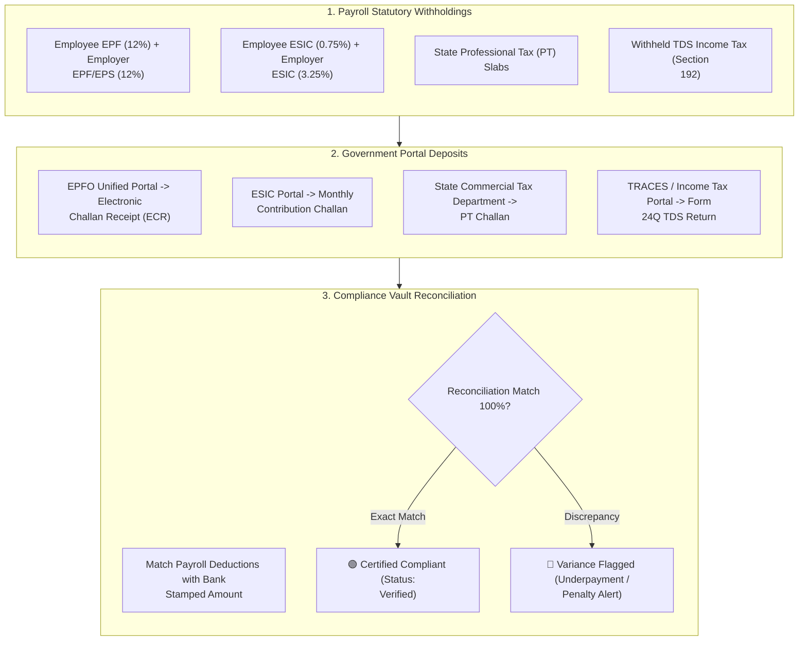

# 05. Statutory Filings & Challans (`/government/compliance`)

The **Statutory Filings & Challans** module serves as the immutable digital vault for all corporate social security remittances, state tax payments, and statutory annual returns. Compliance auditors and government authorities use this module to verify proof of payment, reconcile withheld payroll deductions against bank-stamped electronic receipts, and maintain a permanent audit trail.

---

## 🏛️ Live Interface Overview

Below is the live console layout of the **Compliance & Policy Management** dashboard:

---

## 📊 Summary KPI Indicators & Navigation Tabs

At the top of the `/government/compliance` portal, five real-time metric cards and category filters monitor regulatory violations and audit readiness:

| KPI Indicator | Description | Live Metric Status |
| :--- | :--- | :--- |
| **Compliance Score** | Composite regulatory adherence metric for monitored entities. | High benchmark score (e.g., `95/100`). |
| **Active Violations** | Open non-compliance notices or labor law breaches requiring remediation. | Highlighted in red (e.g., `1 Active violation`). |
| **Pending Audits** | Scheduled compliance audits awaiting field completion. | Audit queue count (e.g., `0 Pending`). |
| **Policy Updates** | Newly promulgated government circulars or regulatory amendments. | Updates count (e.g., `0 New`). |
| **Risk Rate (AI)** | Automated legal liability assessment predicting penalty exposure. | Risk level (e.g., `0% Low risk`). |

### 🗂️ Regulatory Tabs & Quick Reports
* **Violation Tracker**: Detailed record of infractions sorted by Severity, Type, and Date with one-click **Record Violation** modal.
* **Gov Policies**: Repository of applicable statutory labor codes, wage acts, and factory guidelines.
* **Audit Calendar**: Comprehensive timeline of upcoming state inspections and internal reviews.
* **Attendance**: Audit-grade logs verifying working hours, rest days, and overtime.
* **Calendar & Regulations**: Interactive regulatory deadlines and legal circulars.
* **Export Utilities**: Generate targeted reports by category in PDF or Excel.

---

## 🧭 Statutory Challan Verification Flow

The flowchart below demonstrates the verification process connecting payroll deductions to certified government receipts:

---

## 📜 Statutory Returns & Filing Vault Directory

| Statutory Filing | Relevant Act | Filing Frequency | Due Date | Statutory Evidence Document |
| :--- | :--- | :--- | :--- | :--- |
| **EPF ECR Challan** | Employees' Provident Funds Act, 1952 | Monthly | 15th of following month | Bank CRN Receipt & ECR Member Statement |
| **ESIC Monthly Return** | Employees' State Insurance Act, 1948 | Monthly | 15th of following month | ESIC Payment Receipt & Monthly Contribution Sheet |
| **Professional Tax (PT)** | State Tax on Professions & Trades Acts | Monthly / Quarterly | Varies by State (typically 10th - 20th) | State PT Challan with Treasury Reference Number |
| **Factories Act Form 25** | Factories Act, 1948 | Annual | Before 1st February | Annual Return Form 25 with Inspectorate Stamp |
| **Annual Bonus Return** | Payment of Bonus Act, 1965 | Annual | Within 30 days of accounting year | Form D Bonus Register & Payment Disbursal Sheets |
| **Gratuity Valuation** | Payment of Gratuity Act, 1972 | Annual / Actuarial | End of Financial Year | Form F Nomination Master & Actuarial Valuation Certificate |

---

## ⚙️ How to Audit and Verify Statutory Challans

### Step 1: Select Financial Year & Month
1. Navigate to **Compliance Portal > Filings & Challans** (`/government/compliance`).
2. Select the **Financial Year** (e.g., *FY 2026-27*) and target month.
3. Choose the regulatory category (*Provident Fund*, *ESIC*, *Professional Tax*, or *Annual Returns*).

### Step 2: Cross-Check Reconciliation Ledger
1. The screen displays a side-by-side comparison:
   - **Payroll System Withholding:** Exact amount deducted across all employee payslips.
   - **Bank Challan Remitted:** Amount credited to the government authority treasury.
   - **Variance Index:** Must show `0.00 Variance` for automated approval.

### Step 3: Inspect Challan Artifacts
1. Click **View Challan** on any verified record.
2. The viewer opens the original bank-stamped PDF displaying:
   - *Challan Reference Number (CRN)*
   - *Bank Transaction ID & Date of Realization*
   - *Establishment Code & Number of Beneficiary Employees*

### Step 4: Download the Consolidated Audit Pack
1. For statutory audits, click **Export Compliance Pack (ZIP)**.
2. The system packages the monthly payroll summary, bank payment vouchers, and official government ECR receipts into an authenticated, indexed archive.

---

## 💡 Best Practices

> [!TIP]
> **Audit Zero-Variance Monthly:** Always conduct the three-way reconciliation (Payroll Register vs Bank Debit vs Government Receipt) immediately following each monthly deposit to catch any banking transmission failures before the 15th cutoff.
