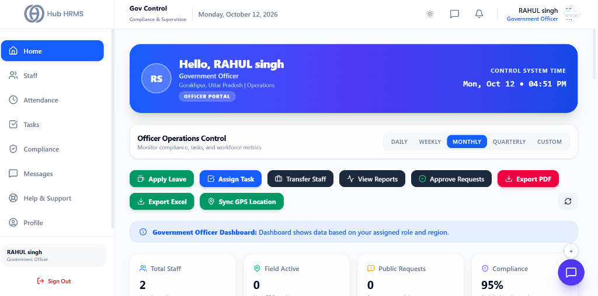
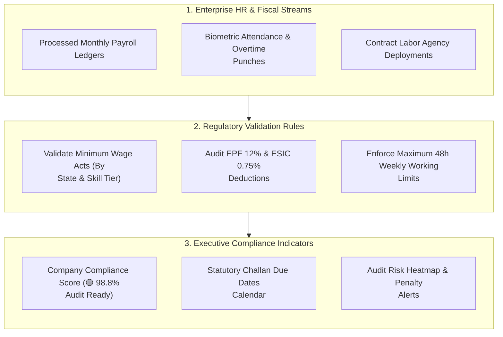

# 01. Statutory Compliance Dashboard (`/government/dashboard`)

The **Statutory Compliance Dashboard** provides compliance heads, internal auditors, and government inspectors with a centralized executive view of corporate legal readiness. It aggregates social security contributions, wage distribution audits, statutory filings, and labor ceiling metrics into an intuitive health scorecard.

---

## 🏛️ Live Interface Overview

Below is the live console layout of the **Gov Control - Officer Operations Control** dashboard:

---

## 🧭 Officer Operations Control & Quick Action Toolbar

The `/government` dashboard provides Government Officers with regional supervision and enforcement tools:

### ⚡ Quick Operational Actions
* **Apply Leave**: File official on-duty leave requests directly from the operations header.
* **Assign Task**: Delegate field inspections or audit inquiries to junior staff.
* **Transfer Staff**: Initiate and track inter-district or inter-department staff transfers.
* **View Reports**: Access consolidated district compliance and workforce summaries.
* **Approve Requests**: Review and authorize pending public or departmental requests.
* **Export PDF / Export Excel**: Instant export of inspection logs and compliance summaries.
* **Sync GPS Location**: Real-time geolocation check-in syncing duty location with reverse geocoding.

---

## 📊 Summary KPI Indicators

At the top of the command center, four real-time metric cards reflect regional oversight:

| KPI Indicator | Description | Live Metric Status |
| :--- | :--- | :--- |
| **Total Staff** | Total civil officers and field inspectors under supervision. | Active headcount (e.g., `2 Headcount`). |
| **Field Active** | Count of personnel currently clocked-in and active on field duty. | Live field count (e.g., `0 Live GPS positions`). |
| **Public Requests** | Citizen grievances and regulatory inquiry tickets awaiting response. | Open ticket count (e.g., `0 Open requests`). |
| **Compliance** | Composite regulatory adherence and labor law score for the region. | Percentage score (e.g., `95% Audit benchmark`). |

---

## 🧭 Real-Time Compliance Monitoring Architecture

The diagram below outlines how attendance, payroll disbursements, and tax challans feed into the compliance health index:

---

## 📊 Core Dashboard Gauges & KPIs

### 1. 🛡️ Overall Compliance Health Index
A weighted composite score reflecting corporate regulatory compliance:
* **🟢 95% - 100% (Audit Ready):** All monthly challans deposited on time; zero minimum wage or overtime ceiling violations.
* **🟡 85% - 94% (Attention Required):** Minor pending documentation (e.g., missing contractor licenses or pending Form 16 disclosures).
* **🔴 Below 85% (High Penalty Risk):** Overdue statutory filings or unregularized labor non-compliances requiring immediate intervention.

### 2. 📅 Statutory Filing Due Date Tracker
Monitors the critical filing calendar across government portals:
* **EPF ECR Filing:** Due 15th of each month.
* **ESIC Monthly Contribution:** Due 15th of each month.
* **Professional Tax (PT) Remittance:** State-dependent monthly/quarterly deadline.
* **TDS Withholding (Form 24Q):** Quarterly filing deadline.

### 3. ⚠️ Active Regulatory Risk Alerts
Dynamic warnings highlighting compliance vulnerabilities:
* *3 Contract staff approaching 240 days without permanent benefits review.*
* *Overtime ceiling warning: 4 operators in Line 2 reached 45 weekly hours.*
* *Pending contractor labor license renewal due in 10 days.*

---

## ⚡ Quick Compliance Actions

From the top action bar, auditors and compliance officers can execute immediate statutory tasks:

| Action Button | Function | Output |
| :--- | :--- | :--- |
| **Export Form A / B / D** | Instant compilation of statutory labor registers. | Formatted Excel & digitally signed PDF pack. |
| **Verify ECR Challan** | Cross-check bank payment receipt against monthly EPF dues. | Reconciliation match report. |
| **Inspection Dossier** | One-click package for visiting government labor officers. | Comprehensive ZIP package with all registers and challans. |

---

## 💡 Best Practices

> [!TIP]
> **Check Due Dates on the 10th:** Review the *Statutory Filing Due Date Tracker* by the 10th of every month. This leaves a 5-day buffer before the standard 15th deadline for EPF and ESIC challan submissions.
