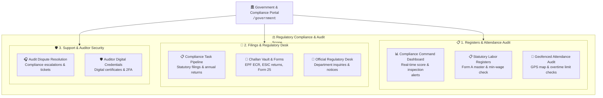
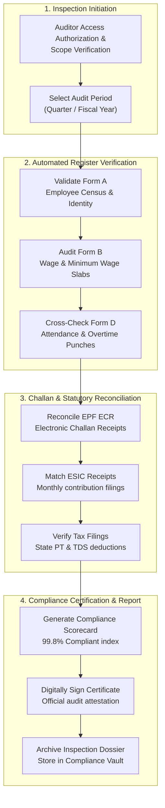

# 🏛️ Government & Statutory Compliance Portal

The **Government & Statutory Compliance Portal** (`/government/*`) is the regulatory audit and labor compliance workspace in Hub HRMS. Designed for compliance officers, legal counsels, statutory auditors, and labor department inspectors, this portal guarantees 100% adherence to labor laws, wage standards, social security remissions (PF, ESI), working hour limits, and equal opportunity regulations.

---

## 🏛️ Live Interface Overview

Below is the live console layout of the **Government & Statutory Compliance Console**:

---

## 🎯 Role Purpose & Regulatory Mandate

The Government Compliance Auditor role provides read-and-verify authority over workforce records, wage registers, statutory deposits, and workplace safety compliance without modifying operational data:

* **Social Security & Statutory Levies**: Verifying electronic challan filings for Employee Provident Fund (EPF), Employee State Insurance (ESIC), and State Professional Tax (PT).
* **Statutory Labor Registers**: Instant export of government-mandated registers (Form A - Employee Register, Form B - Wage Register, Form D - Attendance Register).
* **Working Hour & Overtime Audits**: Ensuring shifts comply with maximum continuous working hours, mandatory rest intervals, and overtime compensation caps.
* **Contract Labor & Equal Opportunity**: Validating licenses for contract labor agencies, minimum wage compliance, and gender pay equality.

---

## 🧭 Statutory Audit & Inspection Workflow

When government labor inspectors or statutory auditors conduct quarterly or annual reviews, Hub HRMS simplifies verification into a transparent four-stage audit flow:

---

## 🗂️ Compliance Portal Navigation Directory

| Module # | Chapter Title | Route Path | Core Regulatory Function |
| :--- | :--- | :--- | :--- |
| **01** | [Compliance Dashboard](dashboard.md) | `/government/dashboard` | Executive compliance index, active audit calendar, overdue filings, and regulatory risk heatmaps. |
| **02** | [Statutory Staff Register](staff.md) | `/government/staff` | Government Form A registers, contractor licenses, minimum wage classifications, and diversity metrics. |
| **03** | [Attendance & Field Audit Map](attendance.md) | `/government/attendance` | Geofenced inspector map, biometric punch auditing, rest day verification, and overtime caps. |
| **04** | [Compliance Task Pipeline](tasks.md) | `/government/tasks` | Regulatory deadlines, audit remediation tasks, filing pipelines, and legal notice closures. |
| **05** | [Statutory Filings & Challans](compliance.md) | `/government/compliance` | Monthly EPF ECR, ESIC receipts, Factories Act Form 25, annual bonus returns, and Gratuity records. |
| **06** | [Official Notices & Liaison](messages.md) | `/government/messages` | Statutory communications, government notice responses, and auditor messaging channels. |
| **07** | [Audit Support & Disputes](support.md) | `/government/support` | Legal counsel advisory requests, inspection dispute resolution, and audit clarifications. |
| **08** | [Auditor Credentials & Settings](profile.md) | `/government/profile` | Digital Signature Certificate (DSC) setup, statutory auditor credentials, and security controls. |
