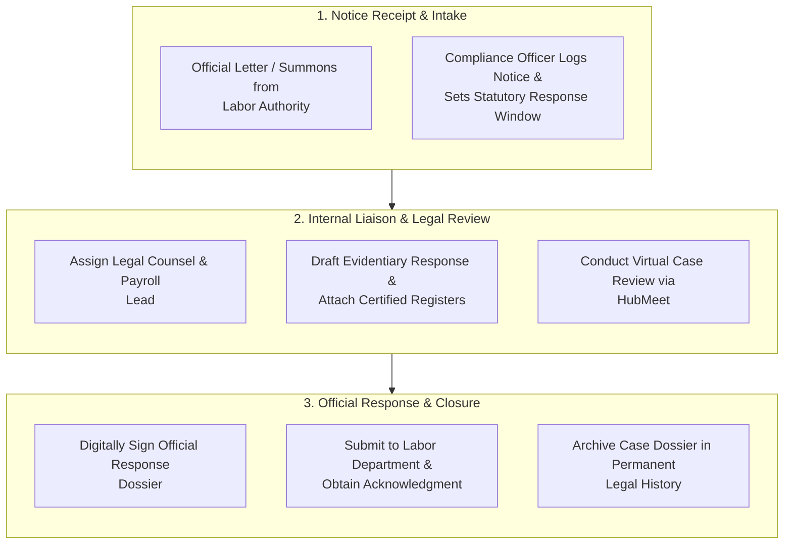

# 06. Official Notices & Regulatory Desk (`/government/messages`)

The **Official Notices & Regulatory Desk** module establishes a formal communication bridge between corporate compliance teams, external statutory auditors, legal counsels, and government labor authorities. Designed to maintain an auditable chain of custody, it tracks official inquiries, show-cause notices, legal responses, and virtual audit hearings.

---

## 🧭 Statutory Notice & Legal Inquiry Lifecycle

The diagram below illustrates how external government notices are logged, reviewed, answered, and officially archived:

---

## 📢 Dedicated Compliance Channels

| Communication Channel | Intended Purpose | Participants | Security Standard |
| :--- | :--- | :--- | :--- |
| **Statutory Notice Ledger** | Official repository for labor notices, inspection remarks, and summons. | Compliance Officer, Legal Counsel, MD | Timestamped, read-only audit log |
| **Auditor Inquiry Desk** | Direct messaging with visiting external statutory auditors. | Compliance Team & Auditors | Role-restricted inquiry thread |
| **Virtual Audit Room (HubMeet)** | Remote inspection walkthroughs and audit exit conferences. | Auditors, Plant Heads, Legal Team | Secure encrypted video call |
| **Internal Legal Huddle** | Private strategy and response drafting discussions. | Internal Corporate Counsel | Confidential internal channel |

---

## ⚙️ How to Log and Respond to a Regulatory Notice

### Step 1: Log Incoming Notice
1. Navigate to **Compliance Portal > Notices & Desk** (`/government/messages`).
2. Click **+ Log Government Notice**.
3. Enter notice parameters:
   - **Issuing Authority:** (e.g., *Office of the Regional Labor Commissioner / EPFO*).
   - **Notice Reference Number & Date Received.**
   - **Mandated Response Due Date:** (e.g., *Within 15 days of service*).
   - **Subject / Topic:** (e.g., *Inquiry regarding Contract Labor Register Form A*).
4. Upload a scanned PDF copy of the physical letter.

### Step 2: Coordinate Response Dossier
1. Use the dedicated inquiry thread to collaborate with HR and Payroll leads.
2. Link verified system registers directly from the compliance vault.
3. If clarification is needed with external legal counsel, click **Start HubMeet Huddle** to initiate an instant virtual consultation.

### Step 3: Dispatch and Record Closure
1. Once approved by corporate legal counsel, click **Record Official Dispatch**.
2. Enter the submission tracking number and attach the government acknowledgement receipt.
3. The notice status transitions to `RESOLVED & FILED`.

---

## 💡 Best Practices

> [!TIP]
> **Track Statutory Timelines Closely:** Government inquiries usually mandate responses within 7, 14, or 30 calendar days. Set automated reminder triggers at T-3 days in the system to ensure timely submissions.
