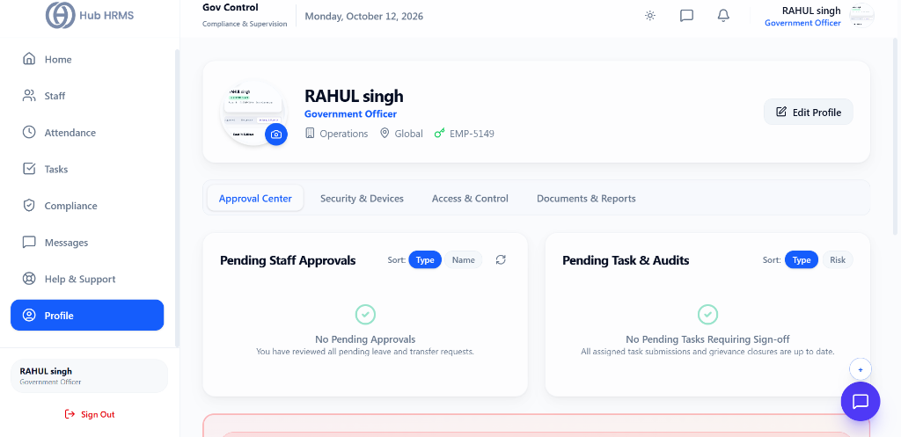
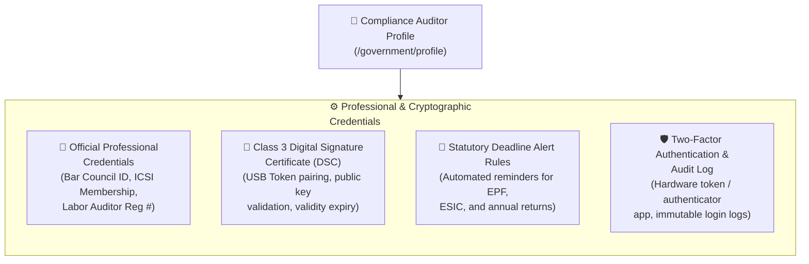

# 08. Auditor Profile & Credentials (`/government/profile`)

The **Auditor Profile & Credentials** module maintains the professional accreditation records, digital signature certificates, and cryptographic verification settings for compliance auditors and statutory officers. Because statutory returns and labor registers require authentic certification, this module manages Class 3 Digital Signature Certificates (DSC) and multi-factor security keys.

---

## 🏛️ Live Interface Overview

Below is the live console layout of the **Gov Control - Officer Profile & Approval Center**:

---

## 🗂️ Navigation Tabs & Officer Authority Panels

The `/government/profile` portal manages credentials, security parameters, and decentralized sign-offs:

### 1. Profile Navigation Tabs
* **Approval Center**: Centralized sign-off desk containing two core execution panels:
  * **Pending Staff Approvals**: Review and authorize subordinate leave applications and transfer requests (`No Pending Approvals`).
  * **Pending Task & Audits**: Final sign-off for completed field inspection reports and grievance closures (`No Pending Tasks Requiring Sign-off`).
* **Security & Devices**: Manages passwords, session history, and authenticated mobile/desktop hardware tokens.
* **Access & Control**: Displays regional jurisdiction boundaries, supervisory privileges, and assigned circulars.
* **Documents & Reports**: Uploaded accreditation certificates, departmental ID scans, and official gazette credentials.

### 2. Officer Details Card
* **Officer Identification**: Name (`RAHUL singh`), Designation (`Government Officer`), Department (`Operations`), Jurisdiction Scope (`Global`), and Employee ID (`EMP-5149`).
* **Edit Profile**: Self-service profile updates and contact details.

---

## 🧭 Auditor Credential Configuration Architecture

The flowchart below demonstrates how auditor credentials and digital signature certificates integrate with statutory filings:

---

## ⚙️ Key Profile Sections & Configurations

### 1. 📇 Official Credentials & Statutory Licenses
* **Full Legal Name, Official Designation, and Bar/Institute Affiliation.**
* **Professional Registration Number:** (e.g., *ICSI / ICAI Membership No. or Government Labor Auditor ID*).
* **Jurisdictional Region:** Assigned state or regional labor commissionerate circle.

### 2. 🔑 Digital Signature Certificate (DSC) Management
To digitally sign statutory returns, challans, and official inspection registers:
* **Token Status:** Displays connected Class 3 USB cryptographic token or cloud DSC.
* **Certificate Validity:** Shows issue date, issuing authority (e.g., *eMudhra, (n)Code*), and expiry countdown.
* **Registering a New DSC:** Click **Update Digital Signature**, plug in the USB cryptographic key, enter the token PIN, and pair the certificate.

### 3. 🔔 Statutory Alert Preferences
Configure advance notification thresholds:
* **Monthly Challans (EPF / ESIC):** Receive alerts at T-7, T-3, and T-1 days before the 15th.
* **License Renewals:** Alerts starting 30 days prior to contractor labor license expirations.
* **Notice Escalations:** High-priority SMS alerts for any unacknowledged labor department letter.

### 4. 🛡️ Two-Factor Authentication & Security Access
* **Hardware Token / App 2FA:** Enforced multi-factor authentication for accessing sensitive workforce wage registers.
* **Audit Trail Session Log:** Displays recent login IP addresses, geolocations, and exported document timestamps.

---

## 💡 Best Practices

> [!IMPORTANT]
> **Annual DSC Renewal:** Digital Signature Certificates typically expire every 1 or 2 years. Hub HRMS alerts the auditor 30 days prior to expiry so the token can be re-certified without causing delays during monthly filing windows.
