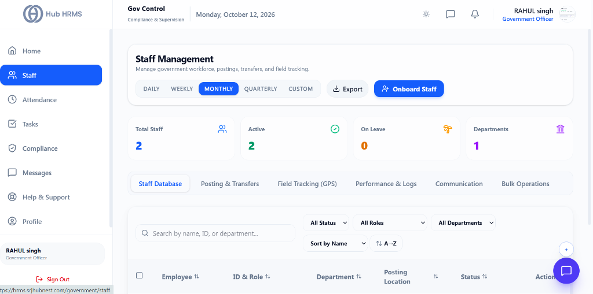
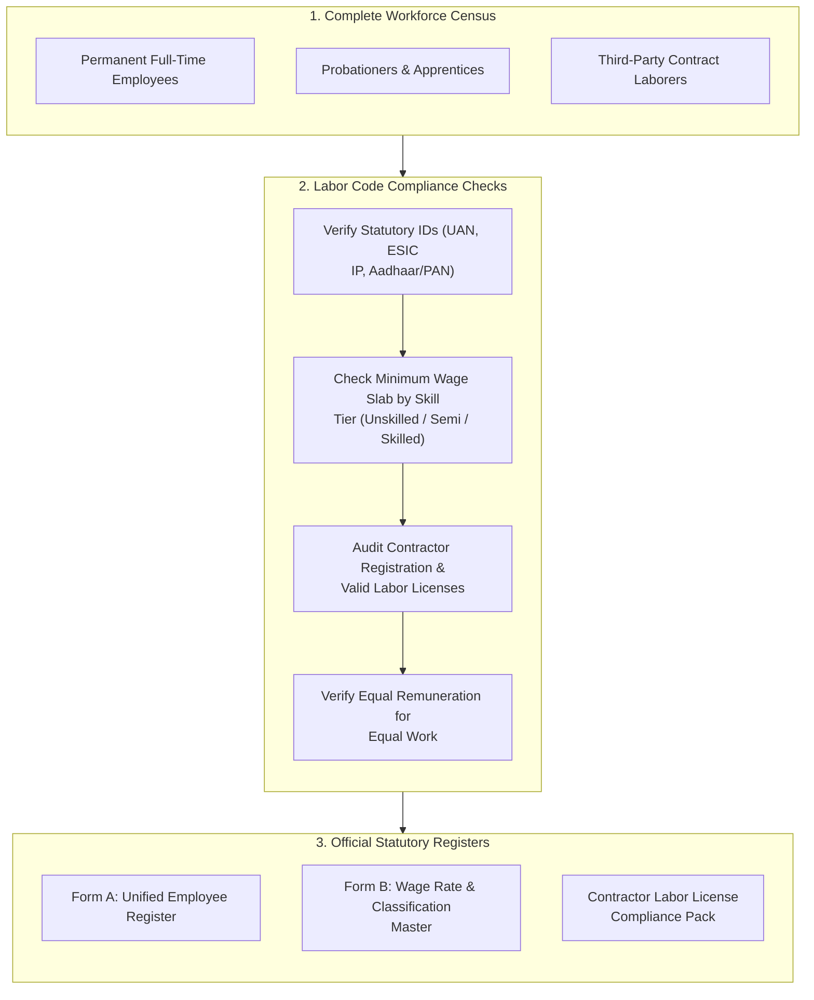

# 03. Statutory Staff Registers (`/government/staff`)

The **Statutory Staff Registers** module provides certified record keeping compliant with national labor codes, Factories Acts, and Shops & Establishments regulations. Compliance auditors and government inspectors use this interface to verify employee identity dossiers, validate minimum wage classifications, audit contract labor agency licenses, and ensure equal remuneration standards.

---

## 🏛️ Live Interface Overview

Below is the live console layout of the **Staff Management** dashboard:

---

## 📊 Summary KPI Indicators & Navigation Tabs

At the top of the `/government/staff` dashboard, four live metric cards and navigation tabs give immediate visibility into the government workforce:

| KPI Indicator | Description | Live Metric Status |
| :--- | :--- | :--- |
| **Total Staff** | Cumulative count of registered personnel and field inspectors. | Total headcount (e.g., `2`). |
| **Active** | Personnel currently deployed and available on active roster. | Highlighted in green (e.g., `2`). |
| **On Leave** | Staff members on authorized earned, medical, or causal leave. | Real-time leave count (e.g., `0`). |
| **Departments** | Operational functional divisions under regional oversight. | Department count (e.g., `1`). |

### 🗂️ Operational Staff Tabs
* **Staff Database**: Master directory with search, filtering by Status, Role, and Department, and alphabetical sorting.
* **Posting & Transfers**: Official record of current assignments, station postings, and inter-district transfer requests.
* **Field Tracking (GPS)**: Real-time map monitoring field inspectors with GPS check-ins.
* **Performance & Logs**: Audit of completed field inspections, notices served, and public grievance resolution records.
* **Communication**: Direct administrative dispatch to officers and regional teams.
* **Bulk Operations**: Multi-staff batch assignments, mass transfers, and roster updates.
* **+ Onboard Staff**: One-click registration modal for new government officers and inspectors.

---

## 🧭 Workforce Verification & Minimum Wage Audit Flow

The diagram below details the audit process for verifying workforce eligibility and compensation compliance:

---

## 📋 Core Statutory Registers & Legal Schedules

| Statutory Form | Regulatory Purpose | Key Data Fields Captured |
| :--- | :--- | :--- |
| **Form A (Employee Register)** | Master record of all employed personnel. | Name, DOB, Gender, UAN, ESIC IP, Date of Joining, Designation, Aadhaar status. |
| **Form B (Wage Register)** | Certified wage rates and wage periods. | Minimum wage tier, basic rate, allowances, payment cycle, payment mode (Bank). |
| **Contract Labor Register** | Audit of outsourced agency personnel. | Agency name, labor license #, validity expiry date, deployed headcount, wages paid. |
| **Equal Remuneration Audit** | Pay parity across male, female, and transgender staff. | Department, designation, median wage by gender, pay variance percentage. |

---

## ⚙️ How to Audit and Verify Staff Records

### Step 1: Filter by Employment Category
1. Navigate to **Compliance Portal > Staff Register** (`/government/staff`).
2. Filter the workforce by:
   - **Type:** *Permanent*, *Contractor*, or *Apprentice*.
   - **Contractor Agency:** Filter by specific third-party labor vendor.
   - **Skill Category:** *Unskilled*, *Semi-Skilled*, *Skilled*, or *Highly Skilled*.

### Step 2: Review Minimum Wage Adherence
1. Select the **Minimum Wage Audit** view.
2. The grid compares each worker's base wage against the state-notified minimum wage for their skill grade:
   - 🟢 **Compliant:** Current wage exceeds statutory floor.
   - 🔴 **Non-Compliant:** Base wage falls below mandatory notification rate.
3. If an underpayment anomaly is flagged, click **Issue Remediation Notice** to notify the Finance and Payroll team immediately.

### Step 3: Verify Contractor Licenses
1. Switch to the **Contractor Licenses** tab.
2. Review agency profiles:
   - *Active Headcount Deployed* vs *Authorized Headcount Limit*.
   - *License Validity Dates*: Red warning flags appear for licenses expiring within 30 days.
   - *Proof of PF/ESIC Remittance by Contractor*: Download vendor-submitted ECR challans.

### Step 4: Export Certified Form A / Form B Registers
1. Click the **Export Form A (PDF / Excel)** button.
2. The system generates the standardized government format pre-filled with all active employee details, ready for statutory inspection stamps.

---

## 💡 Best Practices

> [!IMPORTANT]
> **Contractor Over-Deployment:** Never allow a third-party labor contractor to deploy more workers on the floor than the maximum headcount specified in their official government labor license.
