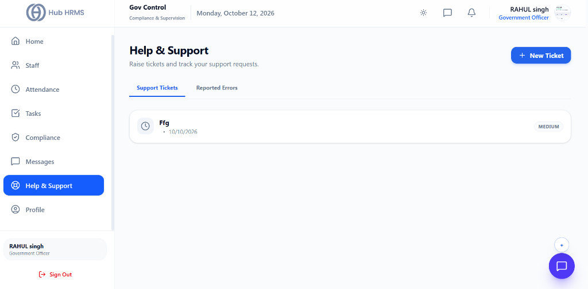
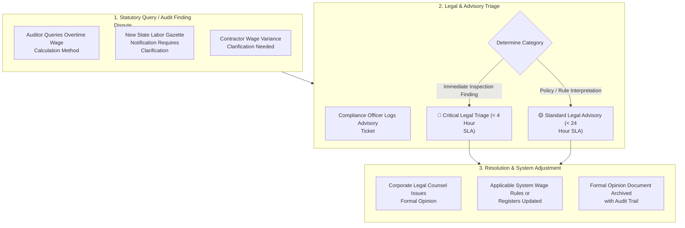

# 07. Audit Support & Disputes (`/government/support`)

The **Audit Support & Disputes** module provides a structured helpdesk mechanism for compliance officers to request authoritative legal interpretations, dispute audit findings, and seek advisory guidance on complex statutory amendments. When regulatory ambiguity or inspection disagreements occur, this portal connects officers with corporate legal experts and certified labor consultants.

---

## 🏛️ Live Interface Overview

Below is the live console layout of the **Gov Control - Help & Support** desk:

---

## 🗂️ Support Views & Grievance Actions

The `/government/support` helpdesk provides administrative officers with channels to raise tickets and report systemic problems:

* **Support Tickets Tab**: Real-time tracking of operational requests (e.g., Ticket `Ffg` created on `10/10/2026` with priority `MEDIUM`).
* **Reported Errors Tab**: Technical log of system errors, data sync failures, and GPS location tracking anomalies.
* **+ New Ticket Button**: Direct modal interface to report urgent inspection blockers or portal sync disputes to system administrators.

---

## 🧭 Statutory Dispute & Advisory Escalation Flow

The flowchart below demonstrates the progression of a compliance dispute or legal interpretation ticket:

---

## 🎟️ Advisory Support Categories & SLAs

| Category | Typical Scope | Target Resolution SLA | Assigned Expert Team |
| :--- | :--- | :--- | :--- |
| **Inspection Finding Dispute** | Rebutting an inspector's preliminary observation or notice. | **< 4 Hours** | Senior Labor Advocate / General Counsel |
| **Statutory Rule Interpretation** | Clarification on minimum wage slabs, allowances, or PF limits. | **< 24 Hours** | Corporate Compliance & Tax Advisory |
| **Contractor Labor Verification** | Dispute regarding contractor compliance or license authenticity. | **Within 48 Hours** | Vendor Risk & Procurement Legal |
| **Software Rule Alignment** | Requesting configuration changes to match newly gazetted laws. | **Within 72 Hours** | HRMS System Administrators |

---

## ⚙️ How to File a Compliance Support Ticket

### Step 1: Open New Ticket
1. Navigate to **Compliance Portal > Support** (`/government/support`).
2. Click **+ Submit Support Ticket**.
3. Select the appropriate classification:
   - *Statutory Labor Dispute*
   - *Tax / PF / ESIC Rule Clarification*
   - *Factory Inspection Observation*
   - *Contractor Compliance Inquiry*

### Step 2: Provide Evidence and References
1. State the specific section of the Act in question (e.g., *Section 59 of Factories Act - Extra wages for overtime*).
2. Detail the exact observation made by the auditor or inspector.
3. Attach supporting documents: inspector memos, employee cards, or state gazette PDFs.

### Step 3: Receive Legal Opinion & Close
1. Once assigned, counsel reviews the case and submits an official legal brief directly in the ticket thread.
2. Review the counsel's guidance and click **Accept & Apply Resolution**.
3. The response is stamped and linked to the corresponding inspection file.

---

## 💡 Best Practices

> [!TIP]
> **Preserve Legal Opinions in the Vault:** When counsel issues an interpretation on an ambiguous state rule, archive the signed opinion document in the *Statutory Vault*. It serves as certified defense evidence during future inspections.
