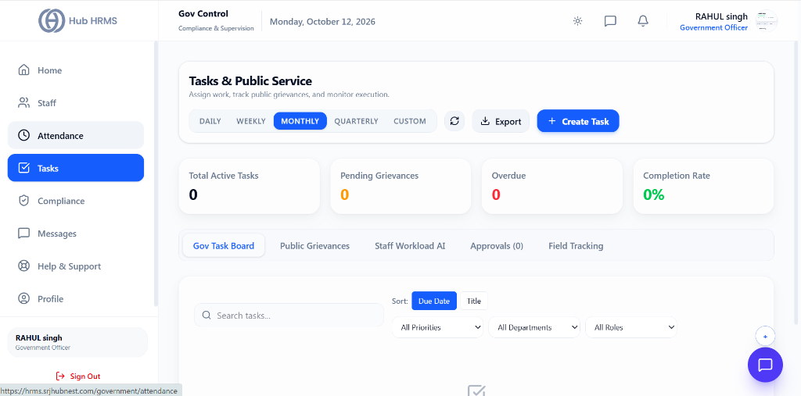
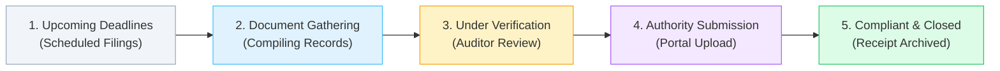

# 04. Compliance Task Pipeline (`/government/tasks`)

The **Compliance Task Pipeline** module provides a structured, visual workflow management system for tracking statutory deadlines, labor inspections, annual filings, and remediation action items. Replacing chaotic email reminders and spreadsheets, the interactive **Compliance Pipeline** ensures that no government deadline is missed and that all legal notices are resolved systematically.

---

## 🏛️ Live Interface Overview

Below is the live console layout of the **Tasks & Public Service** dashboard:

---

## 📊 Summary KPI Indicators & Navigation Tabs

At the top of the `/government/tasks` dashboard, four live metric cards and operational tabs manage public tasks and departmental execution:

| KPI Indicator | Description | Live Metric Status |
| :--- | :--- | :--- |
| **Total Active Tasks** | Current count of public service and administrative tasks underway. | Active count (e.g., `0`). |
| **Pending Grievances** | Citizen grievances requiring official inquiry or resolution. | Queue count (e.g., `0`). |
| **Overdue** | Tasks that have exceeded their designated statutory deadline. | Red alert count (e.g., `0`). |
| **Completion Rate** | Overall resolution efficiency percentage for the selected cycle. | Progress percentage (e.g., `0%`). |

### 🗂️ Task Management Views
* **Gov Task Board**: Visual workflow pipeline grouping tasks across planning, investigation, and closed stages.
* **Public Grievances**: Dedicated citizen service desk for logging and resolving citizen inquiries.
* **Staff Workload AI**: Automated workload balancing tool preventing burnout and reallocating field tasks.
* **Approvals (0)**: Administrative sign-off queue for field reports and travel permits.
* **Field Tracking**: Integrated spatial map monitoring active duty inspectors.
* **+ Create Task**: Action button to generate new public enforcement assignments.

---

## 🧭 Statutory Lifecycle in the Pipeline

The diagram below illustrates the stages through which a compliance requirement or audit remediation task progresses:

---

## 🎛️ Pipeline Stages & Operational Definitions

| Pipeline Column | State Badge | Operational Trigger | Required Compliance Action |
| :--- | :--- | :--- | :--- |
| **1. Upcoming Deadlines** | ⚪ `SCHEDULED` | Recurring statutory deadline or newly received government notice. | Review required documentation checklist and assign owner. |
| **2. Document Gathering** | 🔵 `COLLECTING` | Internal teams assemble registers, salary records, or licenses. | Validate completeness of payroll registers, bills, or certificates. |
| **3. Under Verification** | 🟡 `AUDITING` | Compliance auditor performs legal and mathematical scrutiny. | Cross-check statutory deductions against bank challans. |
| **4. Authority Submission** | 🟣 `SUBMITTING` | Uploading verified pack to government portal (EPFO/ESIC/Labor). | Process digital signature (DSC) and obtain filing acknowledgment. |
| **5. Compliant & Closed** | 🟢 `RESOLVED` | Official government receipt uploaded and archived. | Mark task closed; archived into immutable compliance vault. |

---

## ⚙️ How to Track and Close a Compliance Action Item

### Step 1: Create or Select a Compliance Task
1. Navigate to **Compliance Portal > Tasks** (`/government/tasks`).
2. Review cards organized by priority:
   - 🔴 **Urgent / Legal Notice:** Immediate regulatory action required.
   - 🟡 **Monthly Statutory Filing:** Standard monthly EPF/ESIC/PT routine.
   - 🔵 **Annual Return:** Yearly Form 25, bonus statements, or labor returns.
3. Click **+ Add Compliance Task** if logging a newly received regulatory letter.

### Step 2: Assign Responsibility and Upload Documents
1. Open the task card.
2. Assign the internal owner (e.g., *Head of Payroll*, *EHS Safety Officer*).
3. Set the statutory deadline (hard cutoff date).
4. Attach supporting documents: draft returns, bank payment slips, or employee consent letters.

### Step 3: Advance Through Pipeline Stages
* Drag and drop the task card from *Document Gathering* to *Under Verification* once data is verified.
* Enter the official government portal acknowledgment number into the card upon submission.

### Step 4: Archive with Digital Proof
1. Move the card to **Compliant & Closed**.
2. The system prompts to attach the final **Government Receipt / Stamp**.
3. Once attached, the card locks, generating a permanent timestamped audit trail.

---

## 💡 Best Practices

> [!TIP]
> **Set T-5 Day Reminders:** Ensure all tasks in the *Upcoming Deadlines* stage transition to *Document Gathering* at least 5 days prior to statutory due dates to prevent last-minute government portal server downtime bottlenecks.
