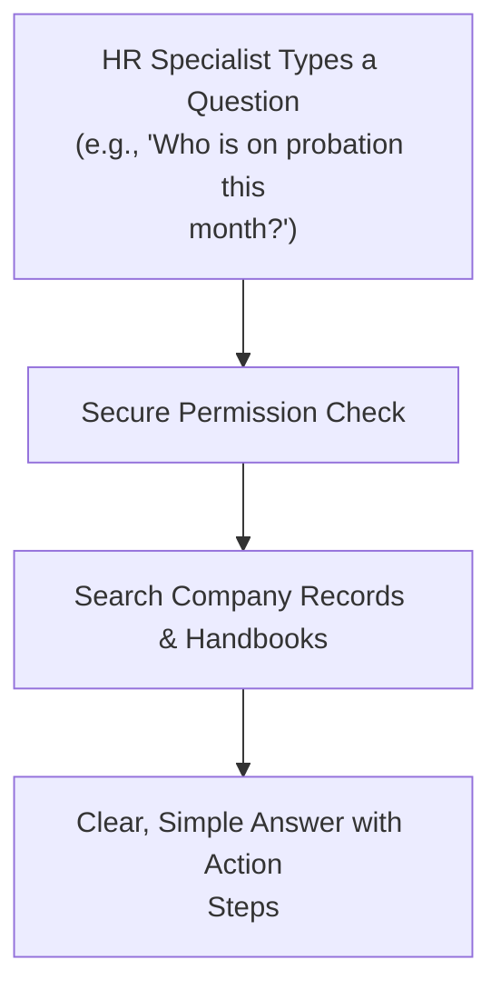

# 11. Smart HR Assistant (`/hr/ai`)

The **Smart HR Assistant** is your day-to-day digital helper inside Hub HRMS. Built specifically for People Operations, it helps HR teams look up employee details in simple English, draft polite emails, and catch signs of team fatigue before people burn out.

---

## 📸 Screen Preview

{ width="100%" }

---

## 🧭 How the Assistant Works

Here is a simple look at how your questions are answered securely from your company's own records:

---

## 💡 What You Can Do with the Assistant

### 1. 💬 Ask Everyday HR Questions
You don't need to dig through complex menus. Just ask questions in natural language:
* **Find People & Roles**:
  * *"How many frontend engineers do we have across our Mumbai and remote teams?"*
  * *"Show me all employees in Sales whose probation review is due this month."*
* **Policy & Handbook Questions**:
  * *"What is our company rule for carrying forward unused leaves?"*
  * *"Help me draft a polite interview invitation email for a developer candidate."*
* **Interview Preparation**:
  * Paste a job description to instantly get suggested interview questions and evaluation criteria.

---

### 2. 🔍 Helpful Team Alerts & Trends
The system quietly checks everyday patterns to help you support your team:
* **Hiring Pipeline Alerts**:
  * Flags candidates who have been waiting in the `Screening` stage for more than 7 days so no good applicant slips through.
* **Workload & Burnout Warnings**:
  * Highlights teams working excessive overtime week after week, helping managers step in before people get overwhelmed.
* **Turnover Signs**:
  * Helps you spot employees who might need extra support, such as long gaps without feedback or frequent unscheduled absences.

---

### 3. 🎯 Manager Coaching & Support Guides
Generate ready-to-use guidance for common workplace situations:
* **Topics Available**: *Improving Performance*, *Leadership Tips*, *Keeping Good People*, and *Resolving Conflicts*.
* **What You Get**:
  * Step-by-step 30-60-90 day improvement plans.
  * Simple conversation talking points for managers having difficult 1-on-1 chats.
  * Recommended training courses for team members needing skill upgrades.

---

## 🔒 Privacy & Data Protection

* **Your Data Stays Yours**: Questions and answers only search your own company's files. No other company can ever see your information.
* **Never Used for Public Training**: Your internal documents and questions are never used to train public models.
* **Confidential Details Protected**: Bank account numbers, government IDs, and private details are automatically masked for safety.

---

## ❓ Frequently Asked Questions (FAQ)

??? question "Can normal employees open this assistant console?"
    No. The `/hr/ai` console is only accessible to HR Specialists, Department Managers, and Company Admins. Employees have their own simple FAQ section inside the Employee Portal.
