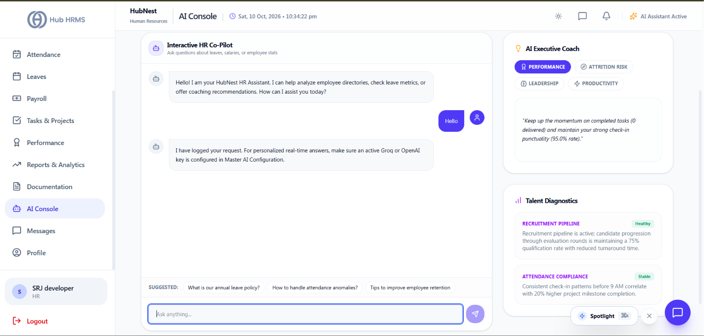
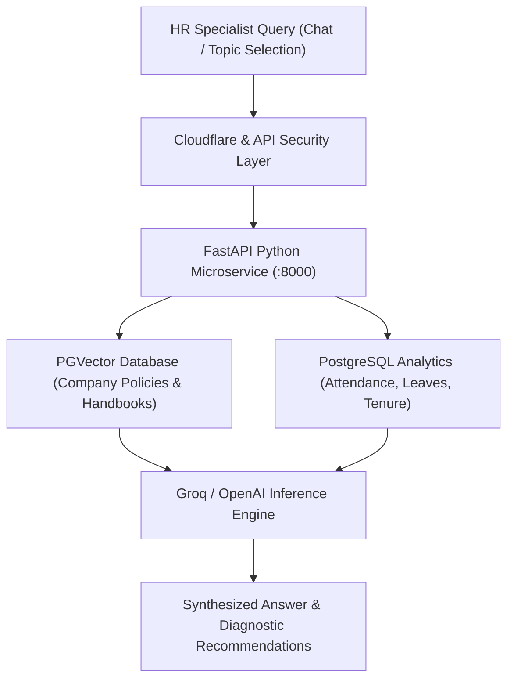

# 11. AI Console (`/hr/ai`)

The **AI Console** delivers an enterprise-grade artificial intelligence co-pilot built specifically for People Operations. Powered by large language models (LLMs) and vector-indexed company data (RAG), it enables HR Specialists to query organization metrics in natural language, detect employee turnover risks, and automate talent coaching.

---

## 📸 Interface Screenshot

{ width="100%" }

---

## 🧭 AI Engine Architecture

---

## 🤖 Core AI Capabilities

### 1. 💬 Conversational HR Talent Assistant
An interactive conversational interface capable of answering ad-hoc HR questions instantly:
* **Directory & Headcount Lookups**:
  * *"How many frontend engineers do we currently have across the Mumbai and Remote branches?"*
  * *"List all employees in Sales whose probation review is due this month."*
* **Policy & Compliance Q&A**:
  * *"What is our company policy on carry-forward leaves for resigning employees?"*
  * *"Generate a polite rejection email for candidates who reached the interview stage."*
* **Interview Question Formulation**:
  * Input a job description to instantly receive tailored, competency-based interview questions with sample scoring criteria.

---

### 2. 🔮 Predictive Diagnostic Insights
Automated diagnostic cards continuously scan organizational telemetry to highlight operational friction:
* **Recruitment Pipeline Diagnosis**:
  * Analyzes funnel conversion velocity, flagging job requisitions where candidates remain stalled in the `Screening` stage for longer than 7 days.
* **Attendance & Burnout Diagnosis**:
  * Flags departments with chronic overtime (> 15 hours overtime/week per employee) combined with declining weekend rest, predicting high risk of burnout.
* **Attrition Risk Scoring**:
  * Evaluates multi-factor turnover signals: tenure length, time since last promotion, leave frequency, and recent manager changes.

---

### 3. 🎯 Talent Coaching Recommender
Select specialized organizational topics to generate personalized coaching blueprints:
* **Topics**: `Performance Improvement`, `Leadership Development`, `Employee Retention`, `Conflict Resolution`.
* **Actionable Output**:
  * Step-by-step 30-60-90 day performance improvement plans (PIPs).
  * 1-on-1 discussion talking points for department managers addressing disengaged staff.
  * Recommended LMS learning modules to close specific technical or communication skill gaps.

---

## 🔒 Data Privacy & Cybersecurity Compliance

* **Tenant Isolation**: AI queries strictly access data isolated to your specific `company_id`. Data is never shared across tenants.
* **No Public Model Training**: Corporate documents and personal employee records processed by the RAG vector engine are never utilized to train public foundation models.
* **PII Redaction**: Personally identifiable financial data (bank account numbers, PAN numbers) is masked prior to prompt transmission.

---

## ❓ Frequently Asked Questions (FAQ)

??? question "Can employees access the AI HR Assistant console?"
    No. The `/hr/ai` console is restricted to HR Specialists, Department Directors, and Company Admins. Employees have a separate, scoped Self-Service FAQ bot on their ESS portal.
