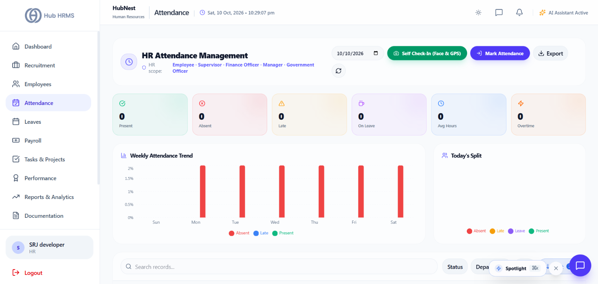
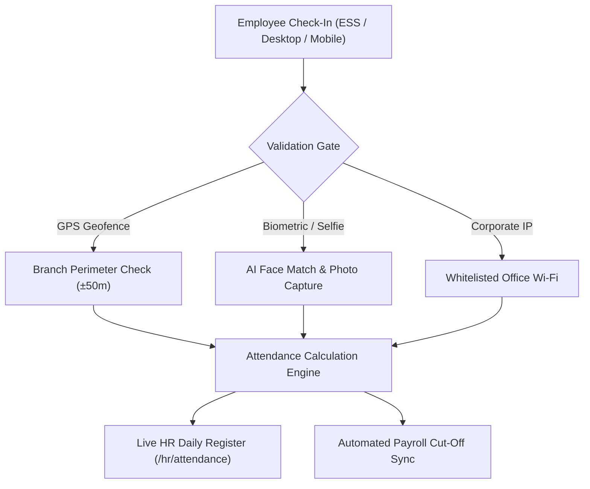
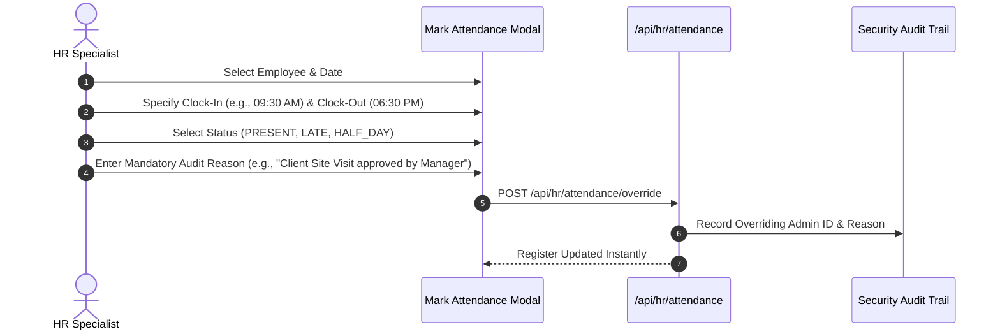

# 04. Attendance Operations (`/hr/attendance`)

The **Attendance Tracking** module provides HR Specialists with real-time auditability over staff check-ins across all corporate branches, remote teams, and shift rosters. It includes geo-fenced GPS validation, biometric/selfie audit trails, manual regularization overrides, and overtime calculations.

---

## 📸 Interface Screenshot

{ width="100%" }

---

## 🧭 Attendance Architecture & Verification Engine

---

## 📊 Live Presence Statuses & Indicators

Every attendance entry in the daily register is categorized into one of five standardized operational statuses:

| Status Code | Badge Style | Operational Definition | Payroll Impact |
| :--- | :--- | :--- | :--- |
| **`PRESENT`** | 🟢 Emerald | Checked in on time and completed full shift hours (>= 8 hrs). | Full Pay Day (1.0) |
| **`IN_OFFICE`** | 🔵 Blue | Actively clocked in and currently working shift. | Active Shift |
| **`LATE`** | 🟡 Amber | Clocked in past the designated branch grace period (e.g., 15 mins). | Late Log / Grace Penalty |
| **`ON_LEAVE`** | 🟣 Purple | Pre-approved leave (Casual, Sick, Paid Time Off, Maternity). | Paid / Unpaid per leave rule |
| **`ABSENT`** | 🔴 Red | No check-in record logged by shift cut-off time. | Loss of Pay (LOP) / Unpaid Day |

---

## 🛠️ Administrative Workspaces & Features

### 1. 🔍 Daily Presence Log & Filters
* **Search by Personnel**: Filter instantly by employee name or corporate ID.
* **Date & Period Picker**: Switch views between **Today**, **Yesterday**, **Weekly Register**, or **Custom Date Range**.
* **Department & Shift Filtering**: Filter attendance registers by department (e.g., Engineering, Customer Support) or specific shift timings (e.g., Morning Shift 9 AM–6 PM, Night Shift 8 PM–5 AM).
* **Work Hours Calculation**: Automatically computes:
  $$\text{Effective Work Hours} = \text{Clock Out} - \text{Clock In} - \text{Designated Lunch Break}$$

---

### 2. 📝 Manual Attendance Override & Regularization (`Mark Attendance`)
HR Specialists can record or correct attendance entries when employees experience technical issues, field travel, or hardware malfunctions:

* **Required Form Fields**:
  * **Target Employee**: Searchable employee dropdown across all active departments.
  * **Shift Date**: Selected calendar date.
  * **In-Time & Out-Time**: Time pickers formatted in 12-hour AM/PM with 24-hour underlying storage.
  * **Override Reason**: Mandatory compliance note explaining the adjustment for internal audit scrutiny.

---

### 3. 🗺️ Check-In Verification Drawer (GPS, Selfie & IP Audit)
Clicking on any attendance entry opens the **Verification Drawer**:
* **GPS Coordinates & Map**: Displays the exact latitude and longitude pin on an embedded map showing distance from registered branch coordinates.
* **Selfie Verification Photo**: If photo punch is enabled, displays the selfie photo captured at the moment of clock-in.
* **Network & Device Metadata**: Displays client IP address, device operating system, and browser user agent to prevent proxy check-ins.

---

## 📈 Attendance Analytics & Overtime Trends

* **Weekly Presence Breakdown (Bar Chart)**: Compares daily present vs. absent vs. late headcounts Monday through Sunday.
* **Status Ratio (Donut Chart)**: Visualizes overall organization presence percentage for the selected pay period.
* **Overtime Logs**: Identifies hours worked exceeding the daily threshold (e.g., > 9 hours) to calculate overtime pay rates in the monthly payroll batch.

---

## 📤 Attendance Export & Regulatory Registers

* **Form B Register (Statutory Compliance)**: Generates statutory attendance registers required under Factories Act / Shops and Establishment Act.
* **Export Dropdown**: Export daily or monthly attendance summaries in **Excel (.xlsx)**, **CSV**, or **PDF** with complete clock-in/out timestamps.

---

## ❓ Frequently Asked Questions (FAQ)

??? question "How is a Half-Day calculated automatically?"
    If an employee clocks out after completing more than 4 hours but less than 8 hours, the system flags the day as `HALF_DAY`, deducting 0.5 from daily payroll unless regularized.

??? question "Can an employee dispute an automated LATE flag?"
    Yes. Employees can submit an **Attendance Regularization Request** via their ESS portal. The request will appear in the HR Specialist's pending approvals queue for review.
