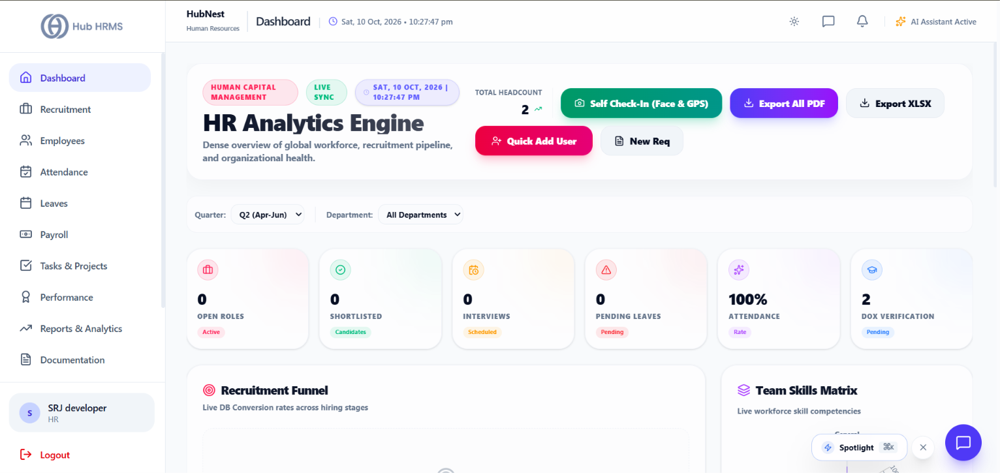
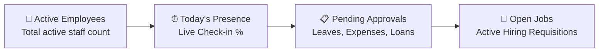
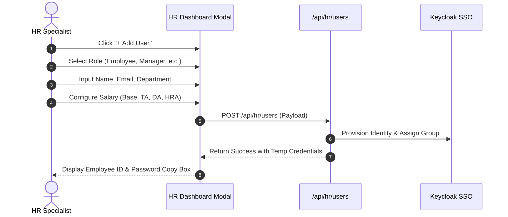
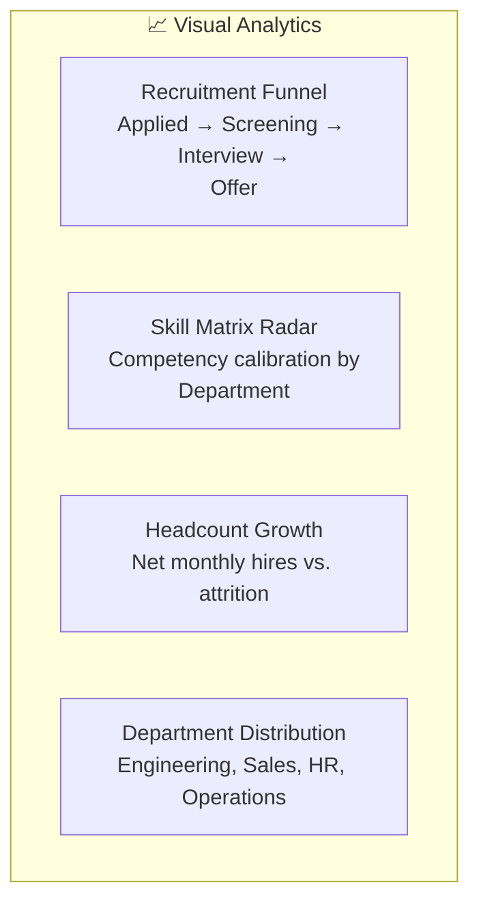

# 01. HR Dashboard (`/hr/dashboard`)

The **HR Dashboard** serves as the central command cockpit for HR Specialists and HR Directors. It provides instant visibility into company-wide workforce telemetry, active hiring funnels, pending approvals, and quick actions to onboard new personnel.

---

## 📸 Interface Screenshot

{ width="100%" }

---

## 🧭 Key Telemetry & KPI Cards

At the top of the console, real-time indicator cards summarize critical organization statistics:

1. **Active Employees**: Total active personnel across all branches, excluding archived or terminated records.
2. **Today's Presence Rate**: Real-time percentage of staff checked in today vs. total expected roster.
3. **Pending Approvals**: Consolidated badge showing leave requests, expense reimbursements, and shift swaps requiring HR action.
4. **Open Requisitions**: Total active job openings currently accepting candidate applications.
5. **Live Time & Date Widget**: Displays localized IST time stamp with active second tick for audit precision.

---

## ➕ Employee Provisioning Modal (`Add User`)

HR Specialists can provision new staff directly from the dashboard header using the **+ Add User** button.

### 1. Account Details & Role Selection
* **Role**: Choose between authorized HR roles:
  * `Employee`: General staff with Self-Service portal access.
  * `Supervisor / Team Lead`: Team oversight with daily attendance audit rights.
  * `Manager`: Department head with approval workflows for tasks and leaves.
  * `Finance Officer`: Access to payroll runs, invoice records, and tax filings.
  * `Government Officer`: Compliance inspector with read-only audit access.
* **Basic Details**: Full Legal Name, Corporate Email Address, Mobile Number, Temporary Password.
* **Demographics**: Gender, Date of Birth (DOB), Residential Street Address.

### 2. Compensation & Allowance Breakdown
The modal includes an interactive salary calculator supporting fixed and percentage-based statutory allowances:
* **Base Salary**: Monthly basic earnings (enforced between ₹0 and ₹1,00,00,000).
* **Travelling Allowance (TA)**: Switchable between **Fixed Amount (₹)** or **Percentage of Base (%)**.
* **Dearness Allowance (DA)**: Switchable between **Fixed Amount (₹)** or **Percentage of Base (%)**.
* **House Rent Allowance (HRA)**: Configured as a direct monthly tax exemption allowance.

> [!TIP]
> **Automated Credentials Dispatch**: Once submitted, the system generates a secure credentials card allowing HR to copy the temporary password or automatically send an invitation email with a first-time login link.

---

## 📊 Analytics & Talent Intelligence Widgets

The dashboard features four interactive analytical charts powered by Recharts:

### 1. Recruitment Funnel (Composed Bar & Line Chart)
* Visualizes candidate conversion through hiring stages: **Applied**, **Screening**, **Interview**, **Offer**, and **Hired**.
* Allows sorting by stage order, volume descending, or volume ascending.

### 2. Department Skill Competency (Radar Chart)
* Evaluates cross-department talent benchmarks across 5 core skill axes: *Technical Proficiency*, *Communication*, *Leadership*, *Domain Knowledge*, and *Execution Velocity*.

### 3. Net Workforce Growth (Monthly Area Chart)
* Tracks monthly hires, departures, and net workforce additions over the last 6 to 12 months.

### 4. Department Distribution (Interactive Pie Chart)
* Visualizes headcounts per business division (e.g., Engineering, Sales, Support, HR, Administration) with percentage breakdowns on hover.

---

## ⚡ Operational Quick Actions

Direct shortcuts placed for fast access:
* **Export Telemetry**: Download snapshot reports in **Excel (.xlsx)**, **CSV**, or **PDF** format.
* **Run Payroll Draft**: Direct link to `/hr/payroll` to review monthly compensation sheets.
* **Post Job Opening**: Direct shortcut to create new vacancy postings in `/hr/recruitment`.
* **Resolve Leaves**: Jump directly to `/hr/leaves` filtered by pending requests.

---

## ❓ Frequently Asked Questions (FAQ)

??? question "Can an HR Specialist create a Company Admin account?"
    No. Under Hub HRMS security isolation, HR Specialists can only create roles up to `Manager` and `Finance Officer`. Creation of `Company Admin` or `Super Admin` accounts is restricted to tenant owners.

??? question "How do I filter dashboard analytics for a specific quarter?"
    Click the **Quarter Filter** pill at the top right of the analytics container to toggle between **Q1**, **Q2**, **Q3**, or set a **Custom Date Range**.
