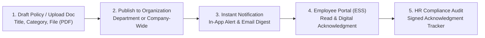

# 10. Company Documentation (`/hr/documentation`)

The **Documentation** module provides a centralized, secure corporate repository for authoring, publishing, and archiving company policies, employee handbooks, statutory compliance notices, and standardized employment contract templates.

---

## 📸 Interface Screenshot

<!-- SCREENSHOT_PLACEHOLDER: /hr/documentation -->
> *[Screenshot Placeholder: HR Documentation & Policy Management]*

---

## 🧭 Documentation Architecture

---

## 📂 Navigation Workspaces

### 1. 📜 `Corporate Policies` (Handbook & Rules)
Publish and enforce organizational standards across all branches:
* **Create Policy Modal**:
  * **Policy Title**: E.g., *"Remote Work & IT Security Policy 2026"*, *"Prevention of Sexual Harassment (POSH) Policy"*.
  * **Category**: `General Conduct`, `Leave & Working Hours`, `IT Security & Data Protection`, `Health & Safety`, `Travel & Expenses`.
  * **Description & Scope**: High-level summary of policy objectives.
  * **Document Attachment**: Upload official PDF documents using the drag-and-drop file uploader.
  * **Status**: `Active` (visible to employees) or `Draft`.
* **Mandatory Digital Acknowledgment**:
  * Flag policies as requiring mandatory employee sign-off.
  * The system requires employees to check *"I have read and agree to these terms"* upon their next login.
  * HR Specialists can export a live compliance roster identifying employees who have not yet acknowledged the policy.

---

### 2. 🗄️ `Document Vault` (Contract Templates & Forms)
Standardized document library accessible to HR personnel:
* **Standard Templates Library**:
  * **Offer Letters & Appointment Contracts**
  * **Non-Disclosure Agreements (NDAs)**
  * **Employee Relieving & Experience Letters**
  * **Annual Appraisal & Salary Revision Circulars**
  * **Statutory Compliance Forms (Form 11, Form 2, PF Declarations)**
* **Template Version Control**: Track document updates with revision numbers and update logs to prevent outdated contract issuance.
* **Granular Access Permissions**: Assign document visibility per department or restrict sensitive financial guidelines to HR Directors.

---

## ❓ Frequently Asked Questions (FAQ)

??? question "Can policies be targeted to a single department rather than company-wide?"
    Yes. When creating or editing a policy, select the target department under **Visibility Scope** to restrict viewing rights to that specific business unit.

??? question "What file formats are supported for policy uploads?"
    Hub HRMS supports PDF, DOCX, XLSX, and PNG/JPEG files up to 50 MB per document. PDF is recommended for formal compliance distribution.
