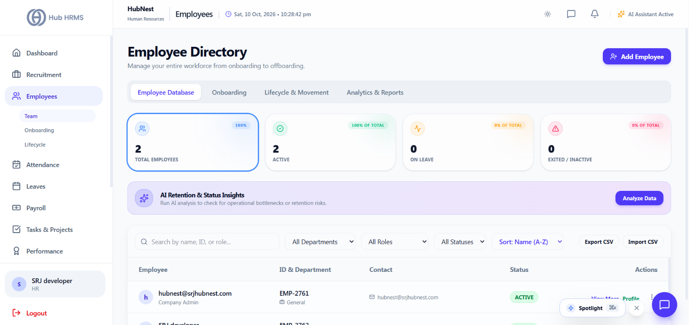
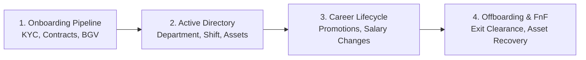
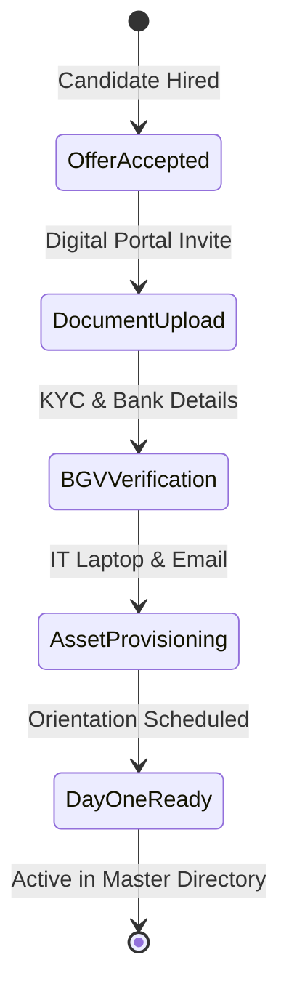

# 03. Employee Management (`/hr/employees`)

The **Employee Management** module provides HR Specialists with total administrative command over the company-wide personnel registry. It spans three specialized workspaces: the **Master Database**, the **Onboarding Pipeline**, and the **Employee Lifecycle** console.

---

## 📸 Interface Screenshot

{ width="100%" }

---

## 🧭 Employee Lifecycle Architecture

---

## 📂 Navigation Workspaces

### 1. 📋 `Master Database` (Company-wide Directory)
The primary administrative registry of all active and past employees:

* **Search & Granular Filters**:
  * Search in real-time by employee name, employee ID (`EMP-XXXX`), or corporate email.
  * Filter by **Role** (`Employee`, `Manager`, `Supervisor`, `Finance Officer`).
  * Filter by **Department** (`Engineering`, `Product`, `Human Resources`, `Sales`, `Operations`).
  * Filter by **Status** (`ACTIVE`, `PROBATION`, `NOTICE_PERIOD`, `TERMINATED`).
* **Employee Record Fields**:
  * **Employee Identity**: Avatar, Full Legal Name, Corporate Email, Mobile Number, Official ID.
  * **Organizational Placement**: Department, Designation, Direct Supervisor / Reporting Manager.
  * **Employment Terms**: Employment Type (Full-Time, Contract), Date of Joining, Branch Location.
  * **Compensation Grade**: Current monthly base CTC and allowance tier.

#### ⚙️ Administrative Actions Per Employee:
* **👁️ View Full Dossier**: Opens the comprehensive modal containing personal information, residential address, emergency contacts, bank account number (for payroll disbursement), and uploaded identity documents.
* **💰 Adjust Salary**: Opens the compensation revision modal to update base pay, change allowance structures, and log appraisal effective dates.
* **🔒 Deactivate / Suspend**: Temporarily revoke system access tokens in case of disciplinary audits or security investigations.

---

### 2. 🚀 `Onboarding Pipeline` (Pre-joining to Day 1)
Tracks newly hired personnel navigating compliance and paperwork before formal deployment:

* **Onboarding Checklist Tracking**:
  * **KYC Identity Verification**: Aadhaar / National ID, PAN card, Passport copy.
  * **Educational & Experience Credentials**: Prior employer relieving letters, degree certificates.
  * **Bank Account Validation**: Cancelled cheque or passbook copy for salary credits.
  * **IT & Asset Provisioning**: Corporate email generation, laptop serial number assignment, and access card issuance.
* **Status Badges**: `Awaiting Uploads`, `Under Verification`, `Asset Pending`, `Ready to Join`.

---

### 3. 🔄 `Lifecycle & Offboarding` (Probation, Notice & Exit)
Governs status transitions throughout an employee's organizational tenure:

#### A. Probation Review & Confirmation
* Tracks probation periods (standard 90 or 180 days).
* Triggers reminder alerts to Department Managers 14 days before completion to submit performance ratings.
* HR can issue formal **Probation Confirmation Letters** or record an extension with mutual performance improvement plans (PIP).

#### B. Resignation, Notice Period & Offboarding
* Records resignation submission dates, official notice period duration (e.g., 30, 60, or 90 days), and calculated Last Working Day (LWD).
* **Cross-Department Clearance Checklist**:
  * **IT Department**: Laptop, monitor, charger, and access token handover.
  * **Administration**: ID badge, vehicle pass, and locker key return.
  * **Finance**: Settling outstanding travel advance balances or loan dues.
* **Full & Final (FnF) Settlement Trigger**: Transfers the finalized separation report to `/hr/payroll` to disburse remaining salary, encash pending privileged leaves, and generate the formal **Relieving & Experience Letter**.

---

## 📤 Directory Export & Reporting

* **Export Formats**: Export complete or filtered employee lists in **Excel (.xlsx)**, **CSV**, or formatted **PDF** registers.
* **Audit Compliance**: All modifications to employee compensation, status, or role permissions are timestamped with the acting HR Specialist's ID in the system audit logs.

---

## ❓ Frequently Asked Questions (FAQ)

??? question "How do I download an employee's signed contract or KYC documents?"
    Click **View Dossier** next to any employee, navigate to the **Documents** sub-tab in the drawer, and click the download icon next to any verified file.

??? question "Can an employee's department be changed after onboarding?"
    Yes. Open the employee record, click **Edit Details**, select the new department from the dropdown, and save. The employee will automatically inherit the new department's reporting hierarchy.
