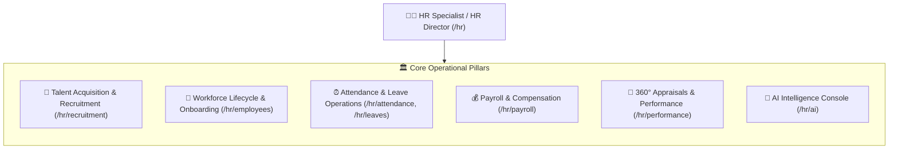

# 👩‍💼 HR Specialist & HR Director Guide

The **HR Specialist / HR Director** portal (`/hr/dashboard`) is the operational command center for people operations, recruitment funnels, talent compliance, employee lifecycles, and payroll execution.

---

## 🎯 Role Overview & Operational Scope

HR Specialists bridge executive strategy with workforce execution, maintaining company-wide authority over hiring, compliance, attendance audits, leave administration, and compensation.

---

## 🧭 HR Portal Sidebar Modules

| # | Module | Route | Primary Responsibilities |
|---|---|---|---|
| **01** | [Dashboard](dashboard.md) | `/hr/dashboard` | Daily workforce telemetry, pending approvals, quick actions, and attendance summary. |
| **02** | [Recruitment](recruitment.md) | `/hr/recruitment` | Job postings, candidate pipelines, interview scheduling, and offer letters. |
| **03** | [Employees](employees.md) | `/hr/employees` | Employee master database with Team, Onboarding, and Lifecycle sub-tabs. |
| **04** | [Attendance](attendance.md) | `/hr/attendance` | Company-wide attendance monitoring, late logs, overtime audits, and shift swaps. |
| **05** | [Leaves](leaves.md) | `/hr/leaves` | Leave request approvals, annual accrual quotas, and sandwich rule management. |
| **06** | [Payroll](payroll.md) | `/hr/payroll` | Monthly compensation runs, PF/ESI/TDS statutory compliance, and payslip distribution. |
| **07** | [Tasks & Projects](tasks.md) | `/hr/tasks` | HR department tasks, onboarding assignments, and project delivery boards. |
| **08** | [Performance](performance.md) | `/hr/performance` | 360-degree appraisal cycles, OKR reviews, and talent calibration grids. |
| **09** | [Reports & Analytics](reports.md) | `/hr/reports` | Headcount trends, diversity metrics, turnover rates, and compliance registers. |
| **10** | [Documentation](documentation.md) | `/hr/documentation` | Company policies, employee contracts, handbook updates, and compliance vaults. |
| **11** | [AI Console](ai.md) | `/hr/ai` | AI talent assistant, attrition predictions, and resume screening automation. |
| **12** | [Messages](messages.md) | `/hr/messages` | Internal messaging, recruitment communication channels, and HubMeet calling. |
| **13** | [Profile](profile.md) | `/hr/profile` | Personal administrative credentials, 2FA, and out-of-office delegation. |

---

## 📸 Interface Screenshots

<!-- SCREENSHOT_PLACEHOLDER: HR Dashboard Overview -->
> *Screenshot will be added here upon user submission.*
