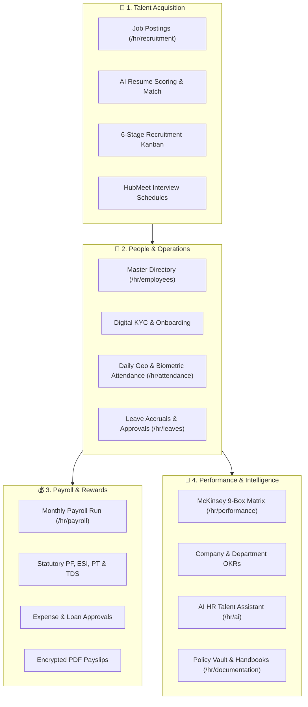

# 👩‍💼 HR Specialist & HR Director Guide — Complete Overview

The **HR Specialist / HR Director** portal (`/hr/dashboard`) is the operational command center for people operations, recruitment funnels, talent compliance, employee lifecycles, and compensation execution within Hub HRMS.

---

## 🏛️ Role Purpose & Architecture

While the **Company Admin** oversees tenant configurations, multi-branch structures, and enterprise billing, the **HR Specialist / Director** executes daily workforce strategies: sourcing talent, onboarding staff, auditing daily biometric attendance, resolving leave balances, calculating statutory payroll, and orchestrating 360-degree performance cycles.

---

## 🔐 Role-Based Access Control (RBAC) Matrix

HR Specialists possess elevated administrative rights over company personnel, subordinate only to the Company Admin:

| Operational Capability | Employee (ESS) | Department Manager | HR Specialist / Director | Company Admin |
| :--- | :---: | :---: | :---: | :---: |
| **View Own Attendance & Payslips** | ✅ | ✅ | ✅ | ✅ |
| **Apply for Leave & Expenses** | ✅ | ✅ | ✅ | ✅ |
| **Approve Team Leaves & Shifts** | ❌ | ✅ (Department only) | ✅ (Company-wide) | ✅ |
| **Post Job Openings & Hire** | ❌ | ❌ | ✅ | ✅ |
| **Create & Update Employee Profiles** | ❌ | ❌ | ✅ | ✅ |
| **Execute Monthly Payroll Runs** | ❌ | ❌ | ✅ | ✅ |
| **Configure Salary Structures (TA/DA/HRA)**| ❌ | ❌ | ✅ | ✅ |
| **Calibrate 9-Box Matrix & OKRs** | ❌ | View Assigned | ✅ Full Calibration | ✅ |
| **Manage Company Settings & Billing** | ❌ | ❌ | ❌ | ✅ |

---

## 🧭 HR Portal Navigation & Module Directory

The HR Specialist sidebar features 13 purpose-built modules accessible across desktop and mobile browsers:

| Chapter | Module | Route | Key Functions |
|---|---|---|---|
| **01** | [HR Dashboard](dashboard.md) | `/hr/dashboard` | Live headcount metrics, daily presence rates, pending approvals, quick user provisioning. |
| **02** | [Recruitment](recruitment.md) | `/hr/recruitment` | Job requisitions, candidate pipeline, AI resume matching, interview scheduling, offer letters. |
| **03** | [Employees](employees.md) | `/hr/employees` | Master employee records, onboarding checklist, lifecycle transitions, salary adjustments. |
| **04** | [Attendance](attendance.md) | `/hr/attendance` | Real-time presence logs, GPS geo-fencing audits, manual punches, weekly overtime trends. |
| **05** | [Leaves](leaves.md) | `/hr/leaves` | Leave applications, sandwich rules, quota balances, approval/rejection workflows with audit notes. |
| **06** | [Payroll](payroll.md) | `/hr/payroll` | Payroll batches, salary advance loans, expense claims, PF/ESI/TDS tax deductions, bank payout files. |
| **07** | [Tasks & Projects](tasks.md) | `/hr/tasks` | HR sprint boards, onboarding workflows, cross-department task allocation. |
| **08** | [Performance](performance.md) | `/hr/performance` | McKinsey 9-Box Matrix, departmental OKR tracking, 360-degree review cycles. |
| **09** | [Reports & Analytics](reports.md) | `/hr/reports` | Headcount demographics, monthly salary outflow, leave utilization, turnover analytics. |
| **10** | [Documentation](documentation.md) | `/hr/documentation` | Corporate policies, handbook updates, contract templates, digital signature vault. |
| **11** | [AI Console](ai.md) | `/hr/ai` | HubNest AI assistant, predictive attrition risk, talent coaching suggestions. |
| **12** | [Messages](messages.md) | `/hr/messages` | Department channels, direct chats with candidates and staff, HubMeet calling. |
| **13** | [Profile & Security](profile.md) | `/hr/profile` | HR administrative credentials, MFA, notification preferences, delegation settings. |

---

## 📸 Interface Screenshots

<!-- SCREENSHOT_PLACEHOLDER: /hr/dashboard -->
> *[Screenshot Placeholder: HR Management Suite Overview]*

---

## 🚀 Recommended Workflow for New HR Administrators

1. **Verify Corporate Directory**: Review `Employees` (`/hr/employees`) to verify existing department allocations and salary grades.
2. **Setup Attendance & Policies**: Ensure company leave policies and holiday calendars are published in `Documentation` (`/hr/documentation`).
3. **Review Daily Dashboard**: Start each workday on `Dashboard` (`/hr/dashboard`) to resolve pending leave requests and monitor presence telemetry.
4. **Publish Open Roles**: Source talent via `Recruitment` (`/hr/recruitment`) using AI-assisted screening.
5. **Execute Payroll on Schedule**: Finalize attendance cut-offs and generate monthly payslips via `Payroll` (`/hr/payroll`).
