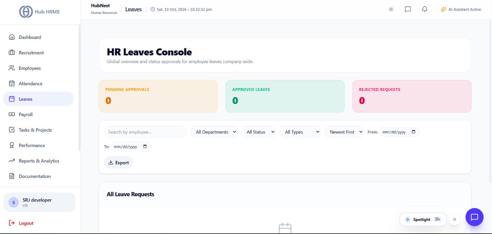
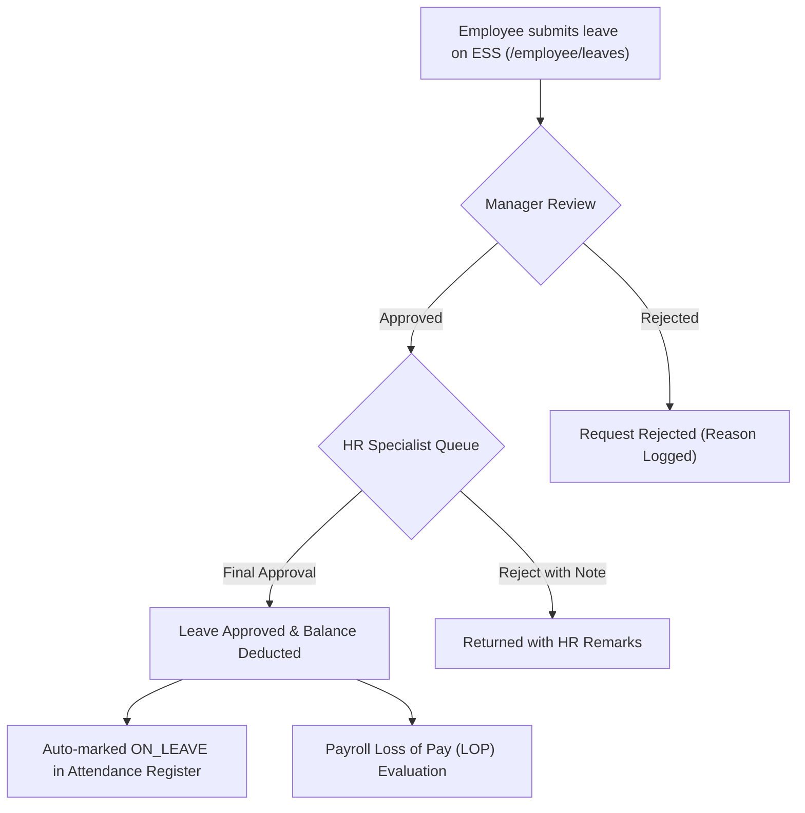
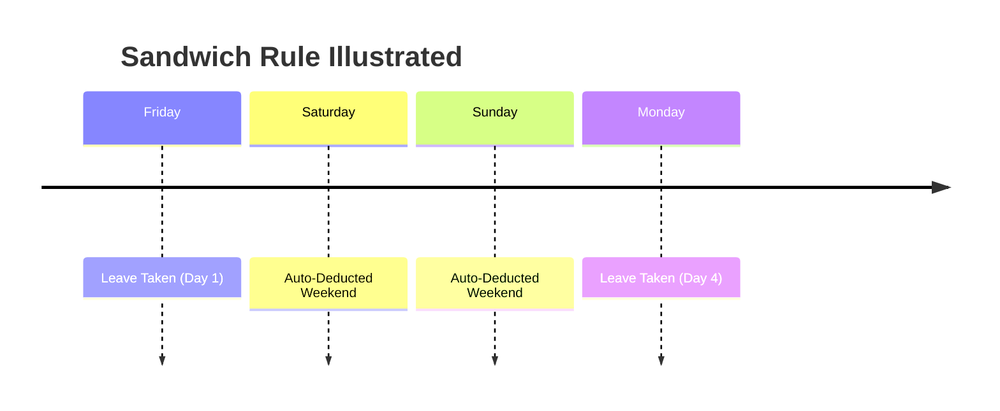

# 05. Leave Management (`/hr/leaves`)

The **Leave Management** module provides HR Specialists with centralized control over company-wide leave balances, vacation requests, statutory sick leaves, and custom leave quotas. It features multi-level approval hierarchies, sandwich rule configurations, and audit logging.

---

## 📸 Interface Screenshot

{ width="100%" }

---

## 🧭 Leave Adjudication Workflow

---

## 📋 Leave Categories & Statutory Quotas

Hub HRMS supports standard enterprise leave categories with automated annual accruals:

| Leave Category | Code | Standard Quota | Carry-Forward Policy | Statutory Notes |
| :--- | :---: | :---: | :---: | :--- |
| **Casual Leave** | `CL` | 12 Days / Year | Lapses at year-end | For short personal emergencies (max 3 consecutive days). |
| **Sick Leave** | `SL` | 12 Days / Year | Up to 15 Days | Requires medical certificate if exceeding 2 consecutive days. |
| **Earned / Privileged Leave**| `PL` | 15–18 Days / Year | Encashed or carried forward | Accrued monthly (1.25 to 1.5 days per worked month). |
| **Maternity Leave** | `ML` | 26 Weeks | N/A | Fully paid statutory leave under Maternity Benefit Act. |
| **Paternity Leave** | `PTL`| 5–15 Days | Lapses in 6 months | Granted to male employees upon child birth/adoption. |
| **Compensatory Off** | `Comp-Off`| Earned on weekend work| Valid for 60 days | Granted upon manager approval of weekend shift. |
| **Loss of Pay (LOP)** | `LOP` | As approved | N/A | Unpaid absence; directly deducts daily wage in payroll. |

---

## ⚖️ Approval & Rejection Console

The main view organizes all incoming employee leave submissions into an interactive table:

### 1. Granular Filters & Search
* **Status Filter**: Toggle between `PENDING` (needs HR action), `APPROVED`, `REJECTED`, or `ALL`.
* **Category Filter**: Filter specifically by Sick, Casual, Earned, or Maternity leaves.
* **Department Filter**: Review leaves department-by-department (e.g., Sales, Operations) to prevent understaffing.
* **Date Range Picker**: Inspect historical leaves taken over specific quarters or pay periods.

---

### 2. Adjudication Actions:
* **✅ One-Click Approval**:
  * Instantly approves the request, updates the employee's remaining leave ledger, and syncs the daily attendance calendar to display `ON_LEAVE`.
  * Sends an automated email and in-app push notification to the employee.
* **❌ Rejection with Audit Reason (`Reject Modal`)**:
  * Rejections require a mandatory explanatory reason (e.g., *"Critical release scheduled during requested dates"*, *"Insufficient casual leave balance"*).
  * The reason is logged permanently in the employee's request history and emailed immediately to ensure transparency.
* **🗑️ Administrative Deletion**:
  * HR Specialists can permanently purge duplicate or test leave entries created in error.

---

## 🥪 The Sandwich Rule Policy Engine

Hub HRMS includes an automated **Sandwich Rule** engine configurable in company settings:

> [!IMPORTANT]
> **What is the Sandwich Rule?**  
> If an employee takes an unapproved or specific categorized leave on a **Friday** and the following **Monday**, the intervening weekend days (**Saturday and Sunday**) are automatically counted as leave days, resulting in a **4-day deduction** instead of 2 days.

---

## 📈 Leave Analytics & Department Heatmaps

* **Leave Category Breakdown (Donut Chart)**: Visualizes the proportion of Sick vs. Casual vs. Earned leaves across the workforce.
* **Monthly Absenteeism Trend (Area Chart)**: Highlights seasonal absenteeism peaks (e.g., holiday seasons, festival months) for workforce capacity planning.
* **Leave Export**: Download leave registers in **Excel (.xlsx)** or **CSV** containing employee names, dates, leave types, and approval timestamps for payroll reconciliation.

---

## ❓ Frequently Asked Questions (FAQ)

??? question "Can HR approve a leave request if the department manager is out of office?"
    Yes. HR Specialists hold administrative override authority and can directly approve or reject any employee request without waiting for supervisor sign-off.

??? question "Can negative leave balances be allowed?"
    Yes, if enabled in company settings, employees can apply for "Advance Leave," which results in a temporary negative balance that offsets against future monthly accruals.
