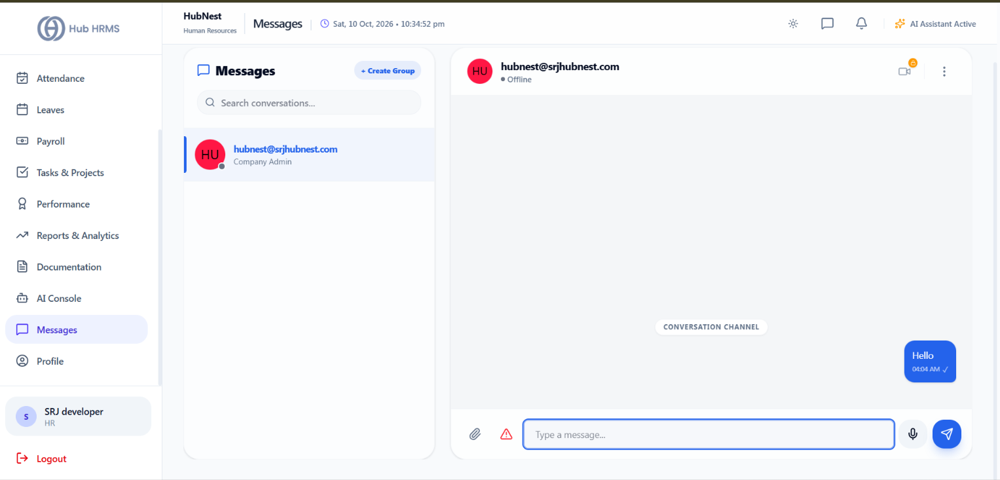
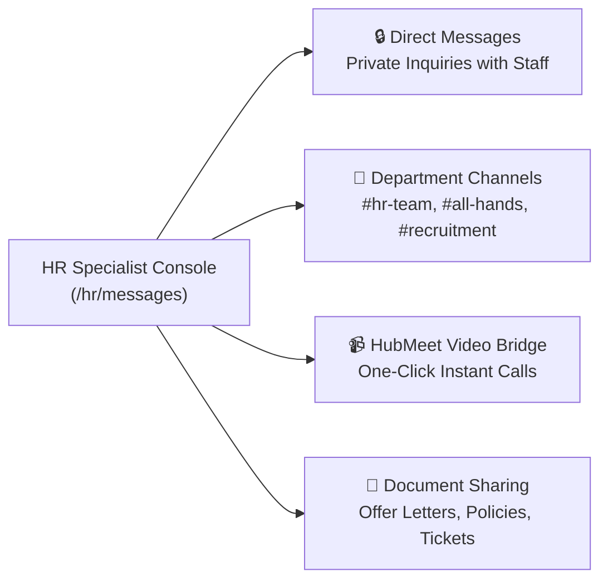

# 12. Messages (`/hr/messages`)

The **Messages** module integrates real-time communications directly inside the HRMS workspace. It allows HR Specialists to maintain confidential 1-on-1 dialogue with employees, collaborate in dedicated department channels, and initiate one-click HubMeet video calls.

---

## 📸 Interface Screenshot

{ width="100%" }

---

## 🧭 Communication Channels & Structure

---

## 💬 Core Messaging Features

### 1. 1-on-1 Confidential Staff Discussions
* Maintain dedicated, encrypted conversation threads with individual employees regarding grievance handling, salary inquiries, or performance feedback.
* **Presence Indicators**: View real-time active status (`Online`, `In a Meeting`, `Away`, `Offline`).
* **Unread Message Badges**: Real-time unread badges keep HR personnel alerted to urgent employee communications.

---

### 2. Department & Hiring Channels
* **Team Channels**: Coordinate hiring drives with hiring managers in focused channels (e.g., `#eng-recruitment`, `#onboarding-cohort-oct26`).
* **Announcements Channel**: Broadcast administrative circulars, holiday reminders, or office updates company-wide.
* **Message Search & History**: Fast, full-text search across historical conversations by keyword, sender, or date.

---

### 3. Rich Media & Document Exchange
* Share offer letter drafts, signed PDF contracts, or medical certificates directly within active chats.
* Embedded preview for PDF documents, spreadsheets, and image attachments.

---

### 4. 📹 One-Click HubMeet Video Calling
* Directly from any chat window header, click the **Video Call** icon to launch a low-latency **HubMeet Video Call**.
* Generates an instant room link shared automatically in the chat for quick 1-on-1 employee syncs or virtual HR interviews.

---

## ❓ Frequently Asked Questions (FAQ)

??? question "Are private HR messages visible to other department managers?"
    No. Direct messages between an HR Specialist and an employee are end-to-end encrypted and completely confidential. Managers only have access to channels they are explicitly invited to.
