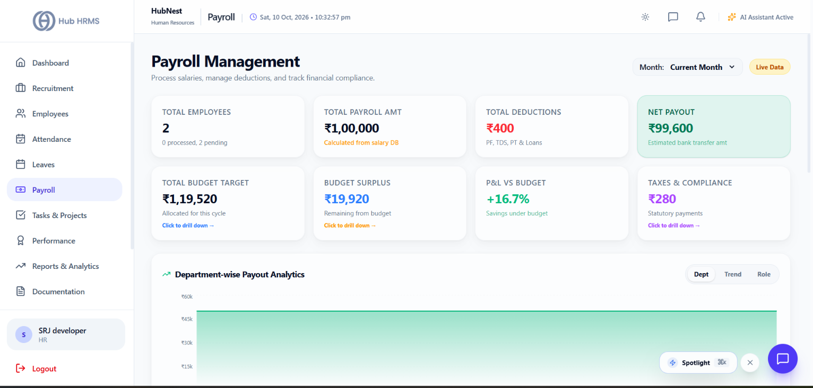
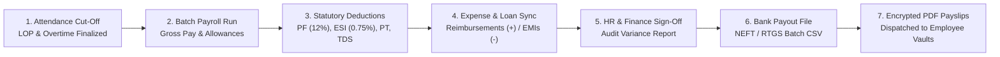

# 06. Payroll Processing (`/hr/payroll`)

The **Payroll Processing** module enables HR Specialists and Payroll Accountants to execute monthly salary disbursements, automate statutory tax withholdings (PF, ESI, Professional Tax, TDS), adjudicate expense claims, manage salary advance loans, and generate encrypted PDF payslips.

---

## 📸 Interface Screenshot

{ width="100%" }

---

## 🧭 Monthly Payroll Lifecycle

---

## 📂 Navigation Workspaces

### 1. ⚙️ `Batch Processing` (Monthly Salary Run)
The primary execution engine for running salary calculations across departments:

#### The Compensation Math Breakdown:
$$\text{Gross Earnings} = \text{Basic Pay} + \text{HRA} + \text{Travelling Allowance (TA)} + \text{Dearness Allowance (DA)} + \text{Overtime Pay} + \text{Special Allowances}$$

$$\text{Total Deductions} = \text{Provident Fund (PF)} + \text{Employee State Insurance (ESI)} + \text{Professional Tax (PT)} + \text{TDS (Income Tax)} + \text{Loss of Pay (LOP)} + \text{Loan EMI}$$

$$\mathbf{Net\ Disbursed\ Salary} = \mathbf{Gross\ Earnings} - \mathbf{Total\ Deductions}$$

#### Statutory Deduction Rules:
* **Provident Fund (PF)**: Calculated at **12% of Basic Salary** (capped at ₹1,800/month if opted for statutory ceiling of ₹15,000 basic).
* **Employee State Insurance (ESI)**: **0.75% (Employee)** and **3.25% (Employer)** for staff earning gross wages up to ₹21,000/month.
* **Professional Tax (PT)**: State-specific statutory deduction (typically ₹200/month).
* **Tax Deducted at Source (TDS)**: Computed based on the employee's declared tax regime (New Regime vs. Old Regime with Section 80C, 80D, HRA deductions).

---

### 2. 🧾 `Payroll Records & Payslips` (Archive)
Historical repository of every executed payroll batch:
* **Period Filter**: Access any historical month/year (e.g., `September 2026`, `August 2026`).
* **Department Filtering**: Filter records by department to analyze branch-wise wage expenditures.
* **Download Encrypted Payslip**: Download formal, tamper-evident PDF payslips featuring company logo, tax breakdown, leave balance summary, and bank credit details.
* **Batch Payslip Release**: One-click trigger to release payslips to all employees simultaneously on pay day.

---

### 3. 💳 `Expense Reimbursements` (Claims & Vouchers)
Adjudicate business travel, food, and mobile expense claims submitted by employees:
* **Receipt Review**: Click on any claim to view attached invoice receipts, travel tickets, or hotel bills.
* **Claim Actions**:
  * **Approve Claim**: Flags the amount to be credited as non-taxable reimbursement in the upcoming payroll cycle.
  * **Reject Claim with Reason**: Returns the claim to the employee with notes (e.g., *"Missing tax invoice; GSTIN invalid"*).
* **Audit Categories**: `Travel & Fuel`, `Client Entertainment`, `Home Internet & Mobile`, `Hardware Peripherals`.

---

### 4. 🏦 `Salary Advances & Loans` (EMI Management)
Manage corporate salary loans and automated monthly recovery:
* **Issue Loan Modal**:
  * Specify Loan Principal (e.g., ₹50,000).
  * Set Repayment Tenure (e.g., 5 or 10 Months).
  * Interest Rate (% or 0% interest-free company loan).
* **Automated EMI Deduction**: The system automatically deducts the calculated EMI each month until the principal balance reaches zero.
* **Early Foreclosure**: HR can record lump-sum manual payments if an employee chooses to clear their loan ahead of schedule.

---

### 5. 🏛️ `Tax & Statutory Compliance`
Compliance reporting workspace for accounting and filings:
* **PF ECR File Generator**: Exports the monthly Electronic Challan cum Return (ECR) text file ready for direct upload to the EPFO portal.
* **ESI Return File**: Monthly return file detailing employee insured contributions.
* **TDS Form 24Q Summary**: Quarterly tax withholding summary mapping PAN cards to deducted tax amounts for Income Tax filing.

---

## 🏦 Bank Payout File Export (NEFT / RTGS)

Once the monthly payroll batch is locked and approved:
1. Click **Export Bank Payout File**.
2. Select your corporate bank template: **HDFC Bank**, **ICICI Bank**, **State Bank of India (SBI)**, **Axis Bank**, or **Standard NEFT CSV**.
3. The exported file contains columns: `Beneficiary Name`, `Bank Account Number`, `IFSC Code`, `Amount`, `Transaction Narration (Salary for Month)`.
4. Upload the file directly into your corporate net banking bulk payment gateway.

---

## ❓ Frequently Asked Questions (FAQ)

??? question "Can a single employee's payroll be re-calculated without re-running the entire company batch?"
    Yes. Find the employee in the processing register, click **Re-calculate Record**, and the system will refresh only their attendance and deduction math.

??? question "What happens to payslips if an employee leaves the company?"
    Former employees retain access to their historical payslips and tax documents via their ESS portal for 365 days following termination.
